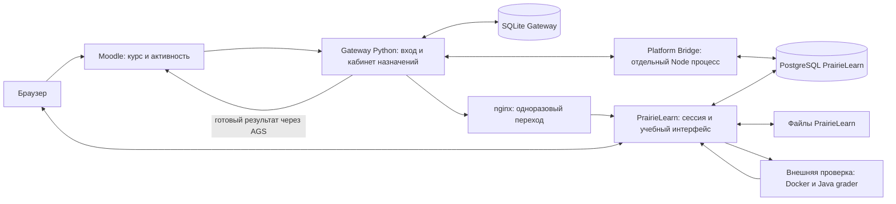
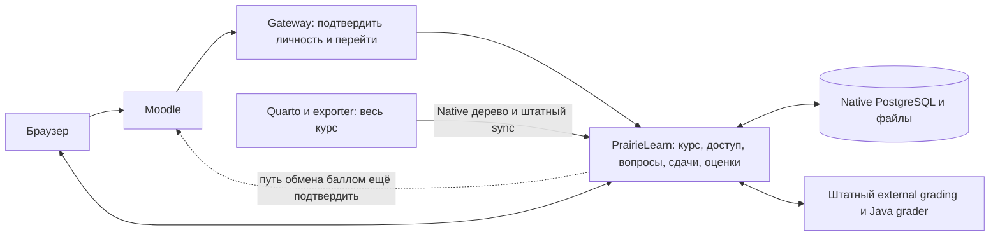

# Что сейчас делает Gateway и каким его оставить

Разбор после уточнения пользователя 4 ноября 2026. **Предпочтительная граница — небольшой адаптер подтверждённого входа Moodle → PrairieLearn.** Курс, список работ, доступ к ним, варианты вопросов, ответы, файлы и оценки принадлежат PrairieLearn. Нынешний Gateway действительно вышел за эту границу: у него появился собственный кабинет назначения защит, согласование, ограничения числа студентов на тему, копия структуры курса и собственная обработка результатов для Moodle.

При этом прежняя фраза «Gateway выбирает варианты» слишком широка. **Случайные вопросы и варианты ответа создаёт PrairieLearn. Gateway выбирает тему и связанную с ней работу защиты.** Файлы решений Gateway тоже не принимает. Ещё часть собственной логики находится в Platform внутри образа PrairieLearn; это не код Gateway и не штатная возможность upstream только потому, что он работает рядом с PL.

Ниже описан прочитанный локальный исходный код. Это не проверка того, какие процессы и редакции реально запущены на сервере. Новая поставка, входы и работа студента этим разбором не приняты.

## Как проходит работа сейчас

Студент открывает Moodle, нажимает зарегистрированную активность и проходит обмен входа через Gateway. После подтверждения личности браузер получает короткий одноразовый переход. Защищённый nginx обменивает его на доверенные заголовки, а callback PrairieLearn создаёт собственную сессию PL. Далее страницу вопроса, редактор, загрузку, сдачу и результат браузер получает от PrairieLearn. Gateway не стоит между каждым ответом студента и PL.

В текущей композиции есть следующие разные владельцы:

- **Moodle** подтверждает пользователя и его роль, задаёт контекст курса и активности, принимает балл в свою строку журнала. Проверка Java в нём не выполняется.
- **Gateway** — Python/FastAPI приложение со своей SQLite. Именованные курсы монтируются в одном приложении с отдельными путями, базами и описаниями поставки. В каждом курсе работает фоновая задача: довести назначение до PL, прочитать результаты, отправить накопленные баллы.
- **nginx** обслуживает публичный вход и защищает передачу личности. Его маршрут `/gateway/.../pl/<token>` является правилом proxy; соответствующего обработчика сдачи в Python нет.
- **PrairieLearn** — основное учебное приложение со своей сессией, правами доступа, PostgreSQL и файловым хранилищем. Учётная запись PL и пользователь Gateway — разные записи, связанные подтверждённым UID.
- **Platform Bridge** — наш отдельный Node HTTP процесс в производном образе PL. Он вызывает внутренние модели PL, меняет enrollment/labels, читает Native попытки и оценки. Публичный proxy его не публикует. Нахождение процесса в образе PL не превращает его API и таблицу в upstream PL.
- **Проверяющий контейнер** исполняет выбранный Java grader. PL организует grading job и принимает результат. Platform поставляет собственные Java/JUnit инструменты и меняет локальные ограничения grader; Gateway к компиляции и тестам не относится. Текущий dirty candidate Platform ещё не получил полную контейнерную приёмку.

## Вход, личность и переход

Gateway принимает LTI/OIDC начало входа от Moodle, вызывает проверку полученного launch, хранит одноразовое состояние входа, собственную сессию и связь личности Moodle с UID для PL. В этой связи различаются issuer, client, deployment и subject; имя — отображаемый профиль, а не идентификатор студента. Повторный вход обновляет имя, сохраняя связь личности. Одноразовый переход связан с проверенной сессией и допустимым адресом; браузер не назначает себе UID или адрес чужого курса.

В нынешнем verifier даже вход связан с зарегистрированным Moodle lineitem и разрешением AGS score. Для адаптера только входа эту зависимость нужно удалить вместе с соответствующей собственной конфигурацией; она не является требованием создания сессии PL. Криптографию подписанного входа, одноразовые state/nonce и защиту токенов при этом сохраняют: у них другая функция, чем у контроля неизменности содержимого курса.

PL callback использует существующий upstream путь доверенного Shibboleth заголовка и `loadUser`; у нас добавлен собственный transport patch для точной передачи Unicode имени. После callback сессией PL владеет сам PrairieLearn. Зачисление в course instance выполняет **Bridge через Native enrollment API**, а не SQL из Gateway. Роль Moodle teacher не даёт автоматически права администратора PL: для отдельного bootstrap проверяется явно назначенная личность, затем Bridge записывает Native администратора. Это дополнительная административная функция, которую не нужно делать частью обычного студенческого входа.

Штатная альтернатива требует различать продуктовые редакции. Текущая официальная документация self-hosted PL называет Google OAuth2 поддерживаемым входом; LTI 1.3 описано как interoperability, не способ такого входа, а SAML/Azure — как enterprise возможности. Поэтому обещание «удалим адаптер и Moodle войдёт штатно» не доказано. Небольшой Moodle login adapter здесь имеет понятное основание. Его обязанность заканчивается подтверждённой личностью и переходом в PL; самостоятельный каталог курса и учебная политика для этого не нужны. [Официальная документация входа](https://docs.prairielearn.com/running-in-production/authentication/).

## Импорт курса и обновление

Gateway **не импортирует вопросы в SQL PrairieLearn**. Наш exporter в расширении `prairielearn` создаёт Native дерево курса: описания вопросов и работ, HTML и ресурсы. Одновременно он пишет собственное общее описание поставки. Platform выполняет bootstrap или обновление существующего Native курса, после чего вызывает штатный `syncDiskToSql`. Gateway лишь читает то же описание поставки для своего каталога, назначений и результатов; Bridge читает его отдельно.

Именно здесь лишняя связь распространилась на несколько компонентов: редактирование содержимого меняет собственную идентичность поставки, хотя логический курс и его вопросы остаются теми же. Ограничение находится не только в Gateway. Оно есть у exporter, в startup Bridge, в инструментах sync, в подготовке provenance и приёмке поставки. Удаление нужно довести через всех этих потребителей, как прямо потребовал пользователь; прежний reader не является причиной сохранить договор.

Штатный путь PL — Native курс в Git и его sync; он документирован, а вызов настоящего Native sync уже виден в нашем локальном инструменте. Quarto остаётся авторским источником и генератором Native дерева. **Единицей новой публикации и обновления остаётся весь курс, включая все задачи банка к 10 ноября.** Отдельный production механизм обновления одной работы или новая тренировочная система отсюда не следуют. [Штатное редактирование и sync](https://docs.prairielearn.com/sync/).

## Вариант вопроса, состав работы и выбор темы

Сейчас существуют три разных выбора:

1. Автор задаёт состав лабораторной, банк кандидатов, слоты и веса; exporter переводит это в Native assessment/questions.
2. PrairieLearn материализует попытку assessment, её вопросы и варианты. Для случайного слота выбор находится в Native question group. Для нашего варианта «решить один из предлагаемых» Native zone содержит кандидатов и `bestQuestions: 1`; студент может работать с ними, а учитывается лучший результат. Bridge проверяет соответствие Native групп описанию и проецирует выбранный/лучший результат в собственные слоты. Он не запускает собственный генератор случайного вопроса.
3. Gateway предлагает студенту **тему и соответствующую защиту**, принимает выбор либо назначение преподавателя и через Bridge открывает нужную работу с помощью Native student label. Это отдельный workflow поверх PL, а не необходимость для рандомизации вопросов.

Native `alternatives`, `numberChoose`, зоны и `bestQuestions` описаны официально. Эти механизмы заменяют собственную модель выбора вопросов, но не являются доказательством существования native очереди заявок на тему с ёмкостью и согласованием. [Настройка assessment](https://docs.prairielearn.com/assessment/configuration/), [схема assessment](https://docs.prairielearn.com/schemas/infoAssessment/).

Целевой Gateway не читает банк, слоты и условия завершения и не определяет список доступных работ. Студент видит список PrairieLearn, а PL проверяет доступ. Native labels и персональные правила доступа могут ограничить конкретную защиту; выбор правил, соответствующих прежнему учебному процессу, нужно подтвердить. Простая смена владельца не сохраняет автоматически прикладной сценарий темы.

## Попытки, ответы, файлы, проверка и баллы

Попытка assessment, экземпляр вопроса, вариант, submission и grading job уже принадлежат PrairieLearn. Его редактор и upload сохраняют ответ; внешний grader получает материалы и файлы студента, возвращает результат, а PL записывает оценки и отображает обратную связь. Локальные upstream файлы подтверждают работу с Native variants/submissions, пересчёт assessment и file-store с привязкой к пользователю/assessment/вопросу. Сам Java grader — наша предметная реализация поверх штатного external grading. [Штатный цикл external grading](https://docs.prairielearn.com/externalGrading/).

Собственная таблица `native_attempts` Gateway хранит **привязку к чужой Native попытке**, а не ответы и код. Gateway проверяет, что номер и ID попытки, выбранные вопросы и область результата не изменились неожиданно, отбрасывает устаревший результат и повторно считает completion по описанию курса. Bridge предварительно считает сходный completion из прочитанных Native строк. Это две собственные проекции поверх основной модели PL.

Для передачи в Moodle сейчас используются **два разных смысла оценки**:

- Для обычной лабораторной Bridge читает реальные points/max_points попытки PL; Gateway передаёт их как балл, сохраняя веса Native assessment.
- Для защиты Gateway передаёт число полностью закрытых обязательных слотов из общего их числа. Порог завершения берётся из политики работы. Средний процент Native assessment и число полностью закрытых слотов могут давать разный результат.

Незавершённое ручное/автоматическое оценивание не отправляется как готовая нулевая оценка. Обычный catalog маршрут не отправляет баллы; registered lab и defense маршруты отправляют их по своим правилам. В новой архитектуре обычный Native score не требует вычислителя в Gateway. Правило защиты нужно явно выразить у Native владельца и подтвердить на прежних критериях; молча заменить его средним процентом нельзя.

Штатное ручное оценивание уже поддерживает смешанные auto/manual points, сохранение ответов, grading UI и обновление оценки с пересчётом assessment. Это основание перенести ручную часть защиты в PL, но не утверждение, что любой прежний порядок допуска/защиты выражается без настройки. [Ручное оценивание PL](https://docs.prairielearn.com/manualGrading/).

## Согласование, защита и признание старого результата

Gateway реализует три режима назначения: свободный выбор, выбор с подтверждением преподавателя и назначение преподавателем. В SQLite сохраняются pending/approved/rejected/assigned/completed и переходное reconciling; проверяются вместимость темы, повтор запроса, замена назначения и привязка к Moodle активности. Bridge применяет выбранную Native метку и сохраняет собственную строку назначения в PostgreSQL. PL после этого обеспечивает доступ в рамках своих правил.

Наличие native labels/access overrides подтверждено и локальными вызовами Native API, и официальными docs. **Готовый штатный PL workflow «заявка → очередь → ограниченная ёмкость → согласование → переназначение» этим исследованием не установлен.** Если такой процесс действительно нужен учебно, сначала следует описать его обязательные свойства. Тогда можно выбрать штатные действия преподавателя с labels/overrides и PL manual grading, если они покрывают потребность. Нельзя перенести нынешний кабинет внутрь PL и назвать это штатным решением. [Native доступ к assessment](https://docs.prairielearn.com/assessment/accessControl/).

Признание прежнего успеха — **отдельная административная доработка Platform**, не публичная функция Gateway и не upstream гарантия PL. Она сверяет прежний автоматический успех и точное назначение, пишет Native audit/score events, использует Native file-store для приватных файлов и штатный пересчёт. Наш patch добавляет guard в Native grading, чтобы признание сохранялось при следующих действиях. Дополнительная ссылка в `pl_gateway_assignments` связывает признанную попытку с назначением. Если нужный Native экземпляр вопроса отсутствует, текущая реализация не материализует его автоматически.

Штатная ручная корректировка оценки не доказывает эквивалентность этому переносу со всеми гарантиями происхождения и сохранения после новых сдач. По прямому указанию пользователя перенос старых баллов второстепенен; старые история и файлы сохраняются отдельно. Для нового курса это не основание удерживать Gateway, назначение по старой поставке или старый patch как обязательный reader.

## Своя база Gateway, входящие маршруты и outbox

В SQLite Gateway двенадцать таблиц. Они образуют три группы:

- Вход: `login_states`, `users`, `sessions`, `handoffs`. Это одноразовые состояния, связь идентичности, роли/контекст сессии и адрес перехода.
- Собственный учебный процесс: `assignments`, `requests`, `native_attempts`. Здесь выбор защиты, версия назначения, очередь согласования и связь с попыткой PL.
- Обмен и учёт: `activity_bindings`, `observations`, `outbox`, `audit`; отдельно `schema_versions` для формата БД. Здесь адрес строки журнала Moodle, увиденное состояние результата, очередь отправки и события.

Содержимого сдачи, исходников студента и полноценных Native variants в этой схеме нет. В PostgreSQL **собственная** таблица `pl_gateway_assignments` хранит повтор назначения для Bridge и ссылку на признанную попытку; основные Native таблицы курса, доступа, попыток и оценок принадлежат PL. Признание использует также штатные audit/score/file таблицы, без отдельной Gateway базы файлов.

Публичные обработчики Gateway принимают начало/окончание LTI входа и выдают открытый JWKS; отдают кабинет и `/my/works`; принимают заявку на защиту, назначения/approve/reject/reassign преподавателя; выполняют bootstrap и запрос перехода в PL. Приватный `/internal/handoff/...` обслуживает доверенный proxy. Отдельный Bridge принимает внутренние enrollment, administrator, assignments, work-launch, results и work-results. **Ни в одном из этих Gateway маршрутов нет upload ответа или вызова Java compiler.** Точные пути вынесены в приложение.

Outbox нужен для доставки результата при сетевых сбоях: фиксируются событие и timestamp, повтор использует прежнее событие, после перезапуска отправка продолжается, устаревшие результаты отсеиваются. Это реальная обязанность интеграции Moodle; она сама по себе не требует владеть лабораторной или повторно вычислять её completion.

Native LTI 1.3 документирует grade passback/AGS, однако пользовательская инструкция сейчас ориентирована прежде всего на Canvas, а не Moodle. Наличие точного рабочего транспорта в выбранной self-hosted Community редакции и сохранение нужной семантики оценок здесь **не доказаны**. Поэтому outbox нельзя объявить автоматически заменённым штатной функцией. В цели «только вход» он удаляется из Gateway, но сначала должен быть выбран и подтверждён реальный путь доставки PL → Moodle; при разрешённом временном отсутствии баллов новый курс может начать работу с оценками в PL. Сохранение AGS worker в Gateway означало бы сознательно более широкую роль, чем login adapter. [LTI 1.3](https://docs.prairielearn.com/lti13/), [пределы текущей LMS интеграции](https://docs.prairielearn.com/lmsIntegrationInstructor/).

## Что оставить, что убрать и что ещё решить

| Обязанность | Кто делает сейчас | Целевой владелец | Действие и доказанность |
| --- | --- | --- | --- |
| Личность Moodle и одноразовый переход | Gateway + nginx + PL callback patch | Маленький Gateway + PL session | Оставить проверенный вход и минимальную связь личности; Native вход Moodle в данной редакции не доказан |
| Сессия PL, enrollment и учебный доступ | PL; Bridge вызывает Native APIs | PL | Убрать учебную политику из Gateway; точный способ первоначального enrollment подтвердить для новой композиции |
| Курс, банк, список работ и обновление | Exporter → Platform sync → PL; Gateway/Bridge держат копии | Native курс PL, подготовленный Quarto/exporter | Удалить дубли каталога; штатный sync существует; весь курс обновляется одной единицей |
| Случайные вопросы и варианты | PL; Bridge проверяет/projection слотов | PL | Удалить вторую модель слотов из Gateway; Native alternatives/numberChoose подтверждены |
| Ответы, файлы и попытки | PL; Gateway хранит ссылки на попытки | PL | Сохранить Native владельца, убрать Gateway attempt registry |
| Проверка Java и ручная оценка | PL grading + Platform Java grader | PL external/manual grading + предметный grader | Gateway не нужен; контейнерную поставку ещё принять |
| Выбор темы, согласование и ёмкость | Gateway policy + Bridge labels/table | Штатные действия преподавателя и правила PL, если подходят | Готовый эквивалент очереди/ёмкости не найден; обязательность каждого свойства — предметное решение |
| Completion защиты и балл Moodle | Bridge и повторный расчёт Gateway; AGS outbox Gateway | PL как владелец результата; подтверждённая PL↔Moodle интеграция | Критерий защиты сохранить явно; Moodle AGS в выбранной редакции проверить, временное отсутствие допустимо |
| Признание прежнего успеха и файлов | Собственный Platform patch/tools + Native storage | Отдельная админоперация при необходимости | Не включать в новый обязательный вход; upstream эквивалент всех гарантий не доказан |
| Собственные course SHA, inventory, provenance gates | Exporter, Platform build/sync/Bridge, Gateway | Удаляются; штатные механизмы инструментов | Удалить producer и все обязательные readers согласованно, без замены новым proof или compatibility bridge |

В минимальном Gateway остаются протокол Moodle входа, минимальное состояние его безопасности, связь подтверждённой личности и допустимый переход в PL. Выдача курса, каталог, заявления, политика ёмкости, повторные completion/attempt проверки и фоновое чтение результатов уходят. Администратора PL назначают его средствами отдельно от обычного студенческого входа. Из Bridge исчезают обязательные assignment/catalog/hash readers; добавлять вместо них новый service, framework или реестр доказательств не предлагается.

Конкретный путь к этой границе: сначала определить Native доступ к полному курсу и необходимые свойства защиты; затем убрать из нового входа обязательные lineitem/assignment/delivery зависимости и вести браузер на штатный список PL; согласованно удалить прежнюю course-модель у exporter и всех downstream readers, оставив Native дерево и sync; отдельно подтвердить путь готовых баллов PL → Moodle, если он нужен сразу. Старые API и старую SQLite новая реализация читать не обязана. Переключение на новый вход — отдельная операция после просмотра результата; прежние VM, базы, файлы и история сохраняются. Это направление удаления существующего слоя, а не новый договор совместимости.

Для защиты остаются содержательные решения: нужен ли студенту выбор темы с заявкой, нужна ли ограниченная ёмкость, требуется ли предварительное одобрение, кто и когда открывает защиту, какие автоматические и ручные части дают зачёт. Существующие условия, слоты и веса сохраняются. Это вопросы учебного поведения; точные имена новых внутренних ссылок или отказ от старых API отдельного решения пользователя не требуют.

Прежнее предложение «сначала ordinary, потом defense» здесь не считается принятым. К 10 ноября требуются все задачи и цельная новая выдача курса. Их наличие и доступность, а также порядок защиты надо принять явно; исключать вопросы из курса из-за прежней архитектуры Gateway нельзя. Отсутствие временного Moodle passback и перенос старых баллов уже разрешены, потеря учебных критериев этим не разрешена.

## Приложение: точные основания и пределы

Корень путей ниже: `/home/tolya/JavaCodex/java-release-20261110/`. Основной текст опирается на текущие локальные файлы; параллельный dirty candidate не изменялся. Старые отчёты — контекст, а не доказательство того, что Gateway исполняет код Platform. При реализации после изменения исходников anchors нужно сверить.

| Основание | Адрес в локальном Source |
| --- | --- |
| Прямое уточнение, весь курс/все задачи, отсутствие совместимости | `java/docs/release-cycle-20261110.md:7`, `:22`; исходный вечерний срез `java/docs/release-evening-20261104.md:1` |
| Gateway composition и общий background worker | `gateway/src/gateway/app.py:82`, `:97`; именованные курсы `gateway/src/gateway/courses.py:12`, `:38` |
| LTI маршруты и private handoff | `gateway/src/gateway/app.py:137`, `:151`, `:170`, `:179`; bootstrap `:189`, administrator `:205` |
| Кабинет и назначения | `gateway/src/gateway/app.py:229`, `:241`, `:248`, `:251`, `:254`, `:257`, `:260`, `:263`; policy `gateway/src/gateway/assignments.py:39`, `:76`, `:94`, `:118`, `:125` |
| Точное состояние SQLite и связь личности | `gateway/schema/runtime.sql:1`; `gateway/src/gateway/store.py:119` (`activate`), `:136` (`handoff`); `gateway/src/gateway/launch.py:45` (`verify`, включая нынешний обязательный AGS claim) |
| Gateway result/attempt/outbox | `gateway/src/gateway/grades.py:30`, `:42`, `:62`, `:82`, `:114`, `:154`, `:192`; клиент `gateway/src/gateway/pl.py:19` |
| Отдельные PL и Bridge процессы | `platform/images/prairielearn/start-bridge.sh:1`; сборка patch/hooks `platform/images/prairielearn/Dockerfile:1`; source compose `platform/compose/compose.gateway.yml:1` |
| Реальный upstream callback и собственный Unicode patch | `platform/tests/fixtures/gateway-name-base.ts:13`; `platform/images/prairielearn/patch-gateway-name.py:1`; описание границы `platform/docs/gateway-identity-transport.md:1` |
| Bridge enrollment/labels/ACL/results | `platform/bridge/server.mjs:99`, `:126`, `:191`, `:240`, `:308`, `:338`, `:357`; внутренний HTTP router в конце того же файла |
| Своя PL таблица назначений и чтение Native результата | `platform/bridge/native.sql:1`, `:44`, `:61`, далее блоки `select_results`, `select_work_attempt`, `select_work_results`; `platform/bridge/policy.mjs:76`, `:106`, `:133` |
| Native assessment/submission/grade/file-store | `platform/tests/fixtures/native-credit-upstream/lib/assessment.ts:163`, `:288`; `lib/assessment-grading.ts:26` (`updateAssessmentInstanceGrade`); `src/lib/file-store.ts:35`, `:68`; их относительный корень — та же upstream fixture |
| Признание — собственная доработка | `platform/bridge/recognized-credit-native.mjs:50`, `:75`; `platform/bridge/recognized-assignment.mjs`; `platform/images/prairielearn/patch-recognized-credit.py`; пределы `platform/docs/recognized-credit.md:1` |
| Native sync и собственные gates | `platform/tools/sync-native-course.mjs:25`, `:44`, `:59`; `platform/tools/native-course-payload.mjs:12`; exporter `prairielearn/_extensions/course-prairielearn/application/export-course.ts:757`, `:842`, `:849` |
| Собственные provenance/receipt вне Gateway | `platform/tools/build-course.py:302`, `:312`; `platform/tools/check-course.py:49`; подробная предыдущая карта `reports/runtime-gateway-boundary-20261104.md` |

Локальные public upstream fixtures относятся к Community source `92584fe426ececb84bc2d09de9975c7056c0c5f6`, что указано в `platform/tests/fixtures/native-credit-upstream/SOURCE.json` и Dockerfile. Они являются ограниченными исходными/compiled фрагментами, а не полным текущим checkout upstream и не доказательством установленного образа. Официальные docs прочитаны 4 ноября; они описывают продукт, но не подтверждают наличие всех возможностей в этом pinned Community image. Для native Moodle auth/passback, полной очереди тем/ёмкости и устойчивого признания прежних результатов эквивалентность **не установлена**.

Допуск исполнителя: собственный chat `01a1a7d8-2309-7b71-97cc-8710eb7d128e`, agent path `/root/gateway_responsibility_explanation`; исходный turn `01a1a7d8-2337-7081-9af8-11b77a8ac2ad`, root turn `01a1a7d6-d0a9-7bc3-9585-2357ce4eebb6`. Первичные записи: `/home/tolya/.codex/sessions/2026/11/04/rollout-2026-11-04T21-35-22-01a1a7d8-2309-7b71-97cc-8710eb7d128e.jsonl`, `session_meta` и весь доступный интервал `turn_context` от исходного хода. Назначение и фактические верхнеуровневые/вложенные настройки совпадают: `gpt-6.1-sol`, `high`. Standard — назначенный режим; `service_tier` отсутствует, скрытая серверная маршрутизация не удостоверяется.

Изменён только этот отчёт. Выполнялось чтение Source, состояния документов и первичных метаданных, а также официальных публичных docs. Source/product/mainstate, базы и данные студентов не менялись; VM/config/auth/network probes, build/tests/render/inspect/hash/commit не выполнялись. Утверждений о runtime приёмке нет.
