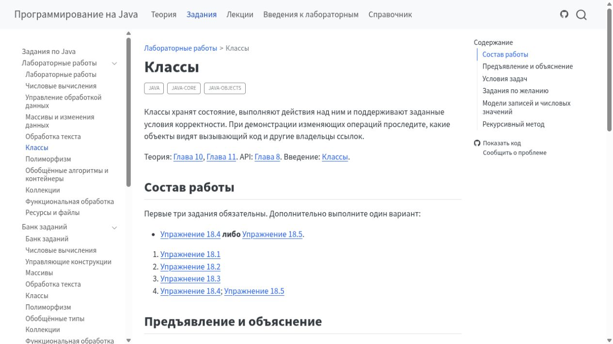
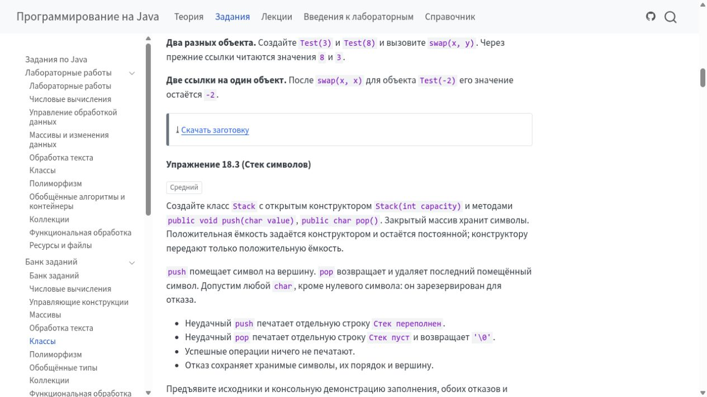

# Новый Gateway и перенос курса 6 ноября

Цель — перенести Java на существующую VM к 19:00. Экспорт тематического банка подготовил 128 задач и десять лабораторных; проверка его пакета прошла. Новый Gateway выполняет вход из Moodle на нашем стенде, его контейнер опубликован. Публичный предварительный прогон подключён. Репетиция обновления восстановленной базы, настоящая сдача, перенос зачёта с частным файлом и сохранность данных при локальном перезапуске приняты в описанных ниже пределах. После обнаружения несоответствия форм вы выбрали фиксированный комплект каждой задачи и поручили внести изменения до 18:00. Все 128 условий уточнены Terra и прошли независимую рецензию Sol; стартеры, авторские варианты и настройки приёмки также согласованы и приняты по исходникам. Полный прогон прежней выдачи завершился с ошибками, причины разобраны ниже. Для новой выдачи готовится исправленный Java-образ; затем её предстоит экспортировать и проверить заново. Публикация ожидает этой приёмки, браузерной проверки и окончательного переноса.

## Кто теперь за что отвечает

| Компонент | Ответственность |
| --- | --- |
| Moodle | Подтверждает личность, роль и email при запуске курса |
| Gateway | Проверяет подписанный LTI-запуск и кратковременно хранит состояние одного входа |
| Приватный Bridge внутри PrairieLearn | Привязывает вход к существующему курсу, зачисляет и выдаёт штатные права |
| PrairieLearn | Хранит пользователей, сессии, задания, ответы, оценки и файлы; обслуживает Workspace |

Название `community` в сборке означает Community Edition самого PrairieLearn. Это существующий контейнер PrairieLearn с интеграционными доработками и Bridge, а не дополнительный сервис. Номер `2.5.6` относится к нашей сборке этого контейнера.

Общий HTTPS-прокси направляет только пути входа в Gateway. После входа страницы курса, скачивания и Workspace идут непосредственно в PrairieLearn. Постоянного реестра пользователей и часовой учебной сессии в Gateway больше нет. Удалены портал, собственные задания, проверка решений, очереди и обмен оценками.

Один запуск фиксирует личность, роль и курс. Изменение регистрации Moodle или привязки курса требует нового входа. Запуск окончательно потребляется до зачисления; при сбое нужно снова открыть курс из Moodle. Старый callback не может удалить cookie более нового входа или восстановить сессию после выхода из PrairieLearn.

Технический выбор остаётся явным: в одном браузере разрешён один незавершённый вход на профиль курса. Уже открытых учебных вкладок может быть несколько. Вход выдаёт необходимые права, но автоматически не отзывает прежние назначения. Ручной отзыв в PrairieLearn также не запрещает повторную выдачу при следующем входе, если роль Moodle или правило владельца всё ещё дают эти права.

Обычный студент не получает преподавательских прав. Преподаватель получает штатные права редактирования курса и работы с данными студентов. Подтверждённый Moodle email владельца даёт права администратора; email не используется для объединения аккаунтов. Для входа владельца в закрытый курс дополнительно выдаются преподавательские права этого курса. Переключение административного режима остаётся штатным действием PrairieLearn.

Конфигурация Gateway и Bridge хранится в JSON. Например, полный Bridge-конфиг для одного курса выглядит так; числовые ID и UUID здесь иллюстративные, оператор подставляет существующие значения PrairieLearn:

```json
{
  "listenHost": "0.0.0.0",
  "listenPort": 3001,
  "tokenFile": "/run/secrets/platform-bridge-token",
  "administratorEmail": "afonenkoaa@bsu.by",
  "bindings": [
    {
      "courseKey": "java",
      "instance": "2026-2027-s1",
      "courseId": "101",
      "courseInstanceId": "201",
      "courseInstanceUuid": "11111111-1111-4111-8111-111111111111"
    }
  ]
}
```

Этот listener доступен только внутри установки. Настроек заданий, проверки решений, файлов курса и очередей в нём нет; команды обновления курса отделены от конфигурации входа.

## Что изменилось для автора курса

Подпроекты перечисляются обычным списком:

```yaml
subprojects:
  - theory
  - tasks
  - lectures
  - practice
  - handbook
```

Утренняя очистка не требует новой разметки условий. Публичные проверки остаются обычным текстом:

```markdown
::: {.public-tests}

Запустите решение без аргументов, с пустым завершённым стандартным вводом. Для заданных в исходнике 10 галлонов и коэффициента 3,7854 выводятся два числа в порядке `10 37.854`; вторая величина — литры. Пробельные разделители свободны, абсолютный допуск вещественного результата — `1e-8`. Вводить объём для этого примера не требуется.

:::
```

Это реальный блок из задачи о галлонах. JUnit остаётся в стартовом комплекте. Собственного YAML-формата публичных тестов нет. Скачать комплект по-прежнему можно одним shortcode:

```markdown

```

Так выглядит блок в готовой student-книге из CI. Ссылка действительно скачивает стартовый комплект; в проверенном комплекте стека есть оба исходника и публичные JUnit. Повторная сборка Quarto ради снимка не выполнялась. Это визуальная проверка книги, не приёмка форм PrairieLearn.


Согласованное правило сдачи — один или два исходника в редакторе, три и более плоских файла в файловом диалоге, дерево через ZIP, с одной активной формой. Последний принятый экспорт содержал 120 редакторов, четыре файловых диалога и четыре ZIP-формы. Однако выбор по файлам стартера не покрывал все разрешённые решения; теперь согласуется явный авторский комплект каждой задачи.

На Circle обнаружено существенное несоответствие: условие и проверяющий допускают дополнительные классы и файлы; допустимый авторский вариант содержит четыре файла, а форма показывает лишь два фиксированных редактора. Штатного добавления файлов в этих редакторах нет. Все 112 автоматически проверяемых задач с редакторами разрешают дополнительные файлы в проверяющем; аналогичная проблема есть у четырёх автоматических задач с фиксированным файловым диалогом. Это не отказ Java-проверки: полный операторский прогон передаёт авторские файлы непосредственно проверяющему и эту границу интерфейса не проверяет.

Вы выбрали фиксирование комплекта и формы каждой задачи с явными ограничениями на имена и пути файлов. Terra уточнила условия; Sol проверил их учебный смысл и согласует техническую часть. Сохраняются свобода алгоритма и вспомогательного кода внутри разрешённых файлов. Для задач на пакеты, дерево или раздельную компиляцию комплект отражает предмет задания. Динамический переключатель форм не разрабатывается.

Например, в новом условии Circle теперь прямо сказано:

```markdown
Для сдачи используйте файлы `Circle.java` и `TwoDShape.java` из `src/main/java`
стартового проекта. Разместите их в двух редакторах без объявления пакета.
Вспомогательные классы и методы можно определить в этих файлах; демонстрацию
можно разместить в одном из них, без третьего исходника.
```

Это уже внесённое уточнение условия. Соответствие нового комплекта проверяющему принято по исходникам; настоящий новый прогон и сдачи через формы ещё принимаются отдельно. Текущий набор содержит 118 стартеров и 267 содержательных авторских вариантов. Убраны 43 варианта, повторявшие тот же алгоритм и добавлявшие искусственные классы для проверки прежней свободы файлов и пакетов. Рецензент независимо проверил это сокращение. Число сценариев новой полной приёмки — 385.

## Что упростили внутри

Удалены собственные контрольные суммы схем и исходников контейнеров, проверки release-proof в курсах и собственный разбор объектов Git. Версии Git и идентификаторы контейнеров остаются штатными средствами соответствующих систем. Подписи LTI и прежний алгоритм устойчивого UID сохранены.

Экспорт повторно использует существующие данные операции и выполняет меньше повторных материализаций. Границы преподавательских, студенческих и приватных файлов сохранены. Содержимое узлов Pandoc и входные данные экспортера получили более точные типы без нового общего каркаса AST.

В прокси исправлена передача IP клиента: внешний заголовок больше не может подменить адрес, который видит PrairieLearn. Исправление проверено настоящим Nginx на отдельном временном стенде; на VM конфигурация ещё не переключена. В исходниках удалены неиспользуемые параметры и постоянные диагностические поля команды зачёта, а также старый патч, который действующая сборка уже не применяла. Команда первоначальной загрузки больше не повторяет разбор уже проверенного объекта курса. Эти небольшие упрощения подготовлены для следующего функционального выпуска; ради них отдельный образ не выпускался.

При просмотре действующих форм обнаружено описанное выше несоответствие разрешённых дополнительных файлов и фиксированного интерфейса Java. Отдельно уже исправлена ошибка существующего API составного ручного ответа: контракт разрешает несколько ручных частей, но экспортер признавал ручным только простой ответ. Исправление прошло адресные проверки, независимую рецензию и CI, затем слито без новой разметки или схемы. Текущие курсы этот вариант не используют, поэтому их повторный экспорт не требуется. Общую типизацию нельзя считать полностью законченной: на границе этого API ещё остаются параметры с типом `any`.

Повторный просмотр прямых вызовов и их вызывающих функций дал следующий остаток `quarto inspect`:

| Компонент | Когда вызывается | Зачем нужен |
| --- | --- | --- |
| Site | При подготовке корня и каждого выбранного подпроекта; при локальном post — ещё для текущего проекта. Полный post использует сохранённое состояние. | Эффективные профили, входы, ресурсы и каталоги назначения; дочерние назначения проверяются до очистки результата. |
| Core | Один при обычной подготовке либо один при подготовке экспортируемого задания. Подготовленная операция повторно использует полученные данные. | Привязка модели к действительным входам, владельцу и профилям Quarto. |
| QRC | Один в post-render. | Текущая конфигурация каталога ссылок, каталог результата и версия Quarto; перечень текущих выходов берётся из hook-окружения. |
| Download | Только резервный путь самостоятельного запуска; в совместной публикации дополнительного вызова нет. | Входы и конфигурационные файлы нужны, чтобы не включить авторские и приватные исходники в скачивание. |
| Экспортер PrairieLearn | Собственного прямого вызова нет. | Использует существующую операцию Core. |

Отдельные запросы версии Quarto удалены: версия уже есть в результате inspect. Таблица описывает действующие пути, а не измеренный общий счётчик процессов полного экспорта. Удаление оставшихся вызовов потребовало бы равноценного эффективного контекста; нового кеша или промежуточного публичного формата для этого не вводили.

## Скорость и готовность

В одной сопоставимой паре полный экспорт Java сократился с 10 минут 47 секунд до 9 минут 8 секунд — примерно на 15%. Это результат этих двух запусков, а не обещание такого ускорения для любого курса. Состав работ, идентификаторы и формы сдачи совпали.

Экспорт окончательной конфигурации с публичными JUnit завершился отдельно за 9 минут 17 секунд. В это время не входит выполнение Java/JUnit. Production-экспорт с опубликованным Java-образом затем завершился за 9 минут 4 секунды. После вашего уточнения о тематическом банке новый экспорт завершился за 11 минут 28 секунд; книга теперь содержит дополнительные страницы, а одновременно работал долгий прогон. Это иные условия, поэтому прежние 15% не переносятся на этот результат. Долгий полный прогон принимается отдельно.

На собственном стенде HTTP-проверка настоящего подписанного запуска Moodle прошла для студента, преподавателя и владельца в Java и System Practice. После выхода из PrairieLearn старые переходы отклоняются; новый вход из Moodle работает. Вы установили ранее одобренный тестовый CA в системное хранилище. После отдельного согласия тот же сертификат добавлен в пользовательское NSS. Оба импорта проверены; обычное HTTPS-обращение к тестовой Moodle проходит. Однако уже запущенный встроенный браузер всё ещё возвращает ошибку доверия, а других управляемых браузеров нет. Поэтому браузерный проход пока не принят; предупреждения TLS не обходились. Возможный перезапуск приложения рассматривается после завершения текущих работ с сохранённым состоянием. Для Workspace проверяем опубликованный образ на отдельном собственном стенде с ограничением доступа к общему Docker. Этот тестовый способ изоляции не входит в поставку на VM; его результат не будет выдаваться за приёмку штатного сервиса запуска Workspace целиком.

На новой копии собственной базы уже запущена опубликованная сборка PrairieLearn `2.5.6` со встроенным Bridge. Штатное обновление Java и System Practice и повторный вход студента из Moodle прошли. Эта собственная база стенда отличается от восстановленной копии базы VM, на которой отдельно принята репетиция переноса.

Настоящая отправка одного правильного решения через форму PrairieLearn принята: создано одно задание External grader, во время выполнения подтверждён опубликованный Java-образ, результат автопроверки ответа — 100%. Проверка использовала настоящий вход студента, поля формы и защитный токен. Поддельный прямой переход к callback получил отказ. Это проверка одной цепочки сдачи; полный прогон задач и браузерную приёмку она не заменяет.

На локальном стенде для сохранения вложений нужна одна явная штатная настройка PrairieLearn: по умолчанию выбран S3, но bucket не задан. Используем файловое хранилище в уже подключённом постоянном каталоге `/files`:

```json
{
  "fileStoreStorageTypeDefault": "FileSystem"
}
```

Это фрагмент конфигурации самого PrairieLearn, а не курса или Gateway. Настройка применена на собственном стенде: каталог доступен для записи, прежние пользователи, ответы и результаты проверки сохранились после перезапуска. На существующей VM этот параметр уже задан; её конфигурация не менялась.

Отдельный перезапуск подтвердил сохранность обоих созданных частных файлов вместе с их владельцами и полными байтами. Локальный сценарий остановки исправлен: он дожидается завершения приложения и PostgreSQL. Чистая остановка прошла за 1,6 секунды. Это исправление собственных тестовых средств; сценарий запуска VM ими не заменяется. В опубликованном контейнере штатный сценарий остановки ещё не дожидается завершения PostgreSQL. Поэтому при переносе проверяем фактическое состояние базы и сохраняем полный холодный снимок вместе с WAL; при необходимости штатное восстановление выполняется только на новой копии. Старые данные остаются точкой возврата.

Отдельный закрытый для студентов курс подтвердил штатный вход преподавателя и владельца и отказ студенту. Пока Gateway показывает общий отказ входа для всех отрицательных ответов Bridge; HTTP-код самого Bridge различает отказ доступа и внутренний сбой. Это ограничение диагностики входа, а не успешное зачисление студента.

Повторный архитектурный обзор выявил и помог исправить две несовместимости перед выпуском. Выдача преподавательских прав больше не зависит от студенческой открытости курса, а команды загрузки и обновления отделены от конфигурации Bridge. В Core сокращена оставшаяся публичная оболочка: удалены поля, которые больше не читает экспортер, и построение полной копии с последующим отбрасыванием. Проверки связей и приватности сохранены; новый кеш не вводится.

## Предварительные проверки и авторские решения

По вашему уточнению процесс разделён на три фазы. Экспорт готовит файлы курса и проверяет структуру и ресурсы. Затем отдельная команда долго проверяет все задачи, используя готовый экспорт. После полной приёмки штатная синхронизация публикует курс на сервере с сохранением пользователей и истории. Проверка не запускает Quarto повторно и не входит во время экспорта.

Для полной приёмки после production-экспорта с опубликованными образами Platform полный прогон задач, репетиция обновления на восстановленной базе и браузерная проверка могут выполняться параллельно. На VM курс публикуется после успешного завершения всех этих проверок.

Публичные JUnit-файлы присутствуют во всех 118 стартовых комплектах автоматически проверяемых задач. Предварительная проверка обязательного API также подключена во всех 118 задачах. Однако отдельный автоматический запуск публичных JUnit был явно отключён в профилях через `verification-tests: []`. По вашему решению он подключён существующим механизмом проверки курса: единые настройки в общем блоке заменили 118 пустых переопределений. Нового формата описания тестов нет.

```yaml
project-checks:
  defaults:
    verification-tests:
      - src/api/java/**/*.java
      - src/test/java/**/*.java
    verification-api-precheck:
      files:
        - src/api/java/**/*.java
      entry: ApiContract
```

Это фрагмент общего блока; остальные настройки сохраняются. Автоматический публичный прогон выполняет операторская проверка курса перед выпуском. Обычная сдача PrairieLearn продолжает использовать проверку API и преподавательские тесты. Новая кнопка предварительного запуска в интерфейсе студента не добавлялась.

Сам экспорт курса не запускает Java и JUnit. Отдельная существующая команда проверяет стартеры и все объявленные авторские решения в контейнере: сейчас это 118 стартеров и 310 решений с вариантами, всего 428 основных сценариев. Выполненные ранее адресные проверки JDK/JUnit и малые контейнерные пробы этот полный прогон не заменяют. Полный прогон всех 428 сценариев на опубликованном Java-образе начат 6 ноября в 10:47 по Минску; его результат будет принят отдельно перед публикацией курса. Первый запуск остановился на ошибке прав при очистке временной сборки. После исправления один реальный сценарий успешно прошёл девять преподавательских и два публичных теста, включая очистку. Это адресный результат, полный прогон им не заменяется. Повторная рецензия также нашла ошибку в аварийной ветви: перед любым удалением временного каталога нужно проверить, что контейнер остановлен. Исправление прошло независимую рецензию, CI и слияние до начала длинного прогона.

## Что показал законченный полный прогон прежней выдачи

Прогон завершился с ошибками: охвачены все 428 сценариев, ожиданиям соответствуют 303, у 125 есть расхождения. Это сценарии, а не число задач. Ни перенос, ни новая выдача этим прогоном не приняты.

| Наблюдение | Результат и действие |
| --- | --- |
| 310 авторских вариантов | 274 прошли, 36 остановились на сбоях проверки; среди полученных результатов нет обычного отказа поведения авторского решения |
| 76 стартеров | Компиляция, API и JUnit завершились, но исключение незавершённого решения классифицировано иначе, чем ожидала операторская проверка |
| 39 сценариев | Исполнение JUnit превысило десять секунд; установлена медленная инициализация энтропии при временных файлах в песочнице |
| 9 старых вариантов | Искусственные имена классов нарушили компиляцию доверенных проверок; эти варианты входят в осмысленно сокращённые дубликаты |
| 1 публичный прогон | Разбор пустого вывода стартером теста бросал исключение; исправлен на обычный JUnit-провал, критерии правильного результата сохранены |

Для будущей проверки исходники стартеров и вызовы тестов сверены отдельно. В 88 профилях явно ожидается ошибка выполнения незавершённого решения. У 87 ожидается ноль; у проекта с уже готовой проверкой аргументов допускается частичный результат меньше единицы. Остальные ожидания сохранены. Проверки компиляции, обязательного API, полноты JUnit и инфраструктуры остаются обязательными. Оценивание настоящих студенческих сдач не меняется. Отсутствующие в прежнем отчёте подробные стеки не выдаются за восстановленные.

Исправление среды JUnit использует тот же файловый источник свежей системной энтропии, который уже применяется для Gradle. Ограничения песочницы и десять секунд сохранены. Отдельный опыт показал 8,948 секунды без него и 0,132 секунды с ним. Новый регрессионный случай в прежнем образе воспроизвёл настоящий таймаут, а локальный диагностический образ с исправлением прошёл проверку. Это ещё не результат штатно опубликованного нового образа.

После нового выпуска требуется повторная полная приёмка всех 385 сценариев. Проверки выполняются существующими командами в параллель; новый runner, кеш или формат отчёта не вводятся. Сначала шесть небольших задач, затем при успешной работе — восемь независимых наборов остальных задач. Весь состав проверяется без повторения сценариев.

## Circle: выжимка прежнего примера ошибок

В сохранённом контрольном примере `Circle` компилируется, но площадь считается через диаметр вместо радиуса:

```java
return Math.PI * getWidth() * getWidth();
```

При `Circle(2)` ширина равна четырём: получается примерно `50.26548` вместо `12.56637`. Результат завышен в четыре раза. В том прежнем намеренно ошибочном примере прошли две проверки из шести; это ошибка поведения, а не компиляции или среды. Для исправления формулы нужен радиус `getWidth() / 2`. Эти результаты относятся к прежней контейнерной пробе, а не к незавершённому полному прогону текущего курса.

## Курс и пользователи на VM

На назначенной VM уже есть 17 пользователей, 907 попыток работ и 312 ответов. База восстановлена в изолированную копию; все таблицы совпали с исходным снимком. Полные записи прежних исторических попыток, вариантов, ответов и результатов проверки также сохранились. Это проверка базы данных; восстановленное приложение, выдача файлов и Workspace ещё требуют отдельной приёмки.

Новый курс сопоставлен с существующим курсом по задачам и устойчивым идентификаторам. Штатная синхронизация на восстановленной копии принята: сохранены пользователи, попытки, ответы, история оценок, идентификаторы обновляемых задач и работ, а также данные соседних курсов. Отдельно разобраны ожидаемые изменения: удалились правила доступа только у снятых с публикации старых работ этого курса и появилась штатная запись блокировки каталога. Это проверка обновления базы, а не приёмка приложения и выдачи файлов. На VM курс пока не опубликован. Три нужных опубликованных контейнерных образа уже загружены в её кеш; прежние работающие контейнеры продолжают работать. Подготовлен отдельный неактивный каталог новой установки: конфигурация и пустые хранилища проверены штатными Compose и Nginx. Новые сервисы не запускались, учебные данные туда ещё не переносились. Прежние контейнеры и их конфигурация сохранены. Это подготовка к переключению, а не само переключение.

Дополнительно проверена выборка прежних успешных ответов: все 65 успешных проверок сохранили связь с теми же вопросами и попытками. Для них не нужны новые попытки или перепривязка. Успех отдельного ответа не объявляется выполнением всей работы; автоматический массовый зачёт по этой выборке не выполнялся.

Для дальнейшего переноса подготовлены 60 результатов задач девяти пользователей и список 87 файлов успешных сдач. При нескольких полных успехах для копии кода выбрана последняя полностью успешная сдача; вся история остальных сдач сохраняется. Состав, принадлежность и содержимое всех 87 файлов проверены штатным API на изолированной копии. Проверка завершилась откатом своей транзакции: все 123 таблицы сохранились без логических изменений, зачёты и вложения не записывались. Найдены исходные старые ZIP для всех 13 задач, затронутых этими результатами. Копирование в штатные личные вложения ещё не выполнено. Стабильная ссылка на точную старую выдачу не подтверждена; найденный статический вариант одного стартера отличается README и точной исходной копией не считается.

На собственном стенде проверен перенос полного зачёта одной задачи без новой проверки её кода. Штатный административный механизм учитывает обе части балла — автоматическую и ручную; балл всей работы остаётся суммой результатов её задач. Исходный ответ и исходная проверка сохраняются. Повтор операции возвращает прежний результат без второй записи зачёта или второго файла. Закрытость работы и состояния других задач сохранены.

Успешный код сохранён штатным файловым хранилищем. В открытой попытке обычный владелец скачал точные исходные байты; другой студент получил отказ, анонимный запрос — переход ко входу без файла. Это настоящие HTTP-проверки через Moodle-сессии, не браузерная приёмка и не выполнение переноса исторических пользователей на VM.

После вашего решения политика закрытых лабораторных изменена и проверена на той же уже закрытой попытке. Штатная синхронизация новой выдачи сохранила прежние аккаунты, ответы, оценки и оба частных файла. Владелец открыл условие и скачал точные исходные байты файла. Настоящая отправка формы с корректными токеном и вариантом получила явный отказ, нового ответа или задания проверки не появилось. Другой студент получил отказ, анонимный запрос — переход ко входу без файла. Работа осталась закрытой. Это реальные HTTP-проверки, браузерный проход принимается отдельно.

Две исторические регистрации Java точно сопоставлены с прежним тестовым стендом по его исходным сценариям и записям действующего Gateway. Эти аккаунты, их старые ответы и права сохраняются без перепривязки к нынешнему Moodle. В обновляемом курсе Java их попыток и зачислений нет. Объединение по email не требуется.

В действующей конфигурации Gateway на VM сейчас настроен только вход Java. Материалы System Practice, его native-данные и права сохраняются; подготовленное переключение сохраняет этот состав входов. Новую привязку Moodle для System Practice в перенос Java не добавляли.

По вашему решению сохраняем существующие аккаунты и всю историю, а новых пользователей создаём при первом входе из Moodle. Предварительное зачисление всей группы и собственный механизм синхронизации списка студентов не нужны.

Gateway, Core, экспортер PrairieLearn, Site, QRC и Download уже слиты после вашего разрешения и проверок. Образ Gateway выпущен штатным workflow через существующую локальную авторизацию GitHub; изменений триггеров публикации не потребовалось. Основная Platform и последующие исправления также слиты после рецензий и CI. Четыре основных образа опубликованы; исправленный контейнер PrairieLearn выпущен отдельно. В нём устранено отклонение допустимых ручных заданий с редактором. Исправлены также проверка остановки контейнера до очистки и поиск экземпляров курса в пределах своего родительского курса. Последующая очистка исходников и исправление прокси отдельной публикации контейнера не требовали. Изменения курса остаются в PR. Слияние исходников и публикация образа сами по себе не означают переключение VM.

## Уточнённые вами решения

В книге будут отдельные тематические страницы банка. Лабораторные сохраняют состав, правила выполнения и ссылки; сами условия определяются один раз на страницах тем. В PrairieLearn остаются десять лабораторных. Перестройка использует существующую разметку и поддержку ссылок между документами, без нового API. Изменение внесено, прошло независимую рецензию, повторный обзор Sol/ultra и структурную сверку: все 128 условий определены один раз, состав и веса десяти работ сохранены. CI student-книги прошёл. На готовом артефакте открыт состав лабораторной, затем обычной ссылкой — условие стека на странице банка. Отдельный production-экспорт PrairieLearn тоже завершён: 128 задач, десять работ, структура пакета принята; во всех десяти работах присутствует согласованная политика закрытого просмотра.

Так выглядят состав лабораторной и переход к условию в тематическом банке на готовом артефакте CI:





По вашему решению после закрытия лабораторной владелец должен сохранять доступ к условиям, своим ответам и файлам при запрете новых сдач. Экспортер задаёт это штатной политикой PrairieLearn:

```json
{
  "afterComplete": {
    "questions": { "hidden": false },
    "score": { "hidden": false }
  }
}
```

Это часть сформированных правил доступа PrairieLearn, а не новый авторский формат. Правка экспортера прошла независимую рецензию и CI и установлена в Java и System Practice. Новый экспорт и проверка его пакета завершились успешно. В работающем PrairieLearn подтверждены просмотр и скачивание владельцем после закрытия вместе с отказом новой сдачи и сохранением прежних данных. В 118 планах проверок изменилось только местоположение условия; конфигурации проверок, публичные JUnit и авторские варианты сохранились. Текущий долгий прогон решений не перезапускается.
