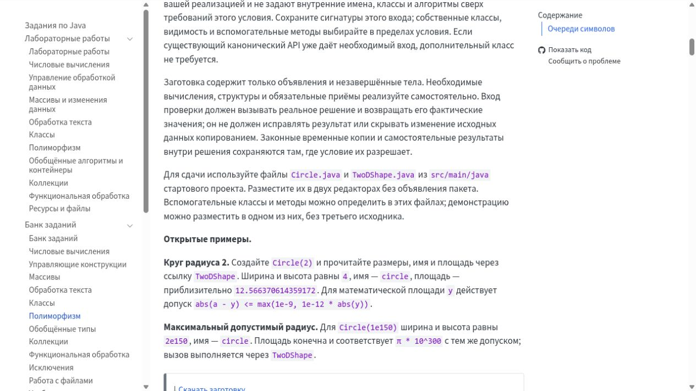
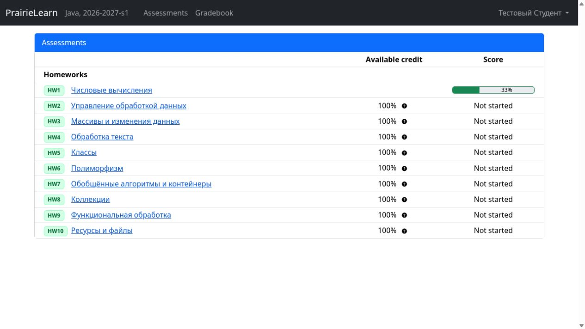
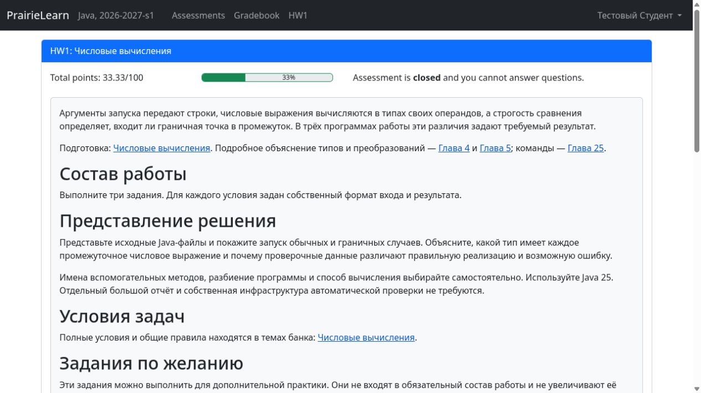
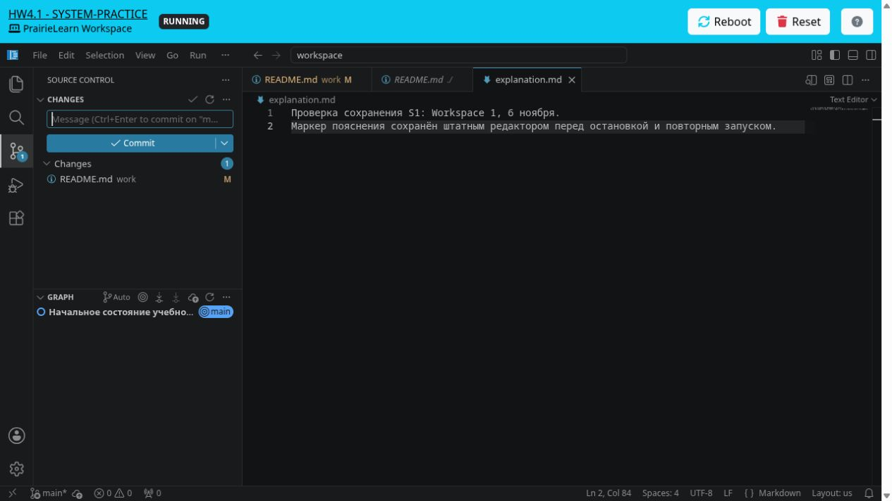
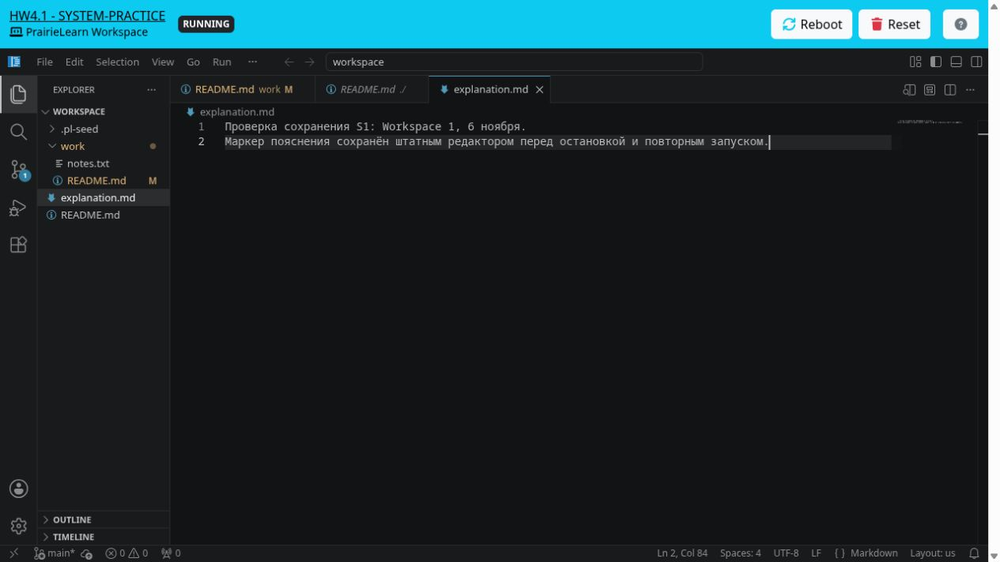
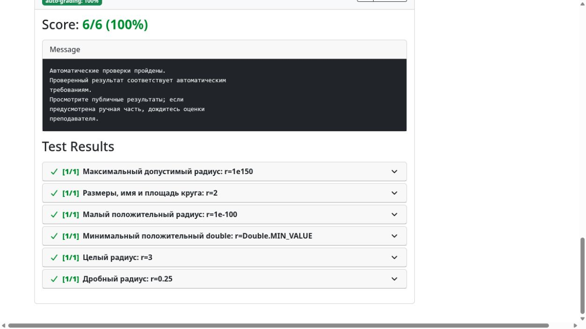

# Локальный стенд, курс Java и Gateway: результаты 6 ноября

По последнему решению до 22:30 готовим полностью рабочий локальный стенд и итоговый отчёт; развёртывание на VM переносится на завтра. Уже принят экспорт 128 задач и десяти лабораторных с исправленным опубликованным Java-образом и увеличенным временем JUnit. Все 128 условий уточнены Terra и проверены Sol; комплекты сдачи и авторские варианты согласованы с ними. Окончательная выдача и книга собраны после увеличения обязательной части и очистки введений. Свежий прогон содержит 385 сценариев: первые 15 дали ожидаемый результат, остальные выполняются. Входы из Moodle и сохранность данных на собственном стенде приняты в описанных ниже пределах. Сдача Circle через два редактора прошла; файловая форма, ZIP и сообщение таймаута ещё принимаются. Отдельно обнаружено ограничение PrairieLearn при изменении весов уже начатых работ: перенос старых попыток требует согласованного решения, описанного ниже.

## Кто теперь за что отвечает

| Компонент | Ответственность |
| --- | --- |
| Moodle | Подтверждает личность, роль и email при запуске курса |
| HTTPS-прокси | Сохраняет адреса сервиса и TLS, направляет запросы к нужному приложению |
| Gateway | Проверяет подписанный LTI-запуск и кратковременно хранит состояние одного входа |
| Приватный Bridge внутри PrairieLearn | Привязывает вход к существующему курсу, зачисляет и выдаёт штатные права |
| PrairieLearn | Хранит пользователей, сессии, задания, ответы, оценки и файлы; обслуживает Workspace |

Название `community` в сборке означает Community Edition самого PrairieLearn. Это существующий контейнер PrairieLearn с интеграционными доработками и Bridge, а не дополнительный сервис. На собственном стенде работает наша сборка `2.5.8`; она обновлена вместе с Gateway `3.0.1` и исправленным прокси. Java-проверяющий выпускается отдельно.

Общий HTTPS-прокси направляет только пути входа в Gateway. После входа страницы курса, скачивания и Workspace идут непосредственно в PrairieLearn. Постоянного реестра пользователей и часовой учебной сессии в Gateway больше нет. Удалены портал, собственные задания, проверка решений, очереди и обмен оценками.

Один запуск фиксирует личность, роль и курс. Изменение регистрации Moodle или привязки курса требует нового входа. Запуск окончательно потребляется до зачисления; при сбое нужно снова открыть курс из Moodle. Старый callback не может удалить cookie более нового входа или восстановить сессию после выхода из PrairieLearn.

Технический выбор остаётся явным: в одном браузере разрешён один незавершённый вход на профиль курса. Уже открытых учебных вкладок может быть несколько. Вход выдаёт необходимые права, но автоматически не отзывает прежние назначения. Ручной отзыв в PrairieLearn также не запрещает повторную выдачу при следующем входе, если роль Moodle или правило владельца всё ещё дают эти права.

Обычный студент не получает преподавательских прав. Преподаватель получает штатные права редактирования курса и работы с данными студентов. Подтверждённый Moodle email владельца даёт права администратора; email не используется для объединения аккаунтов. Для входа владельца в закрытый курс дополнительно выдаются преподавательские права этого курса. Переключение административного режима остаётся штатным действием PrairieLearn.

Повторный системный обзор Sol с усилием ultra обнаружил ещё два дефекта:

| Ситуация | Неожиданное поведение | Исправление |
| --- | --- | --- |
| Ошибка связи с Docker после создания или запуска проверки | Очистка могла быть пропущена, а место в очереди освобождалось; работающий контейнер переставал учитываться в ограничении нагрузки | Гарантировать ограниченную очистку известного контейнера до освобождения места; при неизвестном результате сохранять инфраструктурный отказ и занятое место |
| Передача подтверждённого входа в PrairieLearn | Привязка перехода к браузеру проверялась после передачи личности в native callback | Проверять уже существующий браузерный credential до потребления перехода и передачи личности; позднюю проверку сохранить |

Обе правки независимо проверены, прошли CI и слиты. Исправленные Gateway `3.0.1` и контейнер PrairieLearn `2.5.8` опубликованы. Первый дефект воспроизведён на настоящем коде с фиктивным Docker, без заявления о сбое действующей VM. Для второго проверен и код авторизации из действующего образа: личность действительно попадала в сессию до поздней проверки. Фактическая атака на пользователя не воспроизводилась. Новый Gateway применён вместе с исправленным прокси. Настоящий вход из тестового Moodle прошёл; отсутствующий, чужой и дублированный браузерный credential получили отказ без потребления исходного запуска. После этого исходный запуск с правильным credential успешно завершился. Новый протокол входа или сервис очередей не добавлены; обзор не заменяет нагрузочный тест.

При запуске нового полного прогона обнаружена ещё одна рассогласованная граница: обработчик уже различал ошибку выполнения незавершённого стартера, а входные схемы операторской проверки не разрешали эту классификацию. Схемы согласованы с существующим обработчиком, независимо проверены и слиты после CI. Проверки компиляции, обязательного API, полноты JUnit и инфраструктуры сохранены; инфраструктурная ошибка не превращается в допустимый результат стартера.

Конфигурация Gateway и Bridge хранится в JSON. Например, полный Bridge-конфиг для одного курса выглядит так; числовые ID и UUID здесь иллюстративные, оператор подставляет существующие значения PrairieLearn:

```json
{
  "listenHost": "0.0.0.0",
  "listenPort": 3001,
  "tokenFile": "/run/secrets/platform-bridge-token",
  "administratorEmail": "afonenkoaa@bsu.by",
  "bindings": [
    {
      "courseKey": "java",
      "instance": "2026-2027-s1",
      "courseId": "101",
      "courseInstanceId": "201",
      "courseInstanceUuid": "11111111-1111-4111-8111-111111111111"
    }
  ]
}
```

Этот listener доступен только внутри установки. Настроек заданий, проверки решений, файлов курса и очередей в нём нет; команды обновления курса отделены от конфигурации входа.

## Что изменилось для автора курса

Подпроекты перечисляются обычным списком:

```yaml
subprojects:
  - theory
  - tasks
  - lectures
  - practice
  - handbook
```

Утренняя очистка не требует новой разметки условий. Публичные проверки остаются обычным текстом:

```markdown
::: {.public-tests}

Запустите решение без аргументов, с пустым завершённым стандартным вводом. Для заданных в исходнике 10 галлонов и коэффициента 3,7854 выводятся два числа в порядке `10 37.854`; вторая величина — литры. Пробельные разделители свободны, абсолютный допуск вещественного результата — `1e-8`. Вводить объём для этого примера не требуется.

:::
```

Это реальный блок из задачи о галлонах. JUnit остаётся в стартовом комплекте. Собственного YAML-формата публичных тестов нет. Скачать комплект по-прежнему можно одним shortcode:

```markdown

```

Так выглядит блок в готовой student-книге из CI. Ссылка действительно скачивает стартовый комплект; в проверенном комплекте стека есть оба исходника и публичные JUnit. Повторная сборка Quarto ради снимка не выполнялась. Это визуальная проверка книги, не приёмка форм PrairieLearn.


Согласованное правило сдачи — один или два исходника в редакторе, три и более плоских файла в файловом диалоге, дерево через ZIP, с одной активной формой. В прежней выдаче выбор по файлам стартера не покрывал все разрешённые решения. Теперь комплект каждой задачи закреплён явно. В окончательном экспорте независимо подтверждены 116 задач с редакторами, пять с файловым диалогом и семь с ZIP. Настоящая отправка Circle через два редактора принята. Отправки через файловый диалог и ZIP ещё проверяются отдельно.

В прежней выдаче Circle условие и проверяющий допускали дополнительные файлы, включая авторский комплект из четырёх файлов, а форма показывала два фиксированных редактора. Все 112 автоматических задач с редакторами разрешали дополнительные файлы в проверяющем; аналогичное несоответствие было у четырёх автоматических задач с фиксированным файловым диалогом. Оператор передавал файлы непосредственно проверяющему, поэтому его успех не проверял эту границу студенческой формы. В новых условиях и техническом комплекте эта свобода заменена явным составом сдачи.

Вы выбрали фиксирование комплекта и формы каждой задачи с явными ограничениями на имена и пути файлов. Terra уточнила условия; Sol проверил их учебный смысл и согласовал техническую часть. Сохраняются свобода алгоритма и вспомогательного кода внутри разрешённых файлов. Для задач на пакеты, дерево или раздельную компиляцию комплект отражает предмет задания. Динамический переключатель форм не разрабатывается.

Например, в новом условии Circle теперь прямо сказано:

```markdown
Для сдачи используйте файлы `Circle.java` и `TwoDShape.java` из `src/main/java`
стартового проекта. Разместите их в двух редакторах без объявления пакета.
Вспомогательные классы и методы можно определить в этих файлах; демонстрацию
можно разместить в одном из них, без третьего исходника.
```

Это уже внесённое уточнение условия. Оно видно и в готовой student-сборке из успешной CI:



Соответствие нового комплекта проверяющему принято по исходникам и структуре окончательного экспорта; новый прогон и сдачи через формы ещё принимаются отдельно. Текущий набор содержит 118 стартеров и 267 содержательных авторских вариантов. Убраны 43 варианта, повторявшие тот же алгоритм и добавлявшие искусственные классы для проверки прежней свободы файлов и пакетов. Рецензент независимо проверил это сокращение. Число сценариев новой полной приёмки — 385.

## Обязательный состав лабораторных

По вашему последнему уточнению обязательная часть каждой лабораторной увеличена как минимум до половины её состава. Всего требуется 68 сдач; варианты одной альтернативы считаются одной сдачей. Метка обязательности стоит у 74 из 128 карточек, поскольку часть из них предлагается на выбор. Максимум работы остаётся 100 баллов. Состав и веса независимо подтверждены в окончательном экспорте:

| Работа | Обязательных сдач | Всего карточек |
| --- | ---: | ---: |
| Числовые вычисления | 7 | 13 |
| Управление обработкой данных | 6 | 11 |
| Массивы | 6 | 11 |
| Обработка текста | 7 | 13 |
| Классы | 5 | 10 |
| Полиморфизм | 7 | 13 |
| Обобщённые алгоритмы | 5 | 9 |
| Коллекции | 8 | 15 |
| Функциональная обработка | 8 | 16 |
| Ресурсы и файлы | 9 | 17 |

Повторные перечисления обязательных и дополнительных заданий во введениях удалены; источником состава остаются существующие метки `requirement="required"` и `requirement="optional"`. Условия, проекты и проверки задач не менялись. Штатные обозначения PrairieLearn `HW2` и `HW2.1` по вашему уточнению сохраняются; интерфейс ради их удаления не патчится.

## Изменение весов и уже начатые работы

После штатной синхронизации сохранены прежние ответы, оценки, файлы и все строки начатых попыток. Однако этого оказалось недостаточно для корректного продолжения старой работы: PrairieLearn сохраняет стоимость попытки, а ручную и автоматическую части берёт уже из новой шкалы. В одной прежней добровольной задаче доступная стоимость стала отрицательной. Новые отправки в затронутую попытку остановлены; отрицательную оценку студенту не выставляли.

Это влияет на вычисление баллов, а не только на подпись интерфейса. При правильном новом ответе старое значение может попасть в расчёт новой автоматической части. Общего штатного пересчёта таких изменений без повторной проверки решений не найдено; документация PrairieLearn отдельно оговаривает ограничение [изменения балльной структуры](https://github.com/PrairieLearn/PrairieLearn/blob/92584fe426ececb84bc2d09de9975c7056c0c5f6/docs/assessment/regrading.md).

По вашему решению вопрос переноса старых попыток отложен: в нём есть дополнительный момент, который нужно обсудить отдельно. Политика пересчёта или нового экземпляра не выбрана. Рассмотренный вариант с прежней шкалой в старом экземпляре и новым составом в новом пока остаётся только предложением; ссылка Moodle может сохраниться. Он также требует подготовки: текущий экспорт выбирает один экземпляр, а штатная синхронизация обрабатывает весь курс и скрывает отсутствующие экземпляры. Для сохранения обоих нужна полная согласованная поставка. Автоматически создавать новый экземпляр или пересчитывать исторические баллы не стали.

Свежие студенческие попытки создаются сразу с новой шкалой и принимаются отдельно. Их успех не закроет миграцию старой истории. До согласования и проверки этого перехода настоящий перенос на VM не считается готовым.

## Что упростили внутри

Удалены собственные контрольные суммы схем и исходников контейнеров, проверки release-proof в курсах и собственный разбор объектов Git. Версии Git и идентификаторы контейнеров остаются штатными средствами соответствующих систем. Подписи LTI и прежний алгоритм устойчивого UID сохранены.

Экспорт повторно использует существующие данные операции и выполняет меньше повторных материализаций. Границы преподавательских, студенческих и приватных файлов сохранены. Содержимое узлов Pandoc и входные данные экспортера получили более точные типы без нового общего каркаса AST.

Изображения и остальные ссылочные ресурсы проходят общий путь: ссылки извлекаются из готовой модели, файлы копируются как непрозрачные байты. Отдельного разбора PNG нет. В Site для преобразования ссылок в уже готовом HTML остаётся стандартный AST библиотеки parse5; собственный разбор HTML заменён им. Это отдельный шаг публикации сайта, а не новый формат ресурсов курса.

В прокси исправлена передача IP клиента: внешний заголовок больше не может подменить адрес, который видит PrairieLearn. Исправление проверено настоящим Nginx на отдельном временном стенде; на VM конфигурация ещё не переключена. В исходниках удалены неиспользуемые параметры и постоянные диагностические поля команды зачёта, а также старый патч, который действующая сборка уже не применяла. Команда первоначальной загрузки больше не повторяет разбор уже проверенного объекта курса. Эти небольшие упрощения подготовлены для следующего функционального выпуска; ради них отдельный образ не выпускался.

При просмотре действующих форм обнаружено описанное выше несоответствие разрешённых дополнительных файлов и фиксированного интерфейса Java. Отдельно уже исправлена ошибка существующего API составного ручного ответа: контракт разрешает несколько ручных частей, но экспортер признавал ручным только простой ответ. Исправление прошло адресные проверки, независимую рецензию и CI, затем слито без новой разметки или схемы. Текущие курсы этот вариант не используют, поэтому их повторный экспорт не требуется. Общую типизацию нельзя считать полностью законченной: на границе этого API ещё остаются параметры с типом `any`.

Повторный просмотр прямых вызовов и их вызывающих функций дал следующий остаток `quarto inspect`:

| Компонент | Когда вызывается | Зачем нужен |
| --- | --- | --- |
| Site | При подготовке корня и каждого выбранного подпроекта; при локальном post — ещё для текущего проекта. Полный post использует сохранённое состояние. | Эффективные профили, входы, ресурсы и каталоги назначения; дочерние назначения проверяются до очистки результата. |
| Core | Один при обычной подготовке либо один при подготовке экспортируемого задания. Подготовленная операция повторно использует полученные данные. | Привязка модели к действительным входам, владельцу и профилям Quarto. |
| QRC | Один в post-render. | Текущая конфигурация каталога ссылок, каталог результата и версия Quarto; перечень текущих выходов берётся из hook-окружения. |
| Download | Только резервный путь самостоятельного запуска; в совместной публикации дополнительного вызова нет. | Входы и конфигурационные файлы нужны, чтобы не включить авторские и приватные исходники в скачивание. |
| Экспортер PrairieLearn | Собственного прямого вызова нет. | Использует существующую операцию Core. |

Отдельные запросы версии Quarto удалены: версия уже есть в результате inspect. Таблица описывает действующие пути, а не измеренный общий счётчик процессов полного экспорта. Удаление оставшихся вызовов потребовало бы равноценного эффективного контекста; нового кеша или промежуточного публичного формата для этого не вводили.

## Скорость и готовность

По вашему дополнительному запросу общий бюджет одного запуска JUnit увеличен до 30 секунд. Это существующая настройка курса с переопределением по профилю задачи, без нового API:

```yaml
project-checks:
  defaults:
    limits:
      outer-seconds: 300
      compile-seconds: 120
      run-seconds: 30
```

Единственное прежнее явное переопределение в 15 секунд также поднято до 30. Независимая рецензия подтвердила эффективные 30 секунд у всех 118 автоматических задач; остальные настройки, критерии и ожидания сохранены. Это общий бюджет JUnit. Вспомогательный запуск отдельной консольной Java-программы имеет собственный предел 10 секунд; изменение общего бюджета не увеличивает его автоматически.

Таймаут вложенной программы показывает студенту понятное русское сообщение. При остановке всей JUnit JVM прежний образ показывал общее сообщение о сбое среды и не выставлял оценку. Исправление этого сообщения независимо принято, прошло общий CI и слито; Java-образ `2.5.9` опубликован и получен для окончательного экспорта и свежего полного прогона. Показ нового сообщения в настоящей студенческой форме ещё проверяется. При внешнем таймауте контейнера PrairieLearn выводит английское сообщение с числом секунд. Эти пути различаются.

В опубликованной сборке PrairieLearn ограничитель допускает две одновременные внешние проверки в одном процессе. Остальные ждут; таймер контейнера начинается после его запуска. Пятьдесят сдач не означают пятьдесят одновременно запущенных контейнеров. Ограничитель имеет фиксированное значение и очередь в памяти процесса; её восстановление после перезапуска этим кодом не обеспечивается. Подготовлена одна копия PrairieLearn. Настоящая нагрузочная проверка пятидесяти одновременных сдач ещё не выполнена, поэтому готовность к контрольной на пятьдесят участников не подтверждена. На существующей VM новая сборка ещё не запущена.

В одной сопоставимой паре полный экспорт Java сократился с 10 минут 47 секунд до 9 минут 8 секунд — примерно на 15%. Это результат этих двух запусков, а не обещание такого ускорения для любого курса. Состав работ, идентификаторы и формы сдачи совпали.

Окончательный экспорт с Java-проверяющим `2.5.9`, обновлённой обязательной частью и исправленным ожиданием стартера завершился за 11 минут 21 секунду. Непосредственно предыдущий запуск при параллельной нагрузке занял 21 минуту 44 секунды. Это разные условия запуска, а не чистое сравнение ускорения кода. Окончательный пакет независимо принят: 128 задач, десять лабораторных, все формы и идентификаторы, новые веса и политика закрытого просмотра. В это время не входит выполнение Java/JUnit. Это иной состав и условия запуска, поэтому прежние 15% на этот результат не переносятся. Долгий полный прогон принимается отдельно; его текущий статус приведён ниже. Исправление ожидания одного незавершённого стартера на точные 20% не меняло проверяющий или тесты задачи.

На собственном стенде HTTP-проверка и настоящий браузерный вход из Moodle прошли для всех трёх ролей — студента, преподавателя и владельца — в Java и System Practice. Студент увидел десять лабораторных Java и пять работ System Practice. Закрытая работа сохранила условие, собственный ответ и ссылку на файл без кнопок новой сдачи. Преподаватель и владелец увидели штатные преподавательские интерфейсы. У владельца видна кнопка административного режима; её активация этим проходом не проверялась. После выхода старые переходы отклоняются, новый вход работает. Тестовый CA установлен с вашего согласия в системное хранилище и NSS; браузер использует обычный HTTPS без обхода предупреждений и перезапуска.

В System Practice студент открыл Workspace с code-server и сохранил изменения штатной кнопкой PrairieLearn. Создан ручной ответ с рабочими файлами и Git-репозиторием, включая HEAD, индекс, объекты и ветку. Это сохранение, а не выставленная оценка. После штатного Reboot та же среда снова запустилась: оба текстовых маркера, исходный коммит и незакоммиченная правка README сохранились. Отдельная остановка и возобновление этим не подтверждены. Для Workspace используется опубликованный образ на отдельном собственном стенде с ограничением доступа к общему Docker. Этот тестовый способ изоляции не входит в поставку на VM; его результат не будет выдаваться за приёмку штатного сервиса запуска Workspace целиком.

Снимки настоящего браузера на собственном стенде: список десяти работ, доступная закрытая работа и Workspace после Reboot. Это тестовый пользователь и состояние до загрузки новой выдачи с фиксированными комплектами, а не обновлённая VM:







С вашего разрешения собственный стенд обновлён до PrairieLearn `2.5.8` и Gateway `3.0.1` вместе с исправленным прокси. Резервная копия снята после остановки записи; прежние аккаунты, ответы, оценки, частные файлы и Workspace сохранены. Старая студенческая сессия продолжила работать, новый вход из Moodle также прошёл. Workspace открылся через новое соединение с прежними файлами и Git. В старой вкладке после перерыва осталось устаревшее соединение; её несохранённый буфер не перезагружали. Этот стенд отличается от восстановленной копии базы VM, на которой отдельно принята репетиция переноса.



Настоящая отправка одного правильного решения через форму PrairieLearn принята: создано одно задание External grader, во время выполнения подтверждён опубликованный Java-образ, результат автопроверки ответа — 100%. Проверка использовала настоящий вход студента, поля формы и защитный токен. Поддельный прямой переход к callback получил отказ. Это проверка прежней цепочки. Дополнительно теперь принята окончательная форма Circle с двумя редакторами в свежей работе второго тестового студента: автопроверка дала 100%, общая оценка задачи — 80% с ожиданием ручных 20%. Прежние работы первого студента не затронуты. Файловая форма, ZIP и контролируемый таймаут ещё принимаются.



На локальном стенде для сохранения вложений нужна одна явная штатная настройка PrairieLearn: по умолчанию выбран S3, но bucket не задан. Используем файловое хранилище в уже подключённом постоянном каталоге `/files`:

```json
{
  "fileStoreStorageTypeDefault": "FileSystem"
}
```

Это фрагмент конфигурации самого PrairieLearn, а не курса или Gateway. Настройка применена на собственном стенде: каталог доступен для записи, прежние пользователи, ответы и результаты проверки сохранились после перезапуска. На существующей VM этот параметр уже задан; её конфигурация не менялась.

Отдельный перезапуск подтвердил сохранность обоих созданных частных файлов вместе с их владельцами и полными байтами. Локальный сценарий остановки исправлен: он дожидается завершения приложения и PostgreSQL. Чистая остановка прошла за 1,6 секунды. Это исправление собственных тестовых средств; сценарий запуска VM ими не заменяется. В опубликованном контейнере штатный сценарий остановки ещё не дожидается завершения PostgreSQL. Поэтому при переносе проверяем фактическое состояние базы и сохраняем полный холодный снимок вместе с WAL; при необходимости штатное восстановление выполняется только на новой копии. Старые данные остаются точкой возврата.

Отдельный закрытый для студентов курс подтвердил штатный вход преподавателя и владельца и отказ студенту. Пока Gateway показывает общий отказ входа для всех отрицательных ответов Bridge; HTTP-код самого Bridge различает отказ доступа и внутренний сбой. Это ограничение диагностики входа, а не успешное зачисление студента.

Повторный архитектурный обзор выявил и помог исправить две несовместимости перед выпуском. Выдача преподавательских прав больше не зависит от студенческой открытости курса, а команды загрузки и обновления отделены от конфигурации Bridge. В Core сокращена оставшаяся публичная оболочка: удалены поля, которые больше не читает экспортер, и построение полной копии с последующим отбрасыванием. Проверки связей и приватности сохранены; новый кеш не вводится.

## Предварительные проверки и авторские решения

По вашему уточнению процесс разделён на три фазы. Экспорт готовит файлы курса и проверяет структуру и ресурсы. Затем отдельная команда долго проверяет все задачи, используя готовый экспорт. После полной приёмки штатная синхронизация публикует курс на сервере с сохранением пользователей и истории. Проверка не запускает Quarto повторно и не входит во время экспорта.

Ручное управление этой последовательностью пока слишком сложно: приходится согласовывать пути, параметры и готовность отдельных команд. Отдельный обзор Sol/ultra рекомендует передать порядок выполнения штатному GitHub Actions. Это предложение для следующей отдельной работы; новая CI/CD сегодня не реализуется.

| Стадия будущей доставки | Результат |
| --- | --- |
| Экспорт | Готовый курс; автор сразу получает результат сборки. Проверочные входы сохраняются отдельно. |
| Проверка | Долгий прогон именно этого курса, с отчётом об ожидаемых и фактических результатах. |
| Публикация | После успешной проверки и приёмки тот же готовый курс поступает штатной синхронизации PrairieLearn. |

Автор меняет курс и отправляет изменения в Git. Для полной подготовки выбирает запуск workflow; публикацию подтверждает принимающий. Каталоги результатов и инструменты определяет сама задача CI. Ключ курса берётся из готовой поставки, числовые ID — из PrairieLearn; выбор экземпляра нужен только при нескольких вариантах. Домен, TLS и доступы задаются один раз при установке.

Из пользовательской инструкции должны исчезнуть пять технических переменных и ручная последовательность отдельных команд. Из локального репозитория убираются собственный разбор `.env`, обёртка импорта, дополнительное состояние поставки и обязательные адрес репозитория/commit: действительный native-импорт эти Git-поля не использует. Привязки входа остаются обычной конфигурацией Gateway/Bridge; наполнение их реальными данными относится к отдельной доставке.

Проверочные ожидания также следует передавать отдельно от серверного курса. Нынешний случай с ожидаемыми 20% стартера показывает цену смешивания: точечная правка ожидания требует нового экспорта. В будущей схеме рецензированная правка существующего проверочного документа сможет использовать тот же серверный артефакт. Готовой команды такого обновления сейчас нет.

Два ограничения остаются существенными. Готовый серверный курс и проверочные входы содержат преподавательские материалы, поэтому доступ к ним определяется правами хранилища; студенту публикуется существующая student-выдача. Кроме того, штатная синхронизация PrairieLearn не даёт общей транзакции всего обновления: при сбое возможна частичная запись. Нужны сохранённая предыдущая поставка и явный повтор либо восстановление; одна настройка CI не делает откат автоматическим.

Для первого перехода достаточно трёх обычных заданий одного workflow. Доставку по номеру ранее проверенного запуска или упаковку курса в контейнер стоит добавлять лишь при реальной необходимости. [Подробное предложение](delivery-cicd-proposal.md) приложено отдельно.

[Репозиторий локального стенда и его PR](https://github.com/Afonenko-Course-Tools/prairielearn-local/pull/1) ограничены инфраструктурой: сервисами Compose, первоначальной настройкой, TLS, секретами и постоянными данными. Автоматизация доставки курса в него не входит. Будущая CI/CD разрабатывается отдельно; её предложение не становится скрытым обязательным интерфейсом нового стенда.

Базовый запуск описан одной командой, без обязательного ручного заполнения `.env`:

```sh
docker compose up -d --build --wait
```

Первый запуск создаёт ключи, тестовые аккаунты и обычные конфигурации приложений; повторный использует прежние данные. Курсы, привязка входа и Workspace подключаются отдельно штатными настройками и Compose override. Это граница базовой инфраструктуры, а не обещание готового курса после одной команды. Moodle-образ собран настоящим Docker и пересобран после исправлений. Начался чистый запуск отдельного Compose-проекта: PrairieLearn создал одного начального администратора без курсов, Moodle устанавливает плагины. Запуск всей установки, повторный старт и остановка ещё принимаются. Первый запуск обнаружил несовместимый параметр `wget` в healthcheck прокси. Команда заменена на доступный в том же образе `curl`; проверка CA и имени сервера сохранена и прошла в настоящем контейнере. Повторный запуск с исправлением ещё принимается.

Рецензия нового репозитория выявила дефекты остановки PostgreSQL и согласования портов, а затем несовместимость настройки cookie с выбранным DNS-именем и отсутствие гарантированного перечитывания адреса PL при смене порта. Все исправления независимо приняты по исходникам и опубликованы в PR. Использованы обычные настройки приложений и пересоздание контейнера средствами Compose; нового наблюдателя за конфигурацией или менеджера процессов нет. Узкое обновление портов тестовой Moodle сохраняет её аккаунты, ключи и регистрационные идентификаторы. Фактический запуск, чистая остановка базы и повторный старт новой установки ещё принимаются.


Для полной приёмки после production-экспорта с опубликованными образами Platform полный прогон задач, репетиция обновления на восстановленной базе и браузерная проверка могут выполняться параллельно. На VM курс публикуется после успешного завершения всех этих проверок.

Публичные JUnit-файлы присутствуют во всех 118 стартовых комплектах автоматически проверяемых задач. Предварительная проверка обязательного API также подключена во всех 118 задачах. Однако отдельный автоматический запуск публичных JUnit был явно отключён в профилях через `verification-tests: []`. По вашему решению он подключён существующим механизмом проверки курса: единые настройки в общем блоке заменили 118 пустых переопределений. Нового формата описания тестов нет.

```yaml
project-checks:
  defaults:
    verification-tests:
      - src/api/java/**/*.java
      - src/test/java/**/*.java
    verification-api-precheck:
      files:
        - src/api/java/**/*.java
      entry: ApiContract
```

Это фрагмент общего блока; остальные настройки сохраняются. Автоматический публичный прогон выполняет операторская проверка курса перед выпуском. Обычная сдача PrairieLearn продолжает использовать проверку API и преподавательские тесты. Новая кнопка предварительного запуска в интерфейсе студента не добавлялась.

Сам экспорт курса не запускает Java и JUnit. Отдельная существующая команда проверяет стартеры и все объявленные авторские решения в контейнере. Прежний полный прогон охватил 428 сценариев и обнаружил несовместимости ожиданий, проверок и среды. После исправлений новая приёмка содержит 118 стартеров и 267 вариантов, всего 385. Адресные проверки и малые контейнерные пробы полный прогон не заменяют.

## Что показал законченный полный прогон прежней выдачи

Прогон завершился с ошибками: охвачены все 428 сценариев, ожиданиям соответствуют 303, у 125 есть расхождения. Это сценарии, а не число задач. Ни перенос, ни новая выдача этим прогоном не приняты.

| Наблюдение | Результат и действие |
| --- | --- |
| 310 авторских вариантов | 274 прошли, 36 остановились на сбоях проверки; среди полученных результатов нет обычного отказа поведения авторского решения |
| 76 стартеров | Компиляция, API и JUnit завершились, но исключение незавершённого решения классифицировано иначе, чем ожидала операторская проверка |
| 39 сценариев | Исполнение JUnit превысило десять секунд; установлена медленная инициализация энтропии при временных файлах в песочнице |
| 9 старых вариантов | Искусственные имена классов нарушили компиляцию доверенных проверок; эти варианты входят в осмысленно сокращённые дубликаты |
| 1 публичный прогон | Разбор пустого вывода в публичном тесте бросал исключение; исправлен на обычный JUnit-провал, критерии правильного результата сохранены |

Отдельная рецензия 58 изменённых отрицательных примеров обнаружила зависимость 18 проверок инициализатора от специального параметра JVM. В этих примерах убраны условие и запись служебного файла: нужное исключение теперь возникает при обычной инициализации. Остальные исходники и API сохранены; независимые проверки компиляции, загрузки без инициализации и ожидаемого исключения прошли для всех 18. Это исправление приватных проверочных примеров, без нового параметра проверяющего или формата курса. Настоящее выполнение всех 58 через проверяющий ещё принимается. В обычный прогон 385 сценариев отрицательные примеры не входят. В исходниках сохранилось 562 каталога таких вариантов для автоматических задач, но используемые профили их не объявляют. Физическое наличие файлов не определяет осмысленный обязательный набор: проверка выбранных 58 не будет выдана за приёмку всего этого корпуса. Его предметный отбор и подключение остаются незакрытым пунктом вторника.

Для будущей проверки исходники стартеров и вызовы тестов сверены отдельно. В 88 профилях явно ожидается ошибка выполнения незавершённого решения. У 86 ожидается ноль; у проекта с уже готовой проверкой аргументов допускается частичный результат меньше единицы, а у транспонирования файла теперь ожидаются точные 20% за уже проходящую проверку сохранности входа. Остальные ожидания сохранены. Проверки компиляции, обязательного API, полноты JUnit и инфраструктуры остаются обязательными. Оценивание настоящих студенческих сдач не меняется. Отсутствующие в прежнем отчёте подробные стеки не выдаются за восстановленные.

Исправление среды JUnit использует тот же файловый источник свежей системной энтропии, который уже применяется для Gradle. Ограничения песочницы сохранены. Регрессионный случай воспроизвёл таймаут в прежнем образе и прошёл с исправлением. Исправленный образ опубликован и используется в новой полной приёмке. Затем по вашему решению бюджет JUnit увеличен до 30 секунд.

Повторная полная приёмка всех 385 сценариев выполняется существующими командами параллельно; новый runner, кеш или формат отчёта не вводятся. Первые шесть небольших задач завершены: все 15 сценариев дали ожидаемый результат без недоступных проверок. Остальные 370 сценариев распределены по восьми независимым наборам: все восемь запущены; оставшиеся проверки студенческих форм ждут освобождения места, чтобы не превысить общий предел нагрузки. Это частичный успех. После завершения штатная проверка объединённых результатов должна подтвердить полный состав без пропусков и повторений.

## Circle: выжимка прежнего примера ошибок

В сохранённом контрольном примере `Circle` компилируется, но площадь считается через диаметр вместо радиуса:

```java
return Math.PI * getWidth() * getWidth();
```

При `Circle(2)` ширина равна четырём: получается примерно `50.26548` вместо `12.56637`. Результат завышен в четыре раза. В том прежнем намеренно ошибочном примере прошли две проверки из шести; это ошибка поведения, а не компиляции или среды. Для исправления формулы нужен радиус `getWidth() / 2`. Эти результаты относятся к прежней контейнерной пробе, а не к незавершённому полному прогону текущего курса.

## Курс и пользователи на VM

На назначенной VM уже есть 17 пользователей, 907 попыток работ и 312 ответов. База восстановлена в изолированную копию; все таблицы совпали с исходным снимком. Полные записи прежних исторических попыток, вариантов, ответов и результатов проверки также сохранились. Это проверка базы данных; восстановленное приложение, выдача файлов и Workspace ещё требуют отдельной приёмки.

Новый курс сопоставлен с существующим курсом по задачам и устойчивым идентификаторам. Штатная синхронизация на восстановленной копии принята как сохранение записей: пользователей, попыток, ответов, истории оценок, идентификаторов задач и работ, данных соседних курсов. Это не приёмка продолжения старых попыток по новой шкале: связанное ограничение и отложенное вами решение описаны в разделе об изменении весов. Отдельно разобраны ожидаемые изменения: удалились правила доступа только у снятых с публикации старых работ этого курса и появилась штатная запись блокировки каталога. Это проверка обновления базы, а не приёмка приложения и выдачи файлов. На VM курс пока не опубликован. В её кеш заранее загружены прежние опубликованные образы; окончательные исправленные образы требуют отдельного чтения и сверки. Прежние работающие контейнеры продолжают работать. Подготовлен отдельный неактивный каталог новой установки: конфигурация и пустые хранилища проверены штатными Compose и Nginx. Новые сервисы не запускались, учебные данные туда ещё не переносились. Прежние контейнеры и их конфигурация сохранены. Это подготовка к переключению, а не само переключение.

Дополнительно проверена выборка прежних успешных ответов: все 65 успешных проверок сохранили связь с теми же вопросами и попытками. Для них не нужны новые попытки или перепривязка. Успех отдельного ответа не объявляется выполнением всей работы; автоматический массовый зачёт по этой выборке не выполнялся.

Для дальнейшего переноса подготовлены 60 результатов задач девяти пользователей и список 87 файлов успешных сдач. При нескольких полных успехах для копии кода выбрана последняя полностью успешная сдача; вся история остальных сдач сохраняется. Состав, принадлежность и содержимое всех 87 файлов проверены штатным API на изолированной копии. Проверка завершилась откатом своей транзакции: все 123 таблицы сохранились без логических изменений, зачёты и вложения не записывались. Найдены исходные старые ZIP для всех 13 задач, затронутых этими результатами. Копирование в штатные личные вложения ещё не выполнено. Стабильная ссылка на точную старую выдачу не подтверждена; найденный статический вариант одного стартера отличается README и точной исходной копией не считается.

На собственном стенде проверен перенос полного зачёта одной задачи без новой проверки её кода. Штатный административный механизм учитывает обе части балла — автоматическую и ручную; балл всей работы остаётся суммой результатов её задач. Исходный ответ и исходная проверка сохраняются. Повтор операции возвращает прежний результат без второй записи зачёта или второго файла. Закрытость работы и состояния других задач сохранены.

Успешный код сохранён штатным файловым хранилищем. В открытой попытке обычный владелец скачал точные исходные байты; другой студент получил отказ, анонимный запрос — переход ко входу без файла. Это настоящие HTTP-проверки через Moodle-сессии, не браузерная приёмка и не выполнение переноса исторических пользователей на VM.

После вашего решения политика закрытых лабораторных изменена и проверена на той же уже закрытой попытке. Штатная синхронизация новой выдачи сохранила прежние аккаунты, ответы, оценки и оба частных файла. Владелец открыл условие и скачал точные исходные байты файла. Настоящая отправка формы с корректными токеном и вариантом получила явный отказ, нового ответа или задания проверки не появилось. Другой студент получил отказ, анонимный запрос — переход ко входу без файла. Работа осталась закрытой. Это реальные HTTP-проверки; последующий браузерный проход также подтвердил закрытый просмотр владельцем.

Две исторические регистрации Java точно сопоставлены с прежним тестовым стендом по его исходным сценариям и записям действующего Gateway. Эти аккаунты, их старые ответы и права сохраняются без перепривязки к нынешнему Moodle. В обновляемом курсе Java их попыток и зачислений нет. Объединение по email не требуется.

В действующей конфигурации Gateway на VM сейчас настроен только вход Java. Материалы System Practice, его native-данные и права сохраняются; подготовленное переключение сохраняет этот состав входов. Новую привязку Moodle для System Practice в перенос Java не добавляли.

По вашему решению сохраняем существующие аккаунты и всю историю, а новых пользователей создаём при первом входе из Moodle. Предварительное зачисление всей группы и собственный механизм синхронизации списка студентов не нужны.

Завтрашний перенос также должен сохранить уже настроенную ссылку Moodle и сертификаты. Действующие адрес запуска, регистрация и HTTPS-сертификат сверены с VM. Найден отдельный пробел: прежний сервис публикует открытый ключ по адресу, сохранённому в Moodle, а новый Gateway этого не делает. Готовим статическую выдачу того же публичного ответа через прокси по прежнему адресу. Приватный ключ в публичную выдачу не включается. Эта настройка готовится локально; действующий сервис сегодня не переключается. Фактический вход из исходного Moodle после переноса ещё предстоит принять.

Gateway, Core, экспортер PrairieLearn, Site, QRC и Download слиты после разрешения и проверок. Основная Platform и последующие исправления также прошли рецензии и CI. Штатные публикации используют существующую локальную авторизацию GitHub. Изменения курса остаются в PR. Слияние исходников и публикация образа сами по себе не означают переключение VM.

Дополнительное исправление источника энтропии JUnit прошло независимую рецензию и CI и слито после вашего явного разрешения на Platform и последующие выпуски, слияния и CI текущей работы. Java-образ `2.5.7` использовался для предыдущего прогона; окончательный экспорт и свежий полный прогон переводятся на опубликованный `2.5.9` с понятным сообщением таймаута. Контейнер PrairieLearn `2.5.8` с исправлениями очистки и прокси также опубликован; штатный выпуск проверил опубликованный образ и его источник. Образы Fish и Workspace сохраняются. Полная приёмка новой выдачи ещё не завершена.

## Уточнённые вами решения

В книге есть отдельные тематические страницы банка. Лабораторные сохраняют состав, правила выполнения и ссылки; сами условия определяются один раз на страницах тем. В PrairieLearn остаются десять лабораторных. Перестройка использует существующую разметку и поддержку ссылок между документами, без нового API. Изменение внесено, прошло независимую рецензию, повторный обзор Sol/ultra и структурную сверку: все 128 условий определены один раз, состав и веса десяти работ сохранены. CI student-книги прошёл. На готовом артефакте открыт состав лабораторной, затем обычной ссылкой — условие стека на странице банка. Отдельный production-экспорт PrairieLearn тоже завершён: 128 задач, десять работ, структура пакета принята; во всех десяти работах присутствует согласованная политика закрытого просмотра.

Так выглядят состав лабораторной и переход к условию в тематическом банке на готовом артефакте CI:


По вашему решению после закрытия лабораторной владелец должен сохранять доступ к условиям, своим ответам и файлам при запрете новых сдач. Экспортер задаёт это штатной политикой PrairieLearn:

```json
{
  "afterComplete": {
    "questions": { "hidden": false },
    "score": { "hidden": false }
  }
}
```

Это часть сформированных правил доступа PrairieLearn, а не новый авторский формат. Правка экспортера прошла независимую рецензию и CI и установлена в Java и System Practice. Новый экспорт и проверка его пакета завершились успешно. В работающем PrairieLearn подтверждены просмотр и скачивание владельцем после закрытия вместе с отказом новой сдачи и сохранением прежних данных. При том раннем переносе банка в 118 планах проверок изменилось только местоположение условия; тогда конфигурации, публичные JUnit и авторские варианты сохранялись. Последующее уточнение комплектов сдачи изменило источники авторских вариантов и настройки приёмки, а также потребовало исправить один публичный тест. Поэтому новая выдача требует свежего прогона 385 сценариев.

## Сверка с исходным планом вторника

Исходный план сверён с первичными обсуждениями и принятой тогда программой, с учётом ваших последующих уточнений. Основное направление сохранилось: простая цепочка Java/JUnit, десять настоящих лабораторных, единый комплект задания, сокращение повторных обходов и небольшой адаптер входа Moodle.

| Требование вторника | Достигнуто к текущему срезу | Оставшаяся граница |
| --- | --- | --- |
| Убрать `j25` из учебной выдачи, сохранить устойчивые связи | Учебные идентификаторы и ссылки очищены | Производственные связи окончательно принимаются при переносе |
| Обычный JUnit, единая компиляция, понятная обратная связь | Рабочая цепочка и адресные примеры приняты, повторная компиляция устранена | Читаемость каждого теста корпуса полностью не проверена |
| Все стартеры, авторские решения и отрицательные контроли | Предыдущий полный прогон выявил одно неверное ожидание, исправленное после разбора | Свежий полный прогон; выполнение 58 изменённых отрицательных контролей отдельно от 385 |
| Десять лабораторных, удобная сдача и полные стартеры | 128 задач, согласованные формы, публичные JUnit; обязательная половина каждой работы | Окончательные отправки через три формы и последняя приёмка выдачи |
| Сократить тяжёлые повторы и объяснить inspect | Приняты целевые упрощения и карта оставшихся вызовов | Карта путей не заменяет измеренный счётчик всех процессов |
| Максимально типизировать собственный TypeScript | Типизированы важные API и границы данных | Остаётся `any` в API составного ручного ответа; весь объём не закрыт |
| Обновить Performance и показать статистику | Инструмент доработан, отдельные измерения получены | Сопоставимого итогового before/after всего курса нет |
| Принадлежность System Practice учреждению БГУ | Java уже относится к БГУ в восстановленном снимке | System Practice там всё ещё относится к Default; этот исходный пункт не закрыт |
| Сохранить пользователей, историю и учебные файлы | Репетиция на копии и обновление локального стенда приняты | Настоящий перенос VM и исторических зачётов — отдельная следующая фаза |
| Quarto-ячейки, ресурсы и кеш | Ограниченные проверки приняты | Глубокая матрица по вашему решению исключена |

Согласованные изменения не считаются пропусками: тематический банк в книге, фиксированные комплекты сдачи, увеличение обязательной части, сохранение штатных HW-подписей и перенос VM на завтра следуют вашим поздним решениям. Новая методика и лекция 9 ещё во вторник были выделены в отдельное обсуждение.

Важные остатки действительно есть: отрицательные контроли, принадлежность System Practice, полная типизация и сопоставимая статистика производительности. Готовность к одновременной работе 50 человек также остаётся непроверенным эксплуатационным требованием, добавленным позднее. Их нельзя скрыть общим статусом «всё завершено». [Подробная сверка с исходными требованиями](tuesday-plan-comparison.md) приложена отдельно.
