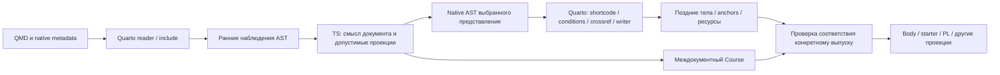

Подготовлено агентом. Направление принято пользователем 29 октября; точные API, поля и остальные детали примеров НЕ ПРИНЯТЫ.

# Ранний смысл курса в TypeScript: проект для рецензии

**Статус: направление принято 29 октября 2026 года, детали — проект.** После независимой рецензии пользователь прямо выбрал N (ранний штатный TS JSON-filter) и исполняемые TS-контракты без CUE, см. [пункт 35 плана](../../refactoring-plan.md#уже-принятые-решения-и-сохраняемые-требования). Это архитектурное решение, не план/разрешение продуктовой миграции. Прежние 34 решения сохраняются; независимая рецензия сама по себе не заменяет прямого принятия.

## Что именно предлагается проверить

Смысл задания и назначения должен определяться до того, как страница потеряла закрытые или условно скрытые ветви. Выбрана ранняя предметная часть в TS, общая для сайта и экспорта; Quarto продолжает читать, преобразовывать и рендерить сайт. Поздние native-тела, ссылки и ресурсы не подменяются выводами ранней модели.

Сравнение ниже сохранено как обоснование выбора **одной предметной логики**, а не двух моделей курса. Основной транспорт уже выбран — N; F не является путём по умолчанию:

- **N: штатный JSON-фильтр Quarto в выбранной фазе.** TS получает нативный Pandoc JSON, извлекает смысл и возвращает преобразованный AST; stdout содержит только AST.
- **F: узкий мост Lua facts/decisions.** Lua извлекает структурные наблюдения, TS принимает предметные решения, Lua применяет их к тому же живому AST. stdout вызванного TS содержит только ответ моста.

N использует готовый протокол и потенциально убирает больше собственного Lua-обхода. F сохраняет живые native-объекты, но требует собственного договора наблюдений, адресации и применения решений. Длительно живущий сервис, универсальный AST-framework и процесс на каждый узел не предлагаются.

База — [фактическая карта Core 8.3.0](lua-ts-pipeline.md), pin `3ccc9e81eb2fc297cd0f283a51e040f71572ce18`, Java `dd1a8a392c570e96a7d0a7e364aee345c800424a`. Источники и старые ограничения сохранены там. Следующие имена стадий и полей — **иллюстрации обязанностей**, не новая утверждённая схема/API и не переименование нынешних `Course`/`DocumentResult`/`Body`/`ProjectFact`.

## Стадии и момент принятия решения



Стрелка от ранней модели к `Course` не означает, что вся книга уже известна при обработке первой страницы. И стрелка к проекциям не означает один вечный общий DTO: каждый потребитель получает нужную проверенную часть.

| Момент | Решение | Кто владеет им в проекте дизайна |
| --- | --- | --- |
| Native metadata/reader | Какие файлы и профили действуют, как наследуются настройки, как раскрывается include | Quarto. TS не пишет свой YAML-merge, Markdown-reader или include-resolver |
| Ранний AST до потери ветвей | Признать декларацию; нормализовать difficulty/time/роль; проверить конфликт; связать решение; понять исходные slots | Предметная часть Core на TS; адаптер добавляет собственные поля/правила. N читает AST в TS, F передаёт достаточные структурные наблюдения |
| Ранняя проекция | Какие закрытые роли допустимы в student/full; какой публичный ответ и какие назначения допустимы по известной политике | Core. Это не повторное вычисление всех native условий `when-format`/`when-meta` |
| Поздний native проход | Что реально осталось после условий, какой HTML/JSON и anchor получились, где находятся ресурсы | Quarto/Pandoc плюс узкий сбор наблюдений Core/QRC. Ранняя модель не объявляет условное решение фактически публичным |
| Текущая междокументная сборка | Уникальность ID, существование участников, допустимость demonstration и выбранный состав работы | Core + явно активные владельцы контрактов, используя текущие ранние декларации и поздние свидетельства |
| Целевой выпуск | Body, файлы стартера, PL binding, печатный layout, состав сайта | Соответствующий владелец; общий учебный смысл не переписывается в каждом адаптере |

Сейчас похожие решения принимают `exercise-defaults.lua`, `native-document.lua`, `assessment.lua`, `visibility.lua`, `native-answers.lua`, а затем `release.ts`/CUE и поздний `preview.ts`. Перенести только `post.ts` недостаточно: там полная модель появляется после writer и только при `renderAll`. [Ранний порядок](../../../tasks/_extensions/Afonenko-Course-Tools/course-core/filter.lua#L37), [поздняя сборка](../../../tasks/_extensions/Afonenko-Course-Tools/course-core/entrypoints/post.ts#L13).

## Пример 1: reverse-array

### Авторский канон и ранний вход

Условие и учебные требования берутся из [одного нынешнего канона](../../../tasks/bank/arrays.qmd#L62). Этот дизайн не утверждает старые технические/отчётные хвосты окончательной прозой: их [редакторский аудит](../yaml-authoring-integration-20261027/task-condition-audit-20261028.md) сохраняется. Исходник, тесты и Gradle-файлы не переписываются.

Краткая QMD-форма ниже повторяет уже обсуждавшийся **предложенный** `.course-declaration`; установленный Core его не поддерживает. Тело условия здесь лишь обозначено, а не копируется автором второй раз. Inline/include равноправны; отдельных страниц каждой задачи нет.

````qmd
:::: {#exr-arrays-reverse-array}
## Элементы массива в обратном порядке

```{.yaml .course-declaration}
difficulty: introductory
project: /projects/arrays/reverse-array
```

<!-- Здесь единственное полное условие, inline либо native include. -->
::::
````

Native effective metadata банка может содержать уже существующие значения:

```yaml
exercise-bank: true
default-exercise-target: prairielearn
default-exercise-statement-visibility: open
course:
  view: student
  adapters: [prairielearn]
```

Это иллюстрация доменных значений, не перенос всего project `_metadata.yml` в scope банка. Единственный локальный `_metadata.yml` кодового проекта и native-наследование сохраняются; технический мост к QMD, происхождение значений и две базы путей остаются отдельными доказательствами. Из одного `project:` нельзя вывести, что Quarto автоматически унаследовал metadata соседнего каталога.

Для N входом будет обычный Pandoc JSON. Сокращённый узел показывает только важные места, не полный исполняемый документ:

```json
{"t":"Div","c":[["exr-arrays-reverse-array",[],[]],[
  {"t":"Header","c":[2,["",[],[]],[{"t":"Str","c":"Элементы массива в обратном порядке"}]]},
  {"t":"CodeBlock","c":[["",["yaml","course-declaration"],[]],"difficulty: introductory\nproject: /projects/arrays/reverse-array"]}
]]}
```

Для F Lua передаёт исходные атрибуты/metadata, структуру контейнера, первый Header, текст служебного блока и идентичность узлов этого снимка; **не** уже вычисленные `purpose`, slots или публичность. Иначе предметная модель останется в двух языках. Обычные абзацы и неизвестные native-узлы остаются в живом дереве. Структура нужна не только как плоский список ID: она сохраняет вложенность, порядок и принадлежность решения/заметок. В частности, scope контейнеров и положение Header нужны для ближайшей темы; одного parent exercise ID недостаточно для списков, таблиц, Note и соседних одинаковых контейнеров ([нынешняя lineage](../../../tasks/_extensions/Afonenko-Course-Tools/course-core/native-document.lua#L31)).

Общий результат предметной функции на TS для обоих путей может выглядеть так; названия полей иллюстративны:

```ts
{
  source: "bank/arrays.qmd",
  exercise: {
    id: "exr-arrays-reverse-array", difficulty: "introductory",
    target: "prairielearn", statementVisibility: "open",
    project: "/projects/arrays/reverse-array"
  },
  publicSolution: { state: "absent" },
  pending: ["native-body", "resource-observation"]
}
```

TS нормализует значения **до** удаления служебного блока и закрытых частей; отсутствие решения не превращается в фиктивный `hasPublicSolution`. Если local difficulty конфликтует с другим объявлением или неизвестный ключ не принадлежит активному адаптеру, отказ должен содержать source/ID/field, а не только ошибку JSON.

### Что получает каждая сторона после native прохода

| Результат | Нужная гарантия |
| --- | --- |
| Сайт | Native Quarto рендерит тот же смысл; служебный YAML не показывается как учебный пример. Необязательный demo не вставляется целым файлом по умолчанию |
| Позднее публичное тело | Связано с тем же exercise ID и конкретным native-выпуском; содержит уже разрешённый текст, а не ранний нераскрытый shortcode |
| README | Получает полное публичное условие и ресурсы из проверенной проекции; добавляет технический запуск. Не копируется вручную из QMD и не получается простым writer без обработки anchors/resources |
| Student IDE | Один канонический starter для Pages/PL: `src/main/java/Main.java`, выбранные явные demo/нужные helpers, обычные Gradle-файлы и README; это файловая ветвь inventory, не конверсия Body в Java-проект |
| Ответ PL | `Main.java` при нынешнем source-profile root; форма ответа независима от глубины IDE/selfcheck. Полный starter ZIP не становится автоматически Java-only answer ZIP |
| Author-full | Свои тесты/решения и отдельные контексты исполнения; не публичная проекция и не объявленное доказательство полноты grader |

Ранний смысл связывается с поздним результатом через уже существующие source/ID/формат/профили/текущий NativeRun и входные свидетельства. Узел в F дополнительно относится к **конкретному AST-снимку**: ID задания не является уникальным адресом каждого безымянного блока. Изменённый AST нельзя принимать со старым решением. Hash/handle доказывают тождество снимка, но не корректность решения и не наличие прав на ресурс.

## Пример 2: работа с fixed/choice и условным решением

Это **синтетический структурный пример**, а не новая работа Java, перераспределение баллов или изменение существующего задания. Имена `exr-review-demo`/`sec-review-work` обозначают только контекст рецензии; новые учебные условия/эталоны не создаются. Fixed/choice-форма основана на [нынешнем выборе](../../../tasks/labs/polymorphism.qmd#L44) и [разборе slots](../../../tasks/_extensions/Afonenko-Course-Tools/course-core/assessment.lua#L46).

В одном банковском QMD есть открытый пример с ролью demonstration и вложенное решение под native условием. Его тело обозначено, чтобы не писать новое учебное решение:

````qmd
::: {#exr-review-demo difficulty="introductory" course-role="demonstration" statement-visibility="open"}
## Разобранный пример
<!-- Существующее условие структурного fixture. -->

:::: {.solution}
::::: {.content-visible when-format="html"}
<!-- Существующий фрагмент решения структурного fixture. -->
:::::
::::
:::
````

В другом QMD native metadata определяет `assessment.kind: lab`, а списки задают назначения. ID работы намеренно явный, чтобы не смешивать проверку границы с нынешними fallback ID из заголовков:

````qmd
---
assessment:
  id: sec-review-work
  kind: lab
---
# Работа для проверки дизайна

::: {.task-items stage="demonstration"}
1. @exr-review-demo
:::

::: {.task-items stage="homework"}
1. @exr-arrays-reverse-array
1. [@exr-arrays-subtract-array-average; @exr-arrays-sort-matrix-rows]{.task-alternatives #alt-review-array-choice selection="choice" requirement="required"}
:::
````

Точная семантика `choice` сохраняется: одна позиция с двумя кандидатами и самостоятельным выбором, не два обязательных fixed-задания. Defaults `requirement=required`, `workMode=individual` назначает предметная часть; внешний `stage` относится к контейнеру, не к кандидату. Иллюстрация TS-данных, без второго формата для авторского заполнения:

```ts
[
  { id: "exr-review-demo", selection: "fixed", candidates: ["exr-review-demo"],
    assignment: { stage: "demonstration", requirement: "required", workMode: "individual" } },
  { id: "exr-arrays-reverse-array", selection: "fixed", candidates: ["exr-arrays-reverse-array"],
    assignment: { stage: "homework", requirement: "required", workMode: "individual" } },
  { id: "alt-review-array-choice", selection: "choice",
    candidates: ["exr-arrays-subtract-array-average", "exr-arrays-sort-matrix-rows"],
    assignment: { stage: "homework", requirement: "required", workMode: "individual" } }
]
```

### Два независимых вопроса о решении

1. **До native условий:** имеется корректно связанный solution, политика разрешает его публичную проекцию: задача open и purpose demonstration. Это кандидат, а не факт появления в выходе.
2. **После native условий:** решение действительно осталось в выбранном формате/профилях. Для HTML fixture — ожидается; для другого формата ветвь может отсутствовать. Наличие исходного solution не позволяет автоматически поставить `hasPublicSolution: true`.

Если работа требует demonstration, общая проверка должна увидеть фактическое публичное решение в **этом выпуске**. При отсутствии — предметная ошибка с указанием работы/задачи и причины, а не тихая подмена роли или выдача полного решения. Нынешняя политика demonstration не ослабляется; формат, где отсутствует solution, нельзя объявить успешно квалифицированным по одному early snapshot. Точное представление промежуточного состояния и момент сообщения остаются частью проверки дизайна.

| Что проверяется | Ранняя стадия | Поздняя/междокументная стадия |
| --- | --- | --- |
| Синтаксис позиции и choice→required | Проверить структуру `task-items`, defaults, distinct candidates и недопустимую вложенность | Подтвердить соответствие выбранным декларациям |
| Существование участника из другого QMD | Сохранить reference/source, не угадывать URL или читать старый sidecar | Найти декларацию в текущем выбранном составе; отсутствующий участник — ошибка release |
| Открытость/роль demonstration | Проверить известные локальные декларации; чужая декларация пока неизвестна | Проверить open + demonstration + фактически публичное решение |
| Видимый текст ссылки | Сохранить Cite для Quarto, не строить собственную подпись | Использовать native resolved link/anchor; QRC отвечает за межпроектную адресацию |
| Ресурс внутри условного решения | Не считать ресурс публичным только по наличию в исходнике | Упаковать только ресурс фактически допустимой проекции и сохранить source/effective base |

## Неполный preview и собранный Course

Одна страница может дать проверенный локальный результат без полной модели книги. Но она не доказывает отсутствие внешнего участника, его публичность или состав всех работ. Поэтому состояния «локально проверено», «ожидает чужую декларацию/native факт» и «release проверена» должны различаться в контракте, а не кодироваться одним безусловным `valid: true`.

Это не новая политика preview: при неизвестном внешнем состоянии сохраняется нынешняя осторожная выдача, без подстановки старой модели. Неподтверждённое назначение нельзя выдать как доказанно публичное. Native Quarto может разрешить ссылку, а поздний Core — показать только членство, подтверждённое текущими facts; нынешний defer/native HTML механизм сохраняется, пока не доказана его более простая замена. [Текущий defer](../../../tasks/_extensions/Afonenko-Course-Tools/course-core/visibility.lua#L184), [native HTML и общая карта](../../../tasks/_extensions/Afonenko-Course-Tools/course-core/entrypoints/preview.ts#L77).

Для полной текущей сборки агрегатор проверяет уникальность и ссылки по всем выбранным источникам. Для выборочного экспорта — по явно выбранной замкнутой области операции; «нет во всей книге» нельзя выводить из выборки. Release не становится кэшем вечной истины, а native witness нельзя переиспользовать после изменения его действительных входов.

## Сопоставление транспортов на обоих примерах

| Граница | N: native phase TS JSON-filter | F: Lua facts/decisions |
| --- | --- | --- |
| Вход | Полный Pandoc JSON данного прохода, metadata и явный native-контекст | Наблюдения текущего AST, raw metadata/attrs, вложенность/порядок/принадлежность, исходные payload служебных блоков и context |
| Где распознаётся course-конструкция | TS-адаптер Pandoc AST; без собственного Markdown AST | TS по наблюдениям; Lua не вычисляет difficulty, role, slots или visibility policy |
| Возврат | Только корректный Pandoc JSON в stdout; stderr для диагностики; facts записывает один владелец текущего run-output | Typed решения с привязкой к снимку и адресуемым узлам; Lua применяет только разрешённые course-операции, не универсальный patch-language |
| Reverse-array | Извлечь declaration block, нормализовать, убрать служебный ввод из видимого тела, сохранить неизвестные ordinary/native nodes | Передать block/структуру; вернуть нормализованный смысл и конкретные действия удаления/представления, применить к тем же узлам |
| Работа | TS читает task-items/Cite/Span и строит slots; native ссылкам сохраняет путь к дальнейшей обработке | Lua передаёт форму списка и атрибуты, TS строит те же slots; Lua применяет допустимый отбор, не собирает slots повторно |
| Conditional solution | Сохранить native условные контейнеры вокруг допустимого solution; позднее подтвердить факт | Сохранить живые контейнеры и применить только policy-решение; позднее тот же факт |
| Что может уйти | Lua domain extraction/projection и значительная часть ручного транспорта AST; остаётся нужная интеграция native-контекста/late capture | Lua domain rules, но structural extractor/handles/decision applier и протокол остаются собственной поддерживаемой частью |
| Основной риск | Сохранность custom nodes, metadata/context, API-version и порядка остальных фильтров на реальном pipeline | Неполные observations превращают Lua в скрытого владельца смысла; устаревшие handles/двойное применение/слишком общий протокол |

Не нужен второй реестр зависимостей: course composition по-прежнему выбирает компоненты и объявленное замыкание, Gradle владеет внешними библиотеками/версиями/tasks. Ни один из этих транспортов не должен выводить demo-файлы автоматически по Java imports.

## Что останется, уйдёт или объединится

Это карта кандидатов при доказанной эквивалентности, не разрешение удалять перечисленные файлы.

| Нынешняя часть | Кандидат изменения | Сохраняемая гарантия и условие удаления |
| --- | --- | --- |
| `exercise-defaults.normalize` + повторные metadata checks | Общая TS-нормализация документа; N извлекает сам, F поставляет raw observations | Native inheritance, совместимость старых имён, conflict diagnostics, числовые границы. Старую ветвь убрать только после одинаковых результатов/отказов |
| `native-document.validate` + `pedagogy.collect` | Собрать предметную часть/таблицу принадлежности; технический traversal зависит от N/F | Ошибки скрытых ветвей до проекции, вложенность/ближайшая тема, pairing и source. Не потерять объявления внутри native контейнеров |
| `assessment.collect` и semantic-ветви `release.ts` | Разбор AST отдельно; единые TS-инварианты slots с локальным/глобальным контекстом | Choice не становится fixed; разные scopes проверки не ошибочно считаются повтором одного входа |
| `visibility.prepare` / `grading.prepare` | Перенести course policy в TS, native применение оставить в выбранном транспорте | Ключи/заметки не доходят в student; скрытые авторские ошибки всё ещё проверяются. Native conditional engine не переписывается |
| `native-answers` и TS fallback | Один владелец нормализации/публичного ответа с явным ранним входом | Сохранить accepted/rejected **и нормализованный output**, multipart/matching/single-choice; не удалить ранний отказ до проекции |
| `exercises.collect` + `bodyJson` transport | Переиспользовать уже вычисленные facts; late bodies связать с ними, а не повторно выводить смысл | Одинаковая identity, публичная/полная форма, Pandoc API и порядок. JSON parse транспорта сам по себе не является плохим дублем |
| `preview` solution witness / native deferred assignments | Пока оставить поздние наблюдения; уменьшать только после доказательства, какие решения могут быть ранними | Фактическая видимость и точные native ссылки. Удаление позднего маркера не заменяется предположением «solution был в QMD» |
| `output` / `native-run` / resource capture | Сохранить владельцев эффектов и currentness; отделить от чистой модели | Только текущий успешный набор документов/ресурсов, временные файлы/восстановление; один writer facts, не пара Lua/TS sidecar-writers |
| `collectExport` late AST replacement / Body partition | Общая проверенная prepared-condition граница и явная поздняя стадия | Shortcode/anchors/resources, public/full разделение, независимый вход адаптера. Сам отдельный native export pass не удаляется обещанием TS |
| Core conditions→Download ZIP→Publisher HTML→AST→HTML→ZIP | Исследовать один prepared-condition + поздний QRC binding + финальный writer/ZIP | Publisher знает final composed pages, QRC — адреса, Download — ZIP. Нельзя удалить проверку anchor/дрейфа как «лишний проход» |

## Владельцы, CUE и ошибки

Неизвестный авторский ключ и дополнительное поле ответа производителя — разные границы. Авторский ввод проверяется по своему контракту/namespace активного владельца; допустимое добавочное поле результата не должно автоматически отвергаться только потому, что авторская схема закрыта. Нужные возможности/несовместимая версия проверяются явно; отсутствие нужного поля не прикрывается расширяемостью. Это не выбор одной универсальной closed-schema для всех сообщений.

Core владеет учебными сущностями/связями и допустимыми проекциями. PL владеет своим grading/submission/runtime binding; Cloud — VM/action правилами; QRC — адресами/ссылками; Download — архивированием; Publisher — составом опубликованного сайта. Перенос в TS не означает перемещение всех владельцев в Core. Адаптерные декларации требуют своих typed readers/проверок и включаются только явно.

Целевое решение исключает CUE во всех рассмотренных расширениях, включая dev/reference-схемы. Один TS-канон владельца задаёт форму, нормализацию/defaults и runtime-проверки, TS-типы выводятся/генерируются из этого исполняемого канона; если нужен отдельный интерфейс, его согласованность проверяется автоматически, без второго вручную поддерживаемого описания той же формы. Параллельных ручных CUE/TS определений не остаётся. Выбор конкретной исполняемой библиотеки/публичных сигнатур ещё открыт. Нынешние CUE-схемы и опыты — текущая реализация/эталон эквивалентности до переноса, а не постоянный fallback или двойной целевой валидатор. Перенос обязан сохранить ограничения, activation, accepted/rejected, нормализованные outputs, диагностику/причины отказов и public/full. Удаление CUE-инструмента, вызовов, CI/dev-схем и производных CUE-выходов словаря входит в будущую миграцию, сейчас не выполняется. [Историческое исследование](cue-typescript-validation.md).

| Отрицательный пример | Требуемое поведение |
| --- | --- |
| Неподдерживаемое поле declaration/неактивного adapter | Ранний отказ с source/ID/field; не молчаливое удаление unknown key |
| `choice` с optional или повторным кандидатом | Локальный отказ до writer; не исправление задания агентом/экспортёром |
| Участник отсутствует в выбранном release | Междокументная ошибка с related source/ID; не ложный локальный отказ первой страницы |
| Demonstration имеет solution, но native условие скрыло его | Release не подтверждена; не выдать ключ/полное решение для компенсации |
| Решение F относится к старому AST-снимку | Отказ применения/новое вычисление в том же корректном lifecycle; не поиск узла по одному suffix |
| Ресурс/anchor отсутствует или input изменился | Ошибка конкретного выпуска, не ошибка авторской семантики; не публиковать частичный артефакт как готовый |
| TS launcher отсутствует, процесс упал или ответ невалиден | Отдельная ошибка инструмента/протокола; не объявлять учебные данные неверными и не продолжать с сырым непроверенным AST |

Source/range и происхождение metadata не возникают из TS-типов. Если native API не даёт точную строку/последний определивший YAML, диагностика не выдумывает их: source/ID/field остаются точными, а недоказанная provenance явно ограничивается. Обработка двух баз путей не делегируется эвристике «строка похожа на путь».

## Минимальный демонстратор и свидетельства

**Что уже подтверждено:** фактический Core pipeline и отдельные native/CUE эксперименты из исследования. Новый дизайн не выдаётся за реализованный целый проход. Штатная возможность [phase-targeted JSON-фильтров](https://quarto.org/docs/advanced/quarto-ast.html#targeting-of-ast-processing-phases) и механизм [Pandoc filters](https://pandoc.org/filters.html) позволяют исследовать N без нового reader/renderer. Доступность `pandoc.pipe` и нынешний `output.bound_materialization` подтверждают технический путь F, но общего document semantics protocol ещё нет.

### Новое малое свидетельство 29 октября

В отдельном изолированном native-проекте закреплённый Quarto 1.11.5 выполнил baseline, identity TS JSON-фильтр `pre-ast` и identity `post-quarto`: три выхода HTML побайтно одинаковы, SHA256 `c0e47cf2a92843c13e23a033739443c0a95890f42d6fa361be1363eea729bb04`. В каждом фильтрованном проходе был один вызов на документ. Include/meta-shortcode, exr/solution, callout, profile/format conditions, внутренние anchors и SVG участвовали в опыте. Четвёртый маленький pre-ast проход перенёс значение существующего `course-role` в один `data-probe-role`; после удаления только добавленной метки HTML равен контролю. Это доступность штатного механизма и одного ограниченного изменения, не реализация вышеприведённой предметной функции.

Наблюдения различили фазы: рано include уже раскрыт, shortcode ещё служебный Span, crossref ещё Cite, скрытая ветвь присутствует; поздно они преобразованы, а часть узлов представлена custom-scaffold. В позднем JSON exr ID уже нельзя искать только как обычный Div ID, хотя writer восстанавливает ожидаемый HTML anchor. Значит late capture должен иметь доказанную привязку, а не повторно угадывать все сущности по форме раннего AST.

Первичная попытка 28 октября действительно остановилась на baseline `Deno.openKv`/sass-cache **до** фильтра. Новая разрешённая проба использовала только task-local `XDG_CACHE_HOME`, предусмотренный [pinned native appdirs](https://github.com/quarto-dev/quarto-cli/blob/87d1078002991c4ba9cc2baa1f401a80402148af/src/core/appdirs.ts#L140), без смены глобальных настроек. Свидетельства: `/tmp/java-native-json-filter-20261029-pfouja7a/{RESULT.md,summary.json,semantic-summary.json,_evidence/}`. Старое свидетельство не переписано. Не проверены другая целевая страница ссылки, чистая пересборка ресурсов, все custom nodes/форматы и полный Java; из сохранённого `other.qmd#sec-other` нельзя вывести корректность опубликованного междокументного URL.

**Выбранный транспорт — N; состав следующего демонстратора остаётся предложением.** Основной ранний штатный JSON-filter принят пользователем, новый facts/decisions-мост F не выбран по умолчанию. Если выявится native-ограничение, сначала требуется предметно проверить необходимую тонкую Lua-адаптацию и только затем отдельно обосновывать иную границу; собственный мост не возникает автоматически. Успех малого identity не доказывает, что N уже заменяет Core.

**Первый исполняемый демонстратор — только N:** один изолированный native-проект с двумя входными QMD, одним include/ресурсом и приведённой работой. После уже выполненного identity-control проверить ограниченное предметное изменение с явным ожидаемым результатом, нормализованные факты/отказы и поздние native-наблюдения. Проверить student/full, HTML и формат без условного решения, затем одиночный preview и весь выбранный состав. Native HTML/anchors/resource bytes сравниваются с контролем отдельно от TS-данных. Только tiny fixture, без миграции курса, серверов и обещаний производительности.

**F пока сравнивается на уровне проекта** по тем же учебным и native-гарантиям, включая необходимость привязки решения к снимку. Исполняемый протокол F не выбран; существенное ограничение N может стать основанием отдельного рассмотрения, а не автоматического внедрения F. Подготовка F не является условием первого демонстратора N. CUE negative corpus и существующие regression tests — источники ожидаемых гарантий, не автоматически пройденный suite.

**Пока не доказано:** перенос всего действующего Core filter без расхождений, custom-node roundtrip для всей нужной поверхности, origins/typed paths кодового проекта, полный README с произвольными ссылками/ресурсами, поведение всех адаптеров, Windows/launcher, recovery и измеренная цена процесса. Эти ограничения не требуют выбирать внутренние ключи пользователю; автор оценивает понятность результата и сохранение своих учебных обязательств.

**Вопросы независимой рецензии:** не теряется ли смысл до late capture; не перенесён ли Quarto resolver в TS; достаточна ли структура F без скрытой Lua policy; чем доказываются full/student/partial guarantees; какие удаления действительно сохраняют гарантию; оправдан ли собственный протокол перед готовым native JSON-filter. Это рецензия проекта, не одобрение реализации.

## Рецензия дизайна

29 октября выполнена независимая техническая рецензия полного проекта и требований: существенных замечаний P1 нет; найден один P2. В прежнем описании минимальная проверка требовала исполняемый F, хотя рекомендация предлагала сначала N, а F — при выявленном ограничении. Это неявно делало собственный мост обязательным.

Замечание исправлено адресно: первый исполняемый демонстратор ограничен N; F пока сопоставляется как проект и не блокирует его. Исполнение F условно, как указано выше. Узкая повторная проверка подтвердила закрытие P2: PASS, проект готов для обсуждения и дальнейшего планирования; остальные разделы не расширялись. Рецензия проверяет качество проекта, не означает принятия дизайна пользователем и не разрешает реализацию курса.

## Прямое решение после рецензии

29 октября пользователь принял направление N и исключение CUE из целевой модели. Это отдельное прямое решение после технического PASS, а не одобрение, выведенное из рецензии. Рекомендация сохранять CUE как целевой вариант заменена; текущие схемы сохраняют роль исторического/переходного эталона. Точные примерные ключи, transport/context детали, API, runtime-библиотека TS и реализация не утверждены; переход к коду/CI требует следующей фазы.
