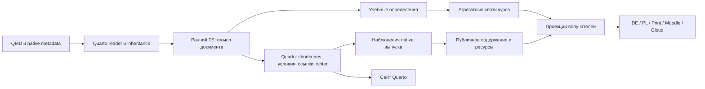

Подготовлено агентом; пользователь не просматривал. Новые контракты, варианты и рекомендации НЕ ПРИНЯТЫ.

# Целевая архитектура курса и расширений

**Уточнение объёма 29 октября, [решение 69](../../refactoring-plan.md#decision-69): Print и Cloud исключены из текущего поручения, включая специальные контракты/модели, экспорты и проверки. Их описание ниже — прежнее исследование, не проектирование «назапас» и не обязательный следующий этап. Текущие получатели — Pages/PL/IDE и действующая Moodle/Gateway-связь; репозитории/исходники не удаляются.**

Проект от 29 октября 2026 года, Europe/Minsk. Это часть одного исследования новой системы, не разрешение реализации. Прямые решения сохраняет [основной план](../../refactoring-plan.md#уже-принятые-решения-и-сохраняемые-требования); последние уточнения 35–56 имеют приоритет над ранними рекомендациями и действующим кодом. Названия типов, операций и каталогов ниже — эскиз проектировщика.

## Главное для разговора

Предлагается небольшой учебный центр с ясными получателями. Core понимает документы, упражнения, состав работ и файловых проектов. Он не становится исполнителем Java/Git, системой сборки Gradle, каталогом виртуальных машин или новым Quarto. Владелец конкретного получателя хранит его договор и проверяет свои данные. Сайт по-прежнему строит Quarto; Print, Moodle, PL и IDE получают необходимые результаты общего разбора, а не независимо разбирают условия заново.

Нужно разделить **описание курса**, **факты конкретного выпуска Quarto** и **результаты для получателя**. Это устраняет ложное равенство «объект правильной формы = текущий доказанный выпуск». Предварительный просмотр одного документа не знает весь курс; файл комплекта не доказывает прохождение тестов. Старые Body/pointer не ограничивают новую форму, но защищавшиеся ими нужные гарантии остаются.

Кандидат технической основы: ранний штатный TS JSON-filter; исполняемые TS-схемы владельцев с выводом типов; обычные семантические функции над проверенными данными; узкая native-адаптация там, где нужны живые узлы Quarto. Для форм предлагается оценить Zod 4, без выбора версии сейчас. Новые сервер, демон, общий оркестратор расширений и свой язык описания тестов не требуются.

| Область | Принято пользователем | Предложено здесь | Основание / что не проверено |
| --- | --- | --- | --- |
| Магистраль | Quarto/Pandoc + TS, сайт рендерит Quarto, CUE исключён из цели; старые API не поддерживаются обязательно | Разделить учебные определения, native-наблюдения и проекции | Пункты 34/35/54; полный новый проход не реализован |
| Автор | Структура bank/projects, один локальный `_metadata.yml`, native inheritance, разные базы путей | Типизированные операции происхождения/состава с отказом при неустановленной базе пути | Пункты 21/23/25/45–48; малый native-кандидат работает для scalar/map, общая операция и массивы не доказаны |
| Контракты | Исполняемый TS-канон по владельцам, типы выводятся, нет второго ручного описания формы | Zod 4 + предметные функции, отдельные формы входа и нормализованного выхода | Официальная документация, прочитана 29 октября; запуск внутри закреплённого Quarto не проверен |
| Проверка | Обычный JUnit/Gradle, 80/20, равные оценочные тесты, только достоверный полный результат | Проверяющий результат принадлежит Platform, а не общему Course | Пункты 32/36/37/49/52/53; точный транспорт и исполнение требуют квалификации |
| Репозитории | Владельцы и публичные интерфейсы, отсутствие обязанности старой совместимости | Самостоятельные пакеты по обязанностям, без обязательного нового общего пакета | Карта установленных владельцев; целевая раскладка не утверждена |
| Качество и стоимость | Форматирование, lint/types, чистка по гарантиям, три уровня проверки | Один адресный маршрут изменения и доказательства, ограниченное переиспользование завершённых результатов | Пункты 39–41; старые измерения не измеряют новый дизайн |

## 1 Минимальный словарь без всеобщей модели

Предлагаются четыре учебных определения. Остальные строки таблицы — значения, наблюдения или результаты, а не новые равноправные учебные сущности.

| Понятие | Что означает | Чего в нём нет |
| --- | --- | --- |
| `DocumentDefinition` | Документ учебной формы, его источник, порядок и вложенность содержательных узлов, объявления и ссылки | Выполнения JUnit, готового ZIP, доказательства опубликованного URL |
| `ExerciseDefinition` | Идентичность упражнения, каноническое условие, необходимые учебные ограничения, связь с ответом/проектом | Балла конкретного студента, выбранного слота конкретной сдачи, принудительного Java-профиля для всех задач |
| `AssessmentDefinition` | Работа и упорядоченные слоты: fixed/choice, кандидаты, обязательность и учебный этап | Копий Exercise на каждый вариант; развёртывания choice в несколько обязательных заданий |
| `ProjectDefinition` | Код/данные задачи, объявленные наборы тестов, выбранные компоненты, эталоны и формы выдачи | Графа Maven-зависимостей, Gradle tasks, контейнерного допуска и состояния студенческого Workspace |
| Значения внутри определений | Слот, назначение, ссылка, источник значения, описание принимаемого ответа | Отдельных глобальных сервисов на каждый вид значения |
| `CourseDefinition` | Завершённый каталог этих определений и проверенных междокументных связей | Второго тела каждого упражнения, изменяемого состояния всех запусков, произвольных полей всех адаптеров |

Теория, объяснение, доказательство, решение, notes и другие педагогические роли сохраняются в дереве содержимого документа. Они не превращаются в отдельный репозиторный объект/класс с собственным жизненным циклом только ради общего реестра. Содержательная ссылка может адресовать такой узел; адрес страницы даёт QRC.

Идентичность определения, конкретное появление в документе и место в работе различаются. Вложенный solution принадлежит своему упражнению; порядок fixed/choice и ближайшая тематическая область сохраняются. Название класса TS не определяет авторский синтаксис. Ответ может не иметь файлового проекта: обычная ручная или предметная задача не получает фиктивный Gradle/Java-контракт.

**Основание нынешнего кода.** [Course/Exercise/Assessment/ProjectFact](../../../tasks/_extensions/Afonenko-Course-Tools/course-core/domain/model.ts#L3) уже различают существенную часть понятий, но смешивают определение, Pandoc-body и данные запуска. Это материал для выверки гарантий, не обязательная целевая схема. Новая модель не обязана повторять `Fragment`, `DocumentResult`, `bodyJson` и прежний pointer.

## 2 Три слоя данных и два разных запуска



1. **Описание.** Значения наследует Quarto; TS декодирует авторский контракт, задаёт предметные defaults и проверяет ссылки в доступной области. Нормализованные определения не зависят от того, куда позднее записан HTML.
2. **Native-выпуск.** Input, root, профили, формат, версии инструментов, реально обработанный Pandoc AST, установленные ссылки/якоря и ресурсы относятся к конкретному проходу. Исходное объявление публичного решения и факт его присутствия после native conditional content — разные сведения.
3. **Проекция.** Условие для студента, авторский комплект, native PL, печатная работа, Moodle XML или Cloud-план выбирают нужное из первых двух слоёв. Это не десять копий общего Course.

`NativeBuild` и `AssessmentRun` — разные процессы. Первый производит документ/комплект; второй исполняет доверенные предметные проверки решения. Успех первого не создаёт балла. `AssessmentRun` принадлежит Platform и адаптеру результата; Core не хранит в Course текущие студенческие сдачи.

Внутри процесса структурированные значения могут быть неизменяемыми представлениями общего снимка. На файловой/процессной границе передаётся проверяемый JSON с явной схемой и идентичностью входов, а не сериализованная способность читать любой файл. Бренд TS не заменяет проверку актуальности и допустимых путей.

## 3 Стадии, полнота и момент принятия решений

| Стадия | Вход → выход | Владелец / гарантия |
| --- | --- | --- |
| Контекст источника | Выбранные input/profile/metadata → штатный контекст и raw/effective сведения | Quarto + узкая техническая интеграция; не собственный YAML merge |
| Ранний проход | Pandoc JSON + доступные effective свойства → типизированный план документа и допустимые изменения AST | Core и активные предметные владельцы; defaults, роли, локальная структура слотов, явные авторские противоречия |
| Native-преобразования | Изменённый штатный AST → shortcodes/conditional content/crossref/layout/writer | Quarto/Pandoc; ранний TS не вычисляет их повторно |
| Позднее наблюдение | Текущий native результат → привязка появлений, публичное тело, ресурсы и реальные адресные свидетельства | Core собирает содержание, QRC адреса; необходимая Lua остаётся технической |
| Агрегация | Все входящие в выбранный полный состав определения → уникальность ID, ссылки, назначения, конфликты активных владельцев | Core + предметные функции владельцев; неполная выборка не выдаётся за полный Course |
| План выдачи | Проверенные определения + позднее содержание + объявленное замыкание файлов → состав конкретного получателя | Core и адаптер; ещё без публикации и выполнения студенческого кода |
| Запись и приёмка | План → файлы/архив/native export → проверка состава и нужного исполнения | Получатель, Download/Publisher/Platform по обязанностям; статус не повышается одним exit 0 |

Ранняя проекция скрывает преподавательские части до студенческого writer; приватность не откладывается до анализа готового публичного HTML. Одновременно ранний план сохраняет декларативный смысл, который native условие может убрать из конкретного представления. Для `publicSolution` нужны поздние положительные сведения о данном представлении, а не только `hasSolution` в исходнике.

Точное связывание ранних появлений с поздними native-узлами — обязательство демонстратора. Нельзя сопоставлять по совпавшему тексту или считать исчезновение plain Div-ID доказательством исчезновения упражнения: Quarto преобразует пользовательские узлы. Возможный тонкий late-capture использует живые native API; новый основной facts/decisions мост ради всех доменных правил не вводится.

**Частичный preview.** Разрешён локальный результат документа с явным перечнем ещё не разрешённых внешних связей. Это не разрешение молча пропустить неизвестную ссылку: UI/отчёт различает локальную проверку и полную приёмку. Полная публикация требует всех необходимых определений и адресных результатов. Восстановленный старый каталог может использоваться только при проверенной актуальности его входов, не как скрытый «полный PASS».

Не обещается один native-проход для всех форматов и экспортов. Штатный JSON-filter в живом HTML-проходе не требует отдельного предварительного сайта; экспорт иного формата может потребовать другого штатного прохода. Каждый повтор должен иметь необходимый новый вход/результат, а не запускаться для каждой ссылки или каждого упражнения. Неподтверждённого API «продолжить любой сохранённый AST как полный Quarto-сайт» в проекте нет.

**Факты фаз.** В закреплённом Quarto 1.11.5 [main.lua:711](https://github.com/quarto-dev/quarto-cli/blob/87d1078002991c4ba9cc2baa1f401a80402148af/src/resources/filters/main.lua#L711) ранняя точка предшествует native-преобразованиям, поздние точки следуют после них; AST post-render не равен файловому project post-render. Датированный малый JSON-filter опыт изложен в [дизайне 29 октября](../open-topics-20261028/lua-ts-design-review.md): три identity HTML равны и одна ограниченная TS-правка сохранена. Это не квалификация всей Java, произвольного custom AST или других форматов; исходный `/tmp` этого опыта сейчас недоступен, новый прогон здесь не заявлен.

**Новый конкретный кандидат происхождения значений.** В служебной копии источников рядом с неизменными авторскими значениями помещается отдельное дерево числовых ID их объявлений; обе структуры объединяет сам Quarto. Так не воспроизводится его merge и не выбирается источник по совпадению значения. В [шести inspect 29 октября](examples/authoring/native-origin-shadow-summary.json) baseline/shadow дали одинаковые effective owner-values: для scalar/map установлены родительское объявление одинаковой строки пути, независимый источник соседнего поля, переопределение профиля и локальный `demo:false`. [Скрипт](examples/authoring/native-origin-shadow-probe.py) сохраняет воспроизводимость, [пределы описаны в авторском приложении](authoring-and-pipeline.md#54-конкретный-origins-кандидат-служебное-дерево-объединённое-quarto).

Контрпример массива дал один effective элемент и два marker ID из-за native dedup; значит, это **не общий per-element origin API**. `metadata-files`, front matter, aliases, несколько профилей и смена формы поля ещё не квалифицированы. Служебное дерево не становится авторским вводом/публичным DTO и удаляется перед owner decode/выдачей. Сопоставление baseline/shadow — доказательство малого опыта, не обязательный вечный двойной inspect каждого проекта. Точная операция работает в пакетном служебном контексте выбранного владельца; цена и полнота этого контекста пока неизвестны. Отдельные [два inspect](examples/authoring/native-context-summary.json) подтверждают допустимый input/default-профиль в малом BOOK-примере, а не готовый bridge рабочего курса.

## 4 Исполняемый канон TypeScript

Предлагаемый конкретный путь — стандартная runtime schema-библиотека для формы/вывода типов и обычные чистые функции для предметной семантики. Типы входа до defaults и нормализованного выхода могут различаться. JSON Schema для редактора выводится только для представимого подмножества; она не становится вторым ручным каноном или доказательством межобъектных правил.

Иллюстрация, не готовый API:

```ts
const ExerciseInput = z.strictObject({ /* авторская форма */ });
const ExerciseValue = ExerciseInput.transform(normalizeExercise);
type ExerciseSource = z.input<typeof ExerciseValue>;
type Exercise = z.output<typeof ExerciseValue>;
// validateCourseReferences(...) проверяет ссылки уже проверенных определений.
```

Для авторских ключей неизвестное поле — адресная ошибка. Обычный `z.object` с удалением неизвестных полей не эквивалентен такому отказу. Для технического ответа допустимые дополнительные поля определяет его владелец; это другой договор, не автоматическое применение закрытой авторской схемы ко всем сообщениям.

У каждого владельца один исходник формы, defaults/нормализации и runtime-проверки; статические типы выводятся из него. Если внешний интерфейс описан отдельно, согласованность проверяется автоматически, а не поддерживается второй ручной копией. Динамические связи, уникальность ID, согласованность слотов, public/full, объявленные зависимости и пределы файлов проверяются исполняемыми функциями там, где для них есть данные. Их не нужно вычислять рекурсивными условными типами TS.

`unknown` разрешён при входе внешнего JSON, ошибке процесса и динамической загрузке. Перед дальнейшим использованием его декодирует владелец. Общая модель, публичные операции и результаты не возвращают `any`, `Record<string, any>` или «проверенный» объект после одного `as`. Используются различимые формы стадий/результатов и исчерпывающий разбор. Проверка типов запускается отдельно: способность `quarto run` исполнить файл ещё не означает typecheck.

Кандидат Zod 4 подтверждён [официальным описанием runtime validation и inference](https://zod.dev/) и [строгими объектами/преобразованиями](https://zod.dev/api). Его JSON Schema [не выражает все transforms/custom-типы](https://zod.dev/json-schema); для редактора нужно явно выбрать input-представление. Exact version, доставка внутри Quarto/Deno, ошибки и стоимость требуют малого установленного демонстратора. Альтернативный builder нужен только при выявленном существенном пробеле; Standard Schema сам по себе не задаёт нормализацию или предметные правила. Новой общей оболочки над несколькими библиотеками сейчас не предлагается.

## 5 Контракты владельцев без гигантского extensions-словаря

Core хранит общие учебные сущности. PL/Cloud/Print/Moodle и другие владельцы хранят свои **типизированные** планы, связанные с общими идентичностями, а не поля своих предметов в универсальном Core. Например, Cloud VM/prepare/check и допуск Java-среды не становятся полями каждого Exercise.

На авторском входе пространства имён собираются в одном native-контексте. Каждая активная часть декодируется своей исполняемой схемой, затем проверяет ссылки на общий каталог. Core получает общие факты и диагностику; конкретный экспортёр получает свой проверенный тип. Внутренний `Map<owner, unknown>` не выдаётся потребителям как строгая модель. Если транспорт действительно содержит переменные части, декодер активного владельца обязателен до их использования.

Активация явная: установка пакета не запускает его анализ/процессы. Подключение владельца предоставляет минимальные потребляемые операции, а не произвольный набор хуков «на всякий случай». Обнаружение точной реализации и чтение её manifest остаются технической задачей штатной поставки расширений; отдельный plugin-framework или service registry не нужен. Внутри владельца компонуются его схемы/предметные функции; межвладельческие конфликты проверяются на полном доступном каталоге.

| Владелец | Публичный результат / обязанность | Не берёт на себя |
| --- | --- | --- |
| Core | Учебные определения, связи, проекции содержания, объявленный файловый состав | Запуск тестов, VM, Moodle XML, ZIP и рендер сайта вместо Quarto |
| Presentation | Отображение педагогических ролей и оформление native-документа | Изменение оценки, назначения и смысла упражнения |
| Navigation | Индексы и учебные переходы из каталога и адресов | Собственный реестр условий или сканирование приватных файлов Core |
| QRC | Разрешённые адреса/якоря между учебными формами и опубликованными подпроектами | Подмена учебного ID URL-строкой, состав стартера, баллы |
| Download | Файлы/архив по готовому проверенному inventory | Повторный отбор тестов, свою копию dependency resolver |
| Publisher | Композиция подпроектов, окончательный каталог/базы публикации и проверка текущего состава | Повторный разбор условий и приватных proof-файлов Core |
| PL | Native-вопросы/работы, формы сдачи, отображение слотов и результата в PL | Предметные Java/Git-предикаты и повторное копирование условий |
| Platform | Допуск среды, изоляция, выполнение доверенных проверок, достоверный завершённый результат | Авторскую модель страниц, правила типографики и новый учебный DSL |
| Print | Печатная выборка и layout через Pandoc/Typst или иной согласованный native-путь | Свою копию полного Body-validator и Markdown-parser |
| Moodle | XML/вложения/представимые виды ответа и связь результата | Скрытую подмену поддерживаемого вида задания другим |
| Cloud | Предмет VM/actions/prepare/check и проверенный план своего экспорта | Общую роль «всех рабочих сред», включая PL Workspace |
| Performance | Наблюдение и сопоставимые опыты по публичным границам | Нормативную модель, изменения исполнения ради красивого измерения |
| Template | Рабочий малый пример/конфигурацию нового курса | Ещё один runtime или копию контрактов расширений |

Core/QRC и получатели не импортируют друг у друга приватный pointer и его файловую раскладку. Внешний вызов описывается именованной потребностью: например, «публичное условие данного упражнения с ресурсами для этой цели», а не доступом ко всему внутреннему запуску. Совместимость нового согласованного состава проверяется реальными установленными потребителями; старые форматы не обслуживаются обязательным адаптером.

## 6 Репозитории, модули и однонаправленные зависимости

Кандидат — самостоятельные репозитории по ответственности/среде поставки. Это обосновано разными предметами и жизненными циклами, а не требованием оставить нынешние файлы. В Core-репозитории могут совместно жить пакеты Core/Presentation/Navigation; адресация, выдача, композиция, PL, Platform, Print/Moodle/Cloud и измерения остаются отдельными владельцами. Template и содержательные Java/System Practice/Cybersecurity — отдельные потребители. Объединение нескольких небольших реализаций допустимо после доказанной общей обязанности; общего нового monorepo/исполняющего пакета проект не требует.

Иллюстрация организации владельца, не обязательные шесть пустых каталогов каждого пакета:

```text
<owner>/
  public.ts          # только поддерживаемая поверхность владельца
  contracts/         # исполняемый канон и выводимые типы
  domain/            # чистые предметные функции
  native/            # узкие входы Quarto/Pandoc и необходимая Lua
  application/       # конкретные операции владельца
  infrastructure/    # файлы, процессы и штатные библиотеки
  tests/             # проверки нужных гарантий
  examples/          # короткие авторские примеры
```

Малый владелец может реализовать это несколькими файлами. `public.ts` — идея явного модуля, не утверждённый путь установки. Загрузка из установленного расширения пользуется поддерживаемым entrypoint и не угадывает внутренние файлы соседнего checkout.

Направление зависимостей: чистые contracts/domain не импортируют файловый Quarto runtime; application вызывает domain и узкие порты IO; native entrypoint собирает эту операцию. Получатели зависят от публичных Core/QRC-контрактов, Core не импортирует их exporters. Предметная часть Cloud/PL предоставляет свой проверенный результат через явную точку интеграции, а не циклический импорт Core↔PL. Publisher соединяет владельцев, но не делает их взаимно зависимыми.

Поставка сохраняет один авторитетный набор source pins/dependencies и производные установленные экземпляры. Нужен проверенный точный состав, а не одинаковый номер всех пакетов. Не предлагаются новый обязательный package registry, второй ручной lock или сборка всех репозиториев после любой правки prose. Конкретные модули и карта их поставки — следующий технический артефакт после проверки минимальных границ.

## 7 Публичные операции, ошибки и срок жизни

| Операция по смыслу, имена не фиксированы | Что получает потребитель | Обязательное ограничение |
| --- | --- | --- |
| Нормализовать документ | Проверенные определения и локальные решения для native AST | Исходные роли/вложенность/порядок сохранены; unknown keys не потеряны молча |
| Собрать каталог курса | Полный каталог и проверенные междокументные ссылки | Только при наличии всех входов выбранного состава |
| Получить публичное условие | Содержание, anchor bindings и нужные ресурсы | Нельзя вернуть авторскую часть под студентской меткой |
| Спланировать/материализовать комплект | Объяснимый source → target → hash → причина включения | Пути/источники подтверждены; нет двух владельцев одного target; выход не привязан к чужому checkout |
| Разрешить ссылки | Адреса в конкретном составе/базе публикации | Сохранённый href не равен доказанному опубликованному target |
| Экспортировать в получателя | Его формат и перечень поддержанных возможностей | Непредставимая обязательная семантика отвергается, а не исчезает |
| Исполнить/принять оценочный набор | Завершённые достоверные исходы либо ошибка проверки | Только первый вариант позволяет обновить балл; прежний лучший результат сохраняется |

Предлагаемый результат операции — различимые успех и отказ. Ошибка содержит владельца, стадию, учебный ID/появление, поле, понятное объяснение, известный источник и связанные объявления; stderr/exit внешнего инструмента сохраняются в техническом отчёте. Точные строковые коды не утверждаются. Неизвестная строка не придумывается ради красивой диагностики; выводится достоверный файл/поле и предел локализации.

**Адрес артефакта не равен готовности его байтов.** Если download-shortcode находится внутри канонического условия, требовать ZIP до native writer нельзя: получится цикл ZIP → позднее условие → README → тот же ZIP. Предлагается заранее назначать планируемому артефакту логическую идентичность и детерминированный будущий URI; native-страница ссылается на этот URI, а байты ZIP создаются после получения полного условия. URI не требует хеша самого ZIP, содержащего ссылку на себя; финальный хеш фиксируется отдельно в inventory. Перед публикацией проверяются существование, состав и адреса всех обещанных артефактов; запланированная ссылка не выдаётся за уже готовое скачивание. Ссылка на этот артефакт отличается от включаемого в архив ресурсного файла. Это эскиз нового договора владельцев, без обязательного второго рендера и без утверждённых имён API.

**Принятое именование A и предупреждение project/ID.** [Решение 56](../../refactoring-plan.md#decision-56) продолжает прежнее правило: из уже известного эффективного `/projects/<theme>/<task>` получается `exr-<theme>-<task>` прямой заменой `/` на `-` после удаления виртуальной базы. Составные имена сохраняются; путь из ID не восстанавливается. Нынешняя пара `/projects/arrays/reverse-array` и `exr-arrays-reverse-array` согласована. B/C из [исследования именования](naming.md) не выбраны.

Опубликованные цели имеют native тип и содержательный суффикс; смысловые QMD/каталоги — без служебных версий/номеров выпуска. Весь путь в sec/fig не обязателен; роль, появление, назначение/слот, UUID и принадлежность решения не парсятся из ID. Технические/Java имена сохраняют назначение. Это принятое направление, а не утверждение всех эскизных типов и API документа.

Несовпадение даёт WARNING по [пункту 55](../../refactoring-plan.md#decision-55) без автоматического исправления, дубли опубликованных ID и структурные конфликты остаются ERROR. Предупреждение само по себе не превращает допустимый результат операции в отказ. Сообщение показывает известный источник/строку, ID, фактическое и ожидаемое имя, различая виртуальную базу `/projects/` и физический путь. Без project путь не выдумывается; недоказанная строка не подставляется. Коды и подавление предупреждений ещё не выбраны; пример сообщения не является работающей диагностикой.

Локальные противоречия, неизвестные обязательные возможности и конфликт состава выявляются до дорогой записи/исполнения. Глобальные ссылки — после доступности каталога; реальные URL/resources — после соответствующей native-стадии. Fail-fast не означает проверять недоступные ещё факты или обрезать условие ради раннего успеха.

Живой доступ к native-файлам ограничен операцией владельца; callback/закрытый handle — возможная реализация, не обязательство старого API. Повторный доступ после завершения и изменение входов должны давать отказ. Сохранённый артефакт остаётся пригодным историческим результатом, но для нового выпуска проверяются его замыкание входов и контекст. Один JSON с правильными полями не даёт права считать прежний запуск текущим.

## 8 Выдача, оценка и перенос: разные обязанности

Объявленная курсовая композиция тестов/исходников разрешается Core; внешние библиотеки, версии и задачи сборки — Gradle. Источники курса не вычисляются по Java-import. Прямой `false` в составе выдачи и обязательное включение через другой выбранный набор дают ошибку с цепочкой; допустимое native переопределение родительского `true` локальным `false` само по себе не конфликт.

README собирается из полного native-разрешённого условия, общей инструкции Java/Gradle и необязательных особенностей проекта; состав отправки выводится из контракта. Авторский full имеет раздельные контексты решений и полный действительный состав, а не произвольно названное «полным» подмножество. Подробный новый путь описывает отдельное приложение исполнения; текущие исследовательские снимки его не доказывают.

[Приложение исполнения](delivery-and-execution.md#7-исполнение-gradlejunit-и-тонкий-pl-adapter) рекомендует одну обычную доверенную Gradle Test/Jupiter-сборку для IDE и PL с тонким адаптером завершённых событий. Это новая рекомендация, не принятый конкретный launcher/upgrade: Platform обеспечивает допуск среды и полного результата. Отдельный Launcher сравнивается только при доказанном необходимом отличии; одних XML недостаточно. Ошибка обычного assertion может завершить Gradle task ненулевым кодом, оставаясь достоверным непройденным тестом: целостность результата не сводится к exit 0.

Баллы: каждый оценочный тест имеет равный вес; `passed / total` полного достоверного набора применяется к автоматической доле, для mixed — 80%, ручные 20% отдельно. Обычное падение предметного теста — достоверный исход. Невалидный/неполный отчёт и полная ошибка проверки не создают оценки из обрывков и не становятся нулём студенту. Единица параметризованного теста, isolation/timeouts и транспорт результата должны получить техническое доказательство, не очередь авторских согласований внутренних отказов.

Текущие ветви Platform являются источником правил/свидетельств, не обязательной новой обвязкой. Приёмка всех корректных эталонов/альтернатив, ожиданий стартера и отрицательных контролей сохраняется. CLI reverse-array не доказывает неизменность массива: по принятому решению это чтение кода в ручных 20%, без нового отчёта. Компактный контракт класса/метода можно задать в QMD, сложный — в каноническом стартовом проекте по ссылке.

SP имеет оба целевых маршрута: upload и native PL Workspace по выбранным задачам. Общий предметный предикат допустим только при одинаковом договоре результата; файловое состояние, обязательное действие и внешний GitHub/SSH-факт не смешиваются. Для local-history один архив с bundle — способ сдачи существующей задачи; bundle не доказывает исходное состояние index/worktree или остановку на конфликте.

Отсутствие старой runtime-совместимости не отменяет разовый перенос оценок, успешного исходного кода, прежней выдачи и нужных адресов. Это отдельная операция над данными с картой соответствий и повторяемой приёмкой PL/Gateway/Moodle; не постоянный новый сервис признания и не ложный успех старого кода на новых тестах. В проекте не предполагается доступный сейчас live-сервер.

## 9 Что действительно объединяется или убирается

| Нынешняя зона / точный источник | Целевой ход | Что должно сохраниться перед удалением |
| --- | --- | --- |
| Lua defaults/roles/slots + TS release + CUE, [filter.lua](../../../tasks/_extensions/Afonenko-Course-Tools/course-core/filter.lua#L36), [validate.ts](../../../tasks/_extensions/Afonenko-Course-Tools/course-core/infrastructure/validate.ts#L34) | Собрать pure semantics в TS-владельце; убрать перенесённые Lua policy-ветви и весь целевой CUE-инструментарий/схемы | Нормализованный смысл, отказы/диагностика, nested scopes, public/full и активация владельцев |
| Поздняя TS-модель после writer, [post.ts](../../../tasks/_extensions/Afonenko-Course-Tools/course-core/entrypoints/post.ts#L17) | Ранний документный смысл + отдельная полная агрегация; не выдавать её за ранний глобальный Course | Рабочий partial preview, окончательные междокументные проверки до публикации |
| Чужое чтение Core pointer PL и разные private loaders | Публичные операции/декодеры владельца с явным сроком жизни | Текущий контекст, допустимые пути, source drift, установленные пространства имён и понятные ошибки |
| Core conditions HTML→AST→HTML, затем Publisher ZIP/HTML→AST→HTML→ZIP | Общий prepared condition/resources, поздний QRC binding, один необходимый writer/архивный шаг на получателя | Финальные anchors/каталог/ресурсы; второй проход не удаляется только по похожести |
| Print/Moodle повторные общие body-проверки | Общий новый публичный contract decoder, специфические проекции у получателей | Обязательные ограничения формата/аудитории/вложений; старый Body v1 не поддерживается ради совместимости |
| PublicChecks/обвязки запуска и независимые consumer suites | Обычный JUnit, общие библиотеки и минимальные адаптеры запуска/результата | Нужное покрытие предметных ошибок и отдельные проверки реального потребителя; совпадение примера не доказывает дубль |
| Производные словари и поставляемые copies | Сохранить один генератор, убрать CUE-выход; не править установленную копию вручную | Единый смысл vocabulary, автономность поставки владельца |

Точная карта нынешних цепочек: [Lua/TS pipeline](../open-topics-20261028/lua-ts-pipeline.md), [владельцы Core](../extension-architecture-20261027/owners/core-export.md), [владельцы и качество](../open-topics-20261028/architecture-quality-release.md). Это основания возможного удаления, не перечень уже разрешённых удалений. Нельзя доказать лишность ветви одним статическим unused-анализом или количеством строк. Упрощение должно уменьшать независимые правила/состояния; дополнительный общий слой, который оставляет прежние дубли, не считается выигрышем.

## 10 Качество, стоимость и рабочий цикл внутри архитектуры

Форматирование канона выполняется отдельной механической партией, исторические байты/студенческие файлы не форматируются. Lint/types разбираются с соответствующим модулем, с точечными исключениями ошибочных примеров/значимых пробелов. Runtime schemas и чистые функции получают предметные отрицательные проверки; typecheck не заменяет их. Совместимость нового состава проверяется producer → установленный consumer, а не только Core.

Для TS предлагается строгая проверка реальных public entrypoints с фактической картой Quarto imports и окружений. Не предлагается смешивать browser/Node/Deno globals или автоматически брать новейший компилятор. Инструменты форматирования/lint остаются кандидатами до согласованной адресной проверки; этот документ не выбирает их набор.

Для QMD нужен инструмент, понимающий Pandoc/Quarto-разметку, а не обещание применить любой Markdown-formatter ко всему курсу. Конкретный кандидат — [Panache](https://github.com/jolars/panache/releases/tag/v3.17.1), выпуск 26 октября: его README описывает CST, форматирование fenced Div и работу с форматтерами блоков кода. Установка/запуск в этом исследовании не выполнялись. До механического прохода пункта 39 нужен малый контроль native attrs, декларативного YAML, include/crossref, значимых пробелов и намеренно неполных примеров с сопоставлением результата native-разбора. Это кандидат, не выбранный обязательный инструмент.

Переиспользование ограничено доказанным замыканием входов: документ/include/metadata contributors, выбранные source/test файлы, профили/формат, версии участвующих владельцев/инструментов и нужный адресный каталог. Изменение README другого исследования не должно само по себе требовать полной квалификации курса, но точный SHA сохраняется как provenance выпуска. Автоматический полный impact graph и межпроцессный cache не объявляются готовыми.

Общий обработчик не запускает native inspect на каждый Div, Gradle на каждую страницу или полный набор на каждый status poll. При необходимости пакетно обрабатывается известный состав; технические кэши Quarto/Gradle используются по их договорам, а не заменяются собственным менеджером. Сначала уменьшаются подтверждённые повторные действия и неподходящие зависимости; затем измеряется стоимость.

Исторические [пять пар Performance/direct](../extension-architecture-20261027/performance-findings.md) дали медианы 14.6335/14.7791 с и смешанные знаки разности; native floor 3.3454 с менял состав гарантий, Body-экспорт был незавершённым. Эти числа не измеряют цену CUE, нового TS-filter, новой схемы или полного курса. Новый проект не обещает проценты ускорения/сокращения LOC без сопоставимого опыта.

Рабочая партия отвечает на один связанный вопрос и имеет одного владельца файла. Сначала собирается достаточное исследование, затем короткое объяснение/решение в чате, техническое приложение остаётся основанием. Проверка относится к изменённой гарантии; после успешного адресного результата без новой причины не запускается новый полный круг. Модельные правила/полный интервал допуска сохраняются; их проверку можно сделать дешёвой автоматической операцией, но нельзя пропустить.

## 11 Проверяемые границы готовности

| Проверка | Достаточное различающее свидетельство | Чего оно не доказывает |
| --- | --- | --- |
| Runtime TS-канон | Форма/defaults/семантика, положительные и отрицательные входы, типизированный установленный потребитель | Одни `strict` или generated JSON Schema не доказывают нормализацию/граф |
| Native document | Ранняя TS-правка + вложенные роли/fixed-choice/условное решение; поздняя привязка и тот же native сайт | Identity-фильтр не доказывает произвольные edits/custom nodes |
| Metadata/path origin | Native effective + достоверный источник и обе принятые базы; одинаковые значения/decoys/globs/override | Список contributors или совпавшее значение не даёт origin |
| Public condition | Include, ID/ссылка, ресурс и правильная аудитория через сайт/README/получателя | Сохранённый href и успешный writer не доказывают target/assets |
| Standalone project | Файлы реально независимы от канона; JUnit/Gradle исполняются; эталоны раздельно | Инвентарь и компиляция одного Main не доказывают full-набор |
| Assessment | Полный валидный набор, равные тесты, корректные отрицательные контроли, отдельная manual-часть | Ошибка runner не даёт нуля/частичного зачёта; прежний best не теряется |
| SP Workspace/upload | Lifecycle и достаточный snapshot по договору конкретной задачи | Байт `.git`/bundle или запуск Workspace не доказывают действия и всю историю сами по себе |
| Выпуск/перенос | Точный состав, нужные выходы/исполнение/восстановление, реальные данные/показ результата | Локальный PASS и source-only анализ не являются публикацией/проверкой сервера |

Новые проверки выполняются позднее по согласованной области, не автоматически этим исследованием. Для scalar/map provenance уже есть ограниченный исполняемый кандидат; общий origin API, arrays, mapping ранних/поздних появлений и переносимый native контекст кодового проекта всё ещё требуют адресной квалификации. Если источник общего пути не установлен, связывание такого пути должно отказать; приписывать значение ближайшему одноимённому YAML-файлу нельзя.

Для Java типовой маршрут — reverse-array, краткий класс/метод и сложный native Gradle-проект; для SP — upload/native Workspace и local-history bundle. Для переносимости Template/Cybersecurity предлагается один минимальный не-Java пример с файловым или ручным результатом: он проверяет отсутствие обязательных Java/PL-зависимостей в Core, не добавляет новых учебных требований или пилота методики.

## Источники и границы этого прохода

Прочитано 29 октября: действующие 54 решения, [AGENTS](../../../AGENTS.md), [методика](../../authoring-methodology.md), [образцы](../../authoring-examples.md), [языковое правило](https://github.com/Afonenko-Course-Tools/quarto-course/blob/main/docs/russian-language-policy.md) (blob `643b64df4f1da1274ada7cca1ba9f99381ff9938`), исходники ниже и официальные страницы Zod/TS. Продукт, CI, сервер и установленные расширения не менялись; новые render/Gradle/benchmark не запускались.

| Источник | Проверенный ref / область |
| --- | --- |
| Java установленные владельцы | [installed-packages.json](../../../installed-packages.json): Core/Presentation/Navigation `3ccc9e81eb2fc297cd0f283a51e040f71572ce18` 8.3.0; PL `11a4fd3d877c7c9c6124a2d05beb0a8c8c2833b5` 8.3.0 |
| Адреса/выдача/композиция | QRC `3df2110e9f525f03f3ecb4926b5d55718e955c4c`; Download `498b1d89c159548c0eb1d706438178be16ddb082`; Publisher `8a70de8bdbfdc34a520bdb7df353abd6e1697423` |
| Quarto | 1.11.5, commit `87d1078002991c4ba9cc2baa1f401a80402148af`; `main.lua` повторно получен по pin, blob `71e62475ff072600e70c6411f413d080494582ff` |
| Platform и прежние экспорты | Закреплённые refs/разборы в [assessment](../open-topics-20261028/assessment-identity-migration.md), [SP](../open-topics-20261028/system-practice-results.md) и [pipeline](../open-topics-20261028/lua-ts-pipeline.md); это отдельные реализации, не текущий live-сервер |
| Runtime/types | [Zod](https://zod.dev/), [API](https://zod.dev/api), [JSON Schema](https://zod.dev/json-schema), [TS narrowing](https://www.typescriptlang.org/docs/handbook/2/narrowing.html); последние docs не являются выбранным pin |

Старые исследования доказывают только указанные в них версии/области. Успех рецензии этого проекта означает качество проекта в проверенной области, не принятие пользователем и не квалификацию реализации.
