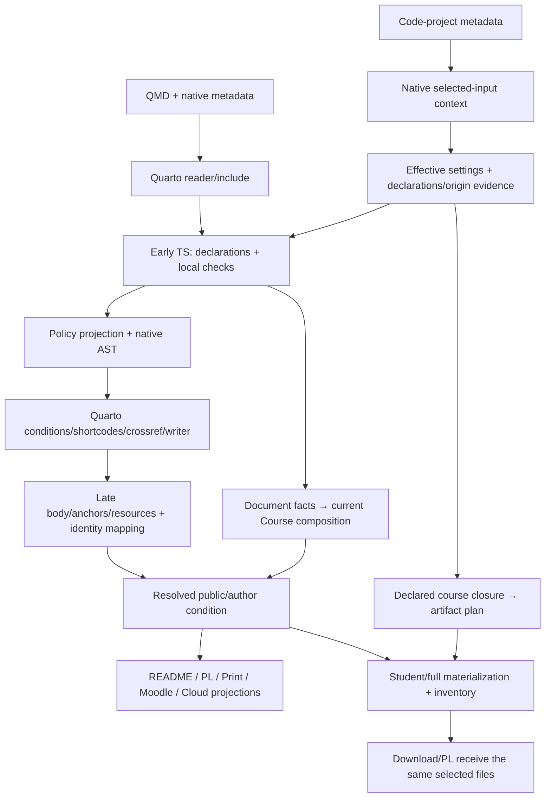

Подготовлено агентом 29 октября 2026 года. **Проект для обсуждения; все новые ключи, операции и способы реализации ниже НЕ ПРИНЯТЫ и не реализованы.** Принятые решения 1–54 имеют приоритет. Это часть целостного дизайна, а не отдельная очередь исполнения.

# Авторский формат и native-цепочка новой системы

## 1. Зачем нужна эта граница

Автор правит учебное условие, роль, назначение или состав проекта в одном месте. Сайт, README комплекта и внешний получатель получают согласованные представления. Ни скачанный комплект, ни чужой экспортёр не становятся вторым авторским каноном.

Основа уже выбрана: Quarto/Pandoc читают документ, разрешают native metadata/include/условия/ссылки и рендерят сайт; ранний штатный TS JSON-filter определяет предметный смысл; Lua остаётся только там, где технически необходим живой native-контекст. Исполняемые TS-контракты владельцев задают форму, нормализацию и проверки; из них выводятся типы и редакторские проекции. CUE и постоянная поддержка старых Body/pointer/API не входят в цель. Исторические источники нужны для сохранения гарантий и разового переноса данных, а не для ограничения новой структуры.

Этот документ предлагает конкретный авторский вид и границы операций. Он не утверждает учебный API Book, новые условия задач, работоспособность нового producer или серверную квалификацию.

## 2. Канон, обычная разметка и производные данные

| Автор видит и редактирует | Кто определяет смысл | Что получается автоматически |
| --- | --- | --- |
| `bank/<theme>.qmd`: ID, заголовок, полное условие inline либо через native include | Автор курса; Core читает учебные объявления | Предметная декларация, публичная/авторская проекции условия |
| Короткие `course-role`, difficulty/time и attrs назначения | Соответствующая сущность Core, не имя атрибута вообще | Типизированная роль/назначение и метки Presentation |
| Один явно отмеченный YAML-блок сложной декларации Div | Core + явно активные адаптеры в своих namespaces | Тот же результат, что у короткой формы; служебный блок не показывается |
| Native front matter, `_quarto.yml`, directory `_metadata.yml` | Quarto объединяет уровни; каждый владелец проверяет свою часть | Effective metadata выбранного native input и контекст запуска |
| `projects/<theme>/<task>/_metadata.yml`: собственные наборы, выдача, ссылки на общий код | Core — состав файлов; владелец исполнения — проверка/ответ | План файлов и объяснимый inventory; не Gradle dependency graph |
| Настоящие Gradle build/settings, обычные Java/JUnit и ресурсы | Gradle — внешние зависимости/версии/tasks; Java/JUnit — код проверок | Самостоятельные компиляционные контексты и результаты запуска |
| Общая инструкция профиля + необязательный локальный `README.md` с особенностями | Автор общей инструкции/проекта | Выходной README: полное условие + общая инструкция + особенности + что сдавать |
| Native Reveal `.notes`, `.fragment`, callout, формулы, Mermaid, QRC `xref`, Download shortcode | Quarto и соответствующие расширения | Native представление, ссылки, ресурсы и кнопки выдачи |

Source/output hashes, входы операции, origins, receipts, список resources и фактический результат проверки — производные свидетельства. Автор не переписывает их в YAML. Общий Git не означает включение авторских решений и полного набора в student ZIP.

При уже подготовленном профиле автор обычной задачи не повторяет настройку сборки или описание технических стадий. Повседневная правка — условие, учебный состав и адресные особенности задачи; общая инфраструктура поставляется владельцами. Это пояснение текущего разделения труда, не новая обязательная роль или схема.

| Обычная правка автора при готовом профиле | Что один раз поставляет и затем сопровождает технический владелец |
| --- | --- |
| Полное условие и короткий предметный API, если он нужен | Native входы/фильтры, распознавание декларации, вывод сайта и условия для получателей |
| Выбор нужных локальных testdirs, общих компонентов и состава student/full; содержательный смысл тестов | Общий Java/Gradle-профиль, инструкции, код helper/проверок и материализация по объявленному составу |
| Необязательные технические особенности конкретного проекта | Получение origins, bridge к metadata кодовой папки, resource/link binding и служебные свидетельства |
| Изменение назначения задачи в fixed/choice работе | Проверка междокументных связей, экспорт и адресный маршрут технической приёмки |

Автору не нужны копии общих build-файлов в каждой задаче, ручное заполнение provenance или ручной запуск каждого внутреннего этапа. Особый native Gradle-проект имеет свою инфраструктуру по задаче; общий профиль не отменяет этот случай.

## 3. Один типизированный вход с несколькими удобными носителями

### 3.1. Активация и принадлежность

**Статус 29 октября, [решение 70](../../refactoring-plan.md#decision-70): принят основной банковский образец Div с ID → первый дочерний Header → служебный YAML `.course-declaration` → полное условие inline/native include.** Служебный YAML не показывается в условии. Полный набор ключей, схемы, API и producer этим не приняты/не реализованы; простые скалярные attrs не запрещены. Остальные правила этого подраздела остаются предложениями.

Предлагаем сохранить прямые короткие атрибуты для простого скаляра и ввести CodeBlock `.yaml .course-declaration` для сложной декларации **непосредственного Div**. В банковской задаче первым дочерним блоком остаётся Header; служебный блок идёт сразу после него. У педагогического Div без заголовка блок может быть первым. Не более одного служебного блока на один Div.

Это не механизм «YAML устанавливает любые атрибуты». TS читает только форму, разрешённую для этого kind узла. `course-role` у Div, assignment `stage` у `.task-items`, `requirement` у reading и у позиции — разные контракты. ID и структура Header принадлежат native AST; их не нужно повторять в YAML. Обычный `.yaml` без специального маркера остаётся учебным кодом. `.answer-spec` имеет свой отдельный типизированный смысл ответа; он не превращается в course-declaration.

Вне банковского документа Core обрабатывает явно обозначенные педагогические Div, а не все Header/CodeBlock подряд. Банк включается явной настройкой документа; именованный проект включается явной ссылкой `project`. Установка адаптера сама по себе не активирует его проверки или дорогой экспорт. Например, `course.adapters: [prairielearn]` разрешает его namespace; параметры неактивного адаптера дают ошибку.

Предлагаемый блок содержит собственные Core-поля непосредственно, а составные поля владельцев — под `adapters.<owner>`. Скалярные attrs и YAML преобразуются одной исполняемой схемой в один результат. Это два синтаксических входа, а не две доменные модели. На новом API не требуется сохранять прежние имена `prairielearn-*`; конкретная карта новых коротких имён формируется из owner-контракта, а не распознаётся произвольным префиксом.

### 3.2. Ошибки и нормализация

| Случай | Предлагаемый договор |
| --- | --- |
| Один explicit field в attrs и в служебном YAML, даже с одинаковым значением | Ошибка двойного объявления; не молчаливый приоритет |
| Повтор YAML-ключа, неизвестный course field, неверный тип/enum | Ошибка source/ID/field; YAML parser не удаляет ключ незаметно |
| Вложенный блок пытается описать родительскую задачу либо найден второй блок | Ошибка привязки с обеими позициями |
| Native local metadata переопределяет default родителя | Штатное наследование, а не ошибка само по себе; несовместимое ограничение/противоречие проверяется после него |
| Объявленная прямая выдача `demo: false`, но выбранный `extra` включает demo | Ошибка с цепочкой `extra → demo` по решению 47 |
| Ссылка на неизвестный компонент, цикл includes/requires, два разных sources в один target | Ошибка формирования состава, без частичной выдачи |
| Разрешённое дополнительное поле публичного ответа производителя | Политика конкретной расширяемой границы, не автоматический отказ авторской closed-schema |
| Невалидный ответ процесса/несовместимая возможность | Ошибка инструмента/контракта; не «неправильная учебная задача» |

Предлагаемый parser локального служебного блока использует готовый YAML parser с CST/позициями и явным обнаружением дублей ключей. Native YAML проекта продолжает читать сам Quarto. Стандартные anchors/aliases не запрещаются заранее: при их использовании нужны позиции объявления и ссылки, а также отказ циклу, который не может дать конечное значение typed поля. Произвольный custom tag не становится исполняемой командой или автоматически допустимым значением: его смысл должен входить в объявленную схему владельца. Точные поддержанные формы и библиотека ещё требуют проверки, без копирования исторического запрета aliases в новый язык. Число `time: 20` и attr `time="20"` получают одинаковый положительный целый тип; строка `"20 минут"` отвергается. `false`, `null`, пустой список и отсутствие поля имеют значения только по его TS-схеме. Общего «reset всего» нет.

Унаследованные настройки Quarto уже разрешены native средствами. Локальный CodeBlock сам не участвует в directory merge: Core применяет проверенные defaults к недостающим полям, не объединяя произвольные maps вторым resolver. Нормальный override default не следует путать с двумя explicit определениями или логически несовместимыми требованиями.

### 3.3. Непоглощаемая разметка остальных владельцев

Исследованный [реестр](../yaml-authoring-integration-20261027/attributes.md) и [его 303 записи](../yaml-authoring-integration-20261027/attributes.json) используются как карта обязанностей, а не список 303 атрибутов для переноса. Проверены семейства Core (202 записи), UI/интеграций (82), PL и смежных владельцев (19), включая metadata, native и generated surfaces.

- Presentation читает проверенные роли/подписи; native `.notes`, fragments, tabsets и callout остаются native.
- Navigation владеет своими links/course URL/Reveal-настройками и индексом; не превращает HTML markers в авторские поля.
- QRC владеет namespaces/imports/exports и `xref`/`@namespace:id`; его адреса не выводятся Core из author ID.
- Download получает уже выбранные артефакты; shortcode — запрос результата, не второй file-selection parser.
- Publisher определяет композицию подпроектов и окончательную адресацию вместе с QRC, не учебное содержание.
- PL/Cloud проверяют собственные декларации. Cloud Header/CodeBlock steps/actions не превращаются в свойства Java-задачи; native Workspace — отдельный маршрут.
- Производные `data-course-*`, `data-qrc-*`, service wrappers и run markers не поддерживаются как новый авторский ввод. Старые schema/API не получают целевого compatibility layer.

## 4. Шесть связанных авторских сцен

Ниже технические образцы **предлагаемого синтаксиса**. Они не готовые файлы курса и не новая учебная редакция. Для reverse-array сохранён полный читаемый пример; остальные пять сцен пока показывают носители и границы, а не полные материалы для исполнения. Многоточия обозначают существующий текст, а не разрешённый токен YAML. Реальные исполняемые fixtures должны содержать полный текст и зависимости.

### 4.1. Reverse-array: банк, include и кодовый проект

**Статус 29 октября, [решение 70](../../refactoring-plan.md#decision-70): расположение ID в Div, затем Header, затем YAML принято как основной банковский образец.** Полный QMD по ссылке ниже показывает эту раскладку; его producer/схемы ещё не реализованы/не утверждены. Короткий attrs-эскиз ниже сохраняет прежнее предложение, а не заменяет новый основной образец и не означает запрета простых attrs. Текст условия, весь набор полей и конкретные пути этой репликой не утверждены.

Полный [QMD для предметного чтения](examples/authoring/reverse-array/bank-arrays.qmd) сохраняет нынешнее условие буквально, кроме ровно двух технических абзацев, прямо отвергнутых пользователем в обсуждении 50. Первым дочерним блоком Div остаётся Header. [Происхождение и точные удаления](examples/authoring/reverse-array/PROVENANCE.md) отделены от учебного текста. Рядом — полный [illustrative expected README](examples/authoring/reverse-array/README.expected.md): условие, общая инструкция профиля владельца исполнения и однофайловая сдача. Он составлен вручную для чтения, не получен новым producer; Gradle/PL и native README-pipeline не проверялись. Это исследовательский снимок предлагаемой разметки, не второй поддерживаемый канон и не принятие всей новой редакции.

Банковский input `tasks/bank/arrays.qmd` сохраняет тему и полный канон. Короткий вариант:

````qmd
:::: {#exr-arrays-reverse-array difficulty="introductory" project="/projects/arrays/reverse-array"}
## Элементы массива в обратном порядке


::::
````

Include необязателен: то же полное условие можно оставить непосредственно внутри Div. Вынесение — перенос одного канона, а не создание вручную сопровождаемого `statement` рядом со student. Относительные ссылки включённого текста считаются по правилам native include от банковского input; расположение фрагмента не становится базой Java helpers.

Если декларация действительно стала сложнее, **вместо** атрибутов difficulty/project возможна такая запись после того же Header:

````qmd
```{.yaml .course-declaration}
difficulty: introductory
project: /projects/arrays/reverse-array
```
````

Полное условие имеет один [нынешний канон](../../../tasks/bank/arrays.qmd#L62). Приняты отдельные принципы корректировки по решениям 50/51, а не весь новый текст условия из исследовательских вариантов. Простая задача сохраняет `Main.main(String[] args)` и вывод; метод `printReverse` не добавляется. Использование массива и сохранность входа относятся к чтению кода в ручных 20%; stdout не доказывает неизменность внутреннего массива. Два прежних demo проверяют лишь обычный и нулевой массив, а не полную оценочную полноту.

Предлагаемые directory defaults для кодовых проектов:

```yaml
# tasks/projects/_metadata.yml — проект, не рабочий API
course-project:
  build: java-junit
  starter: starter/src/main/java
  delivery:
    student:
      testsets:
        demo: true
```

Единственный local input:

```yaml
# tasks/projects/arrays/reverse-array/_metadata.yml — проект
course-project:
  testsets:
    demo:
      sources: tests/demo
      requires: [java-process, numeric-output]
    full:
      sources: tests/full
      includes: [demo]
  solutions:
    reference: solutions/reference/src/main/java
  verification:
    testsets:
      full: true
  delivery:
    author-full:
      testsets:
        full: true
```

`verification` здесь обозначает выбор полного оценочного набора по решению 49, а не обязательный новый формат test cases. Его связь с API/expectations/executor задаёт владелец исполнения. `solutions.reference` и `testsets.full` не утверждают наличие нынешних недоступных full sources. Reference/альтернативы проверяются раздельно; историческое решение 18 октября не становится принятым эталоном автоматически.

Общее определение `java-process` хранит `sources` один раз в корневом конфигурационном каталоге. Например, связующий фрагмент нового root input мог бы выглядеть так:

```yaml
# tasks/_quarto.yml — только проект нового course-ввода
course-project:
  components:
    java-process:
      sources: components/java/process
    numeric-output:
      sources: components/java/numbers
  builds:
    java-junit:
      files:
        build.gradle: components/gradle/java-junit/build.gradle
        settings.gradle: components/gradle/java-junit/settings.gradle
      instructions: components/gradle/java-junit/README.md
```

У `files` ключ обозначает target в готовом комплекте, значение — definition-relative source; это новая иллюстративная форма, не копия нынешнего producer API. Папка `starter` в образце — предлагаемый путь канона, не новое обязательное имя: уже существующая `student/src/main/java` также может быть выбрана source. Выходной `src/main/java/Main.java` связывается с именем ответа `Main.java` отдельно через submission-контракт владельца PL; ни имя каталога, ни наличие Java-файла сами его не определяют.

Локальный demo задаётся прямо через `tests/demo`; превращать его в новый именованный компонент без переиспользования не требуется. `includes` включает тестовый набор; `requires` подключает обязательный код поддержки. Внешние Jupiter/launcher и их версии находятся в настоящем Gradle-коде профиля `java-junit`, не в этой YAML-карте. Привязка `project → selected full testset → API/expectations → runtime/submission` должна быть показана вместе с договором исполнения; этот фрагмент намеренно не выдаётся за уже полный действующий grading config.

Для локального исключения студентского состава допускается native bool-map:

```yaml
course-project:
  delivery:
    student:
      testsets:
        demo: false
        extra: true
```

`extra` должен быть объявлен. Если он включает demo, это ERROR по решению 47, а не скрытое возвращение «отключённого» набора. Отсутствующий ключ наследуется, `{}` не очищает карту. Обычные списки native Quarto объединяет; `[extra]`, `[]`, `null` и `false` не служат отменой наследованного `[demo]`. Булева карта — именно выбранная семантика выбора, не универсальный способ отключить нужный helper.

### 4.2. Book: компактный контракт без обязательной заглушки

````qmd
:::: {#exr-objects-book-selection difficulty="intermediate"}
## Отбор книг

<!-- Здесь полное каноническое условие. -->

<!-- Ниже лишь пример носителя, взятый из нынешнего Book.java;
     состав будущего учебного API требует предметной выверки. -->
Предлагаемый фрагмент контракта: `public static Book[] author(Book[] a, String s)`.
<!-- Далее — выверенное описание поведения, а не готовая реализация метода. -->
::::
````

Сигнатура взята из [нынешнего Book.java](../../../tasks/projects/objects/book-selection/student/src/main/java/Book.java#L7) только для демонстрации короткого текстового носителя; этот конкретный будущий контракт не принят. Нынешний [TaskBinding](../../../tasks/projects/objects/book-selection/student/src/test/java/TaskBinding.java#L1) показывает техническую зависимость от конкретных конструкторов/методов; их весь набор не принят как будущий учебный API. После предметной выверки короткая сигнатура пишется один раз в условии, как требует решение 51. Студент создаёт реализацию сам; новый stub только ради grader не нужен. Owner проверки реализует тот же заявленный договор обычным Java-клиентом/API-precheck и JUnit, а не скрытыми требованиями к «удобной» структуре.

### 4.3. Комплексный проект: API у стартера

````qmd
:::: {#exr-files-gradeapp-report project="/projects/files/gradeapp-report"}
## Отчёт по студентам: завершение gradeapp

<!-- Здесь полное существующее условие и ссылка на канонический стартер,
     задающий комплекс классов/файлов и изменяемые части. -->


::::
````

Сцена основана на [существующем GradeApp](../../../tasks/projects/files/gradeapp-report/student/README.md), не на новом API. Комплексный starter сохраняет его настоящие build/settings и формат ответа по условию; простой общий Java-профиль не подменяет native build специального проекта. Core переносит объявленные файлы, не разбирает Groovy для вывода зависимостей. Загрузка полного комплекта не меняет способ сдачи автоматически.

### 4.4. Теория/лекция: короткая роль и native оформление

````qmd
---
lang: ru
format: revealjs
course-presentation:
  answers: auto
---

## Ссылочные значения {#sec-lecture-values-absence}

::: {course-role="objectives"}
<!-- Существующие цели данного раздела, если автор выделяет их. -->
:::

::: {.notes}
<!-- Заметки преподавателя остаются native Reveal notes. -->
:::


````

Техническая сцена не требует добавить `objectives` в принятую лекцию. Один короткий `course-role` удобнее отдельного YAML-блока. `course-presentation.answers` проверяет Presentation; `xref` — QRC при объявленном import, не Core. Аналогично сохраняются `{mermaid}`, обычные ссылки, native размеры и `.fragment`; им не нужен общий контейнер деклараций. Смена носителя роли не меняет принятый рассказ лекции.

### 4.5. Cybersecurity: тот же смысл без Java и PL

````qmd
:::: {#exr-data-integrity-backup course-role="independent-study" difficulty="intermediate" time="90"}
<!-- Существующее условие задачи backup. -->

::: {course-role="deliverables"}
<!-- Уже предусмотренный результат. -->
:::

::: {course-role="criteria"}
<!-- Уже предусмотренные критерии. -->
:::
::::
````

Структура взята из исследованного `task/data-integrity/backup.qmd`; цели/prerequisites/limitation/takeaway встречаются в `theory/crypto/random.qmd`. Роль `deliverables` принадлежит окружающей деятельности по структурному occurrence, не превращается в purpose упражнения. Отсутствие Java-проекта или PL target допустимо. В новом богатом блоке Cyber мог бы описать своё owner-поле без загрузки Java/runtime-контрактов. Это проверка переносимости авторского формата, не обещание исполнения VM или миграция всего Cybersecurity.

### 4.6. SP: работа, fixed/choice и inline Span

````qmd
---
assessment:
  id: sec-git-review
  kind: lab
---
# Работа Git — технический образец композиции

::: {.task-items stage="homework"}
1. @exr-local-history
1. [@exr-existing-a; @exr-existing-b]{.task-alternatives #alt-git-review selection="choice" requirement="required"}
:::
````

Это структурная сцена, **не новая работа SP и не утверждённые ID/состав**; синтетические existing-a/b должны заменяться фактическими подходящими объявлениями при будущем fixture. Choice остаётся одной позицией с несколькими кандидатами; stage принадлежит списку. Span — inline-узел, CodeBlock внутри него невозможен: короткий атрибут здесь сохраняется. Список ссылок — канон состава, второй YAML `members` не вводится.

`local-history` уже выбран для самодостаточного bundle-upload; другие SP-задачи получают upload либо Workspace по принятому распределению. Эти transport-поля принадлежат адаптеру исполнения, не меняют список назначения. Bundle не доказывает index/worktree и обязательные действия; их остаток объясняется в контракте проверки, не скрывается в новом синтаксисе. Никаких новых отчётов не добавляется.

## 5. Native inheritance и происхождение путей

### 5.1. Три разные базы и две разные операции

| Поле/содержимое | База значения | Origin для диагностики |
| --- | --- | --- |
| QMD `project: /projects/…` | Виртуальный путь от Quarto owner root | Сам Div/декларация банковского input |
| `starter`, local testset sources/resources, solutions | Выбранный каталог кодового проекта, даже если convention задан родителем | Файл/поле, где convention объявлен; это не база пути |
| Sources общих компонентов и файлы общего build | Физический owner общего определения | Конкретное определение компонента/профиля |
| Ссылки/ресурсы текста native include | Контекст включающего native input по правилам Quarto | Исходный фрагмент, если native source map это подтверждает; иначе точный документ/ID/field и ограничение |
| Общая инструкция и local README addition | Собственный объявленный текстовый input каждого фрагмента | Файл инструкции/дополнения, отдельно от канонического условия |

Нормализация пути — отдельная typed операция, не поиск «похожих на путь строк». Native Quarto уже может перебазировать существующую строку, оставив glob неизменным. Её нельзя ещё раз трактовать как raw project-relative. Нужны raw declaration, effective native value, тип поля и доказанная привязка к определению.

Native inspect не обещает per-value origin. Список конфигурационных файлов, совпадение значений или существующий каталог не восстанавливают точный последний источник. Поэтому предлагается отдельный origin-index **исходных деклараций** с позициями. Только Quarto выбирает активные объявления и выполняет merge; доказанно связанные raw declaration и native effective snapshot служат входами одной типизированной нормализации владельца. Raw не образует самостоятельный канон или второй merge: тип поля определяет, как учесть native rebasing пути или восстановить непутевой смысл скаляра. Индекс не вычисляет объединённый объект и не принимает решения о Quarto overrides. Одинаковые значения из двух уровней сохраняют двух contributors; выдавать guessed winner нельзя.

Кандидат источника provenance — контролируемое чтение CST исходных course-деклараций в фактических `_quarto.yml`, профилях, `_metadata.yml` и подключённых metadata-файлах, связанных с текущими native inputs. Это извлечение объявлений/позиций, не вычисление собственного effective object. `inspect` даёт native effective значения и часть file inventory; недостающие contributors нужно учитывать по реальным source-файлам. **Публичного проверенного native per-leaf trace API в исследовании не найдено.**

Связь occurrence→effective field должна подтверждаться native-адаптацией/trace для поддержанной поверхности. Если точную связь получить нельзя, это явно `origin-unresolved`, а не сфабрикованная строка. Для typed path, где от definition-origin зависит реальный файл, операция не может выдать готовый комплект до устранения неоднозначности. Для обычной диагностики source/ID/field остаются обязательными, range обещается только при наличии реальной позиции. Ниже в §5.4 проверен конкретный кандидат для scalar/map-поверхности; **целевая операция по всем входам ещё не реализована и не доказана**. Патч/fork Quarto, копирование его private merge и обязательный авторский locator не предлагаются.

### 5.2. Кодовый input внутри book

Банк не наследует `_metadata.yml` соседнего code-project. Inspect каталога даёт проектную конфигурацию, а не effective metadata произвольного входа. Обычный README исключён из native inputs; book list глав заменяет `project.render`. Новый обязательный README/QMD автору не нужен.

**Предлагаемый основной мост:** внутри одной служебной операции создать disposable native-context с тем же расположением авторских входов, разрешёнными профилями и явно отобранным временным пустым input в каталоге кодового проекта; применить штатный временный профиль `project.type: default` + `project.render`, выполнить native inspect. Служебные файлы существуют только в disposable копии/контексте и не публикуются. Рабочий `_quarto.yml`, book и кодовый каталог не редактируются. Копия должна сохранять существенное наличие файлов/каталогов: иначе native existence-based rebasing изменит смысл. Минимальную допустимую копию нельзя определять по одному статическому списку imports.

**Пакетная область:** один такой контекст на выбранный native owner и операцию, с набором нужных code-project inputs; не полная копия курса на каждую из задач. Подготовка/presence snapshot и конфигурационные входы переиспользуются внутри этого срока жизни; изменение существенного входа инвалидирует соответствующий результат. Поддержанный публичный CLI может всё ещё требовать отдельных inspect для разных inputs: один контекст не доказывает один процесс или уже существующий native batch API. Цена копирования, повторных inspect и точная минимальная presence-область ещё не измерены; новый межзапусковый cache не следует из этого предложения. Этот контекст — внутренняя native-адаптация, не второй Course/Run DTO, распространяемый по расширениям.

Профиль меняет способ получения технических metadata кодовой ветки, а не способ рендера сайта: банковский QMD всё равно проходит настоящий book/native-контекст. Операция сверяет owner, формат, пользовательские профили, raw inputs и effective результат; попытка использовать один их набор вместо другого — ошибка. Данные этого inspect не доказывают существование позднего тела или успех Gradle.

| Способ | Цена/ограничение | Позиция проекта |
| --- | --- | --- |
| Disposable контекст + явный служебный input/default profile | Нужно доказать эквивалентность окружения и стоимость копирования | Основной кандидат, не изменяет author source |
| Временный overlay/input непосредственно в рабочем дереве с восстановлением | Меньше копирования; дополнительные состояния прерывания и source drift | Сравниваемый вариант, не основной; наличие нынешнего overlay не обязывает сохранить его |
| Собственный directory merge либо копирование внутренних функций Quarto | Новый resolver, private API и дублирование native поведения | Отклонён |

### 5.3. Новое узкое свидетельство 29 октября

Два `quarto inspect` в `/tmp/authoring-native-context-20261029-8icykgp0`, pinned Quarto 1.11.5; hooks/filters/execute/render отсутствуют. Исходная книга содержит только `index.qmd`. Служебный `_course-input.qmd` находится в code-project, но не является главой.

| Запуск | Наблюдение, оба exit 0 |
| --- | --- |
| Book без технического профиля | Owner стал листовым каталогом; inputs пусты; получены только листовые metadata |
| Явный default-profile с этим input в `project.render` | Owner — исходный root; input включён; root+projects+task metadata сохранены; parent `demo:true` → child `demo:false`, `extra:true` |

В fixture проверено именно native объединение карты и возможность временного явно выбранного input с underscore. `summary.json`, stdout/stderr и hashes сохранены в названном каталоге. Долговечные материалы этого пакета: [воспроизводящий скрипт](examples/authoring/native-context-probe.py) и [version/output summary с хешами входов](examples/authoring/native-context-summary.json). Скрипт сохранён после двух наблюдений и дополнительно не запускался. Это **не** готовый mirror-адаптер Java book, не origins trace, не действующий `course-project` parser и не render. Предыдущие четыре JSON-filter запуска не повторялись.

### 5.4. Конкретный origins-кандидат: служебное дерево, объединённое Quarto

Простого индекса деклараций недостаточно: без связи с effective значением даже корректный общий `components.java-process.sources` мог бы всегда останавливаться на `origin-unresolved`. Для необходимой в примерах поверхности есть проверяемый кандидат, использующий только публичный `quarto inspect` и YAML metadata. Он **не является уже реализованной целевой операцией и не принят пользователем**.

В disposable контексте технический producer добавляет к каждому исходному owner-объявлению отдельный служебный ключ `course-origin-trace-research`. Исходный `course-project` не оборачивается и не меняет значений. Служебное дерево повторяет его карты; вместо каждого scalar leaf содержит уникальный числовой ID. В отдельном индексе ID связан с реальным source-файлом, путём поля и raw value; будущий CST-reader добавляет только достоверные позиции. Число не перебазируется как файловая строка. Native Quarto выбирает active profile, объединяет исходные значения и **сам** объединяет соответствующие деревья ID. Producer читает победивший ID, не воспроизводя порядок merge и не сравнивая одинаковые строки для угадывания источника.

Например, `sources: helper` определено в root и в `projects/_metadata.yml`. В обоих местах `helper` существует; такой же decoy-каталог находится рядом с кодовым input. Native effective получает `../helper`, trace — ID родительского объявления. При частичном override карты соседнее унаследованное поле получает ID root. Это разделяет три операции: Quarto определяет effective результат, ID устанавливает source occurrence, а typed контракт нормализует доказанно связанные raw/effective значения по назначению поля и выбирает базу. Для `components.*.sources` она от определения; для `starter: src`, унаследованного из родителя, — от выбранного кодового проекта. В последнем случае native `../src` нельзя повторно трактовать как raw local convention: producer использует доказанные raw `src` и происхождение по принятому типу поля, сохраняя native effective для сверки/диагностики.

Почему это учитывает реальное rebasing: в закреплённом [project-shared.ts](https://github.com/quarto-dev/quarto-cli/blob/87d1078002991c4ba9cc2baa1f401a80402148af/src/project/project-shared.ts) `toInputRelativePaths` проходит вложенные значения и меняет относительную строку только при существующем `baseDir/value`; directory metadata перебазируются от каталога объявления к input. Проектные/profile metadata аналогично перебазируются от project root в `projectMetadataForInputFile` из [render-contexts.ts](https://github.com/quarto-dev/quarto-cli/blob/87d1078002991c4ba9cc2baa1f401a80402148af/src/command/render/render-contexts.ts). В установленном bundle это соответственно `quarto.js:76858–76908`, `76984–77020`, `91625–91637`. Числовой trace не испытывает этого преобразования. Код прочитан как основание, он не импортируется и не копируется в producer.

**Новая ограниченная проба:** три fixture, у каждого baseline и instrumentation, всего шесть `inspect` на Quarto 1.11.5; все exit 0, stderr пуст. В каждом effective metadata после удаления только служебного ключа структурно равны baseline. Никаких render/filters/hooks/execute и работы с настоящим курсом.

| Случай | Фактически наблюдалось |
| --- | --- |
| Scalar/map: одинаковые raw paths root/parent, partial map override, decoy, glob, parent true → child false | `sources` получил parent ID и `../helper`; соседний label — root ID; glob остался `missing/**/*.java` с root ID; selection false — leaf ID. Унаследованный `starter` сохранил parent ID, несмотря на отдельную project-relative базу его типа |
| Явный active profile | `profiled.sources` получил ID `_quarto-originprobe.yml` и native `../../profile-helper`; прочие winners не изменились |
| Контрпример для array-path | Root и parent содержат `[missing/**/*.java]`: effective array содержит **один** элемент, служебный array — **два разных ID**. Связывание по индексу недостоверно |

Долговечные материалы: [исполненный воспроизводитель](examples/authoring/native-origin-shadow-probe.py), [полный version/output summary, effective values/trace и hashes](examples/authoring/native-origin-shadow-summary.json). Исходные stdout/stderr и обе версии fixture сохранены в `/tmp/authoring-native-origin-20261029-mujtvh04`; скрипт и summary в пакете не зависят от сохранности этого `/tmp`. Fixture записана JSON-подмножеством YAML; она не доказывает работу будущего YAML CST-reader, aliases, tags или source ranges.

**Область вывода и оставшиеся условия.** Кандидат даёт источник для scalar leaf внутри согласованной формы карт: именно так записаны общие `components.*.sources`, `builds.*.files.<target>`, `instructions` и local conventions в §4.1. Для этой формы нельзя больше утверждать, что все допустимые общие пути неизбежно неразрешимы. Это не скрытое утверждение scalar-only схемы для любого авторского YAML: точные формы ещё предложения. Если форма допускает path внутри array, этот probe **не даёт** его occurrence binding; до отдельного технического решения такая форма не может выдать готовый origin-dependent комплект. Для `includes/requires` также нельзя выдавать два marker ID за точное поэлементное соответствие одному native-элементу; известные source contributors сохраняются, но это ещё не полная provenance каждого effective элемента. Собственный dedup/merge для исправления trace не вводится.

Вне доказанного fixture остаются `metadata-files`, front matter, format-specific owner-поля, несколько/условные профили, YAML aliases/merge keys и изменения формы предка map↔scalar↔array. Полнота конкретных входов должна проверяться на поверхности целевой схемы; нельзя молча применить scalar-кандидат к произвольному Quarto metadata. Native по-прежнему выбирает активные входы: индексирование/инструментация деклараций в копии не назначает порядок их применения. Кандидат не требует нового locator от автора или атомарного переопределения всех компонентов.

Служебный ключ существует только в техническом inspect-контексте, удаляется перед owner decode/выдачей и не попадает в авторский QMD, сайт или комплект. Producer проверяет отсутствие коллизии с ним и равенство исходных effective owner-values с baseline при квалификации адаптера; штатный рабочий путь не обязан навсегда выполнять двойной inspect каждого проекта. Это внутренняя часть одного пакетного контекста §5.2, без отдельного сервиса, нового Course/Run, proof-token протокола или обещания ускорения. Стоимость и полнота ввода ещё не измерены. **Итог: scalar/map feasibility подтверждена малым опытом; общий origin API и целевой bridge всё ещё требуют реализации и адресной квалификации.**

## 6. Сквозная цепочка и минимальные публичные операции



Стрелки — обязанности, не единый гигантский DTO. Предлагаемые имена ниже иллюстративны; окончательные signatures согласуются с общей архитектурой пакета.

| Публичная операция / владелец | Вход и результат | Обязательная гарантия |
| --- | --- | --- |
| Получить native настройки входов / native-адаптация Core | Выбранные owner/input/profile/format → effective metadata и доказательства источников | Native merge; отсутствие побочной публикации; ошибка owner/origin mismatch; ограниченный срок операции |
| Нормализовать документ / Core + активные owner-контракты | Native AST и settings → локальные декларации, diagnostics, проекционные решения | Проверены скрытые ветви до потерь; сохранены occurrence/order/container scope; один writer фактов |
| Завершить native документ / тонкий native-адаптер | Позднее дерево/выход того же запуска → resolved body, anchors, resource facts | Доказанная связь с early occurrence, а не поиск по изменившемуся виду Div |
| Собрать выбранный Course / Core | Текущие document facts + late evidence и explicit область операции | Локальный incomplete не становится полным PASS; global ID/member/solution checks |
| Получить условие / Core, адресация QRC | Exercise identity + нужная public/author проекция → resolved content/resources | Не требуется фиктивная assessment ради одного starter; ключи/notes исключены из public |
| Получить план/байты комплекта / Core | Project + delivery selection + resolved condition → materialized files/inventory | Одно разрешение includes/requires, origin/path/target checks, complete либо ошибка |
| Привязать конечные адреса / QRC + Publisher или целевой exporter | Resolved references + фактическая композиция назначения → конечные URLs/anchors | Нет собственного угадывания адресов Core; один финальный writer целевого представления |

Общий контракт результата содержит нужную версию/возможность и identity контекста; source hashes и public поля не заменяют жизненный цикл. Нельзя сохранять live context за пределами его операции или считать receipt вечной истиной после изменения inputs. Точные новые schemas не копируют нынешний private NativeRun pointer. Публикация требует завершённого текущего результата, а не успешного раннего parser.

JSON-filter получает/возвращает Pandoc JSON через stdin/stdout; диагностика идёт отдельно. Встроенный Deno запускается штатным `quarto run`, launcher поставляется расширением; не требуется вручную держать отдельный сервис. Механизм N имеет датированное свидетельство прежнего fixture, но источник input/format/profiles и передача non-JSON native context ещё должны быть квалифицированы. Прежний `/tmp/java-native-json-filter-20261029-pfouja7a` более не доступен на текущем исполнителе; основание — сохранённый [отчёт дизайна](../open-topics-20261028/lua-ts-design-review.md#новое-малое-свидетельство-29-октября), не свежий PASS и не вновь проверенные raw outputs. Process count не означает доказанное ускорение.

## 7. Ранний смысл, поздняя истина и README

Рано проверяются допустимость декларации, связь solution, исходные assignments и политика public/full. Затем TS возвращает native AST, сохраняя непрочитанные ordinary/native узлы. Quarto продолжает условия, shortcodes и crossrefs. Реальная публичность условного solution, окончательный текст ссылки, anchors и generated resources появляются позднее. Существование solution в исходнике не означает `hasPublicSolution=true` для выпуска.

Partial preview получает локально проверенный документ и явные нерешённые внешние зависимости; чужая отсутствующая декларация не объявляется отсутствующей во всей книге. Нельзя брать старый sidecar ради видимости ссылки. Полная сборка/экспорт проверяют явно выбранный текущий состав. Неполный semantic контекст отличается от полного результата проверки, а техническая ошибка не превращается в учебную ошибку.

Поздние custom nodes могут скрыть исходный exr ID за native scaffold. Связь early→late должна быть доказана технической identity-меткой/таблицей occurrence в пределах того же прохода; такую метку не редактирует автор. Сохранность native custom context и отсутствие служебных утечек входят в проверку, а не предполагаются по JSON roundtrip.

Для README рекомендуем выделить новую публичную границу **resolved condition** после native разрешения. Она не привязана к assessment и нужна сайту, PL и комплектам. Из неё один целевой writer создаёт полный Markdown-текст условия и переносит нужные resources, затем добавляет общую Java/Gradle-инструкцию и необязательные local особенности. Текст «что сдавать» берётся из submission-контракта. Ссылки каждого присоединяемого фрагмента нормализуются с его origin; смешивать их сырыми относительными строками нельзя.

| Подход к README | Польза | Существенная цена |
| --- | --- | --- |
| Resolved native AST → target GFM + явный resource/link mapping | Одна предметная проекция нескольким получателям; основной кандидат | Нужно проверить anchors, формулы, таблицы, библиографию и native конструкции |
| Current native HTML → AST → GFM | Возможность переиспользовать готовую страницу | Дополнительный roundtrip и зависимость от HTML; не повод сделать его каноном |

Raw QMD → обычный Pandoc writer не выбран: прежний малый опыт сохранил ссылку, потерял явный якорь, не раскрыл include и не скопировал SVG. `--resource-path` не является упаковщиком. Полное условие в README обязательно; ссылка «откройте index.html» его не заменяет. Для реально непредставимой native конструкции нужен технически обоснованный target writer либо предметное обсуждение представления, без молчаливой потери текста.

Resources отбираются по фактически выбранной проекции: сырой asset из скрытого решения не становится student-файлом. Generated resource фиксируется по native effective base/hash/bytes, пока доступен. Конечные ссылки Pages/README/PL отличаются; общий канон — содержание и identity ресурса, а не один вечный URL.

## 8. Приёмка дизайна и границы знания

| Уже установлено | Что это не доказывает |
| --- | --- |
| Реестр семи пакетов и источники их 303 записей | Нужность каждого старого API в новой архитектуре |
| Native inspect BOOK/default и rebasing существующих строк | Полный code-project bridge с точными origins |
| Четыре прежних native TS JSON-filter запуска: baseline/identity early/late/одна метка | Полный перенос Core, все custom nodes/форматы или реальный междокументный URL |
| Два новых inspect с явным временным input и bool-map | Отсутствие drift на Java book, source maps и скорость |
| Материализованный reverse-array snapshot, JDK-компиляции и два CLI-входа reference | Рабочий producer, Gradle/JUnit PASS или полный grader |
| Прежние performance measurements | Цена новой модели, нового bridge и нового README writer |

Следующий доказательный набор для реализации: один обычный Div/один marker block/обычный учебный YAML; duplicate attrs/block; inline Span; notes/Table/list nesting; partial/full composition; identical raw metadata в разных ancestors; parent path/glob с совпадающим task-каталогом; bool-map override и false/includes conflict; отсутствующий ресурс/неверный target; conditional solution; source drift и повторное использование результата; README с include/anchor/interproject link/generated asset. Негативные случаи проверяют предметную причину, а не любой ненулевой exit.

Результаты проверки решений следуют решениям 49/52/53: корректные reference/alternatives проходят полный предметный набор, стартер — своё объявленное ожидание; готовый достоверный набор даёт passed/total, неполный/невалидный отчёт — полную ошибку проверки без зачёта по обрывкам. Это не автоматизация ручных 20%. Исполнение, exact payload/UI и сервер остаются областью отдельной квалификации, не этим документом.

## 9. Источники и воспроизводимость

Исследовательская база Java `dd1a8a392c570e96a7d0a7e364aee345c800424a`; установленный Core/Presentation/Navigation 8.3.0 `3ccc9e81eb2fc297cd0f283a51e040f71572ce18`, PL 8.3.0 `11a4fd3d877c7c9c6124a2d05beb0a8c8c2833b5`, Publisher 5.1.5 `8a70de8bdbfdc34a520bdb7df353abd6e1697423`, QRC 3.1.0 `3df2110e9f525f03f3ecb4926b5d55718e955c4c`, Download 3.2.1 `498b1d89c159548c0eb1d706438178be16ddb082`. SP PR8 `76a87d65bf73605b8d1e2bb0e81e8949e0defa08`; Cyber сравнивался на `054cfa39e1040799a00e5a2e4d55a7fe49850070`, не как свежий deployment.

Официальные руководства проверены 29 октября; доступность нового API из latest-документа не приписывается закреплённому runtime без проверки:

- [Quarto metadata merging](https://quarto.org/docs/projects/quarto-projects.html#metadata-merging): native уровни и объединение maps/arrays.
- [Quarto AST phases/custom nodes](https://quarto.org/docs/advanced/quarto-ast.html#targeting-of-ast-processing-phases): доступ к нужной native стадии, не собственный reader.
- [Quarto include](https://quarto.org/docs/authoring/includes.html): контекст включающего документа.
- [Quarto Deno scripts](https://quarto.org/docs/projects/scripts.html#deno-scripts), [Deno subprocess API](https://docs.deno.com/api/deno/subprocess/): механизм запуска, не выбранная новая версия Deno или постоянный сервис.
- [Pandoc JSON filters](https://pandoc.org/filters.html): JSON stdin/stdout между native reader и writer.
- [TypeScript assertions](https://www.typescriptlang.org/docs/handbook/2/everyday-types.html#type-assertions): стираемые типы не исполняют контракт над JSON.
- Pinned Quarto 1.11.5 commit `87d1078002991c4ba9cc2baa1f401a80402148af`: [mergeArrayCustomizer](https://github.com/quarto-dev/quarto-cli/blob/87d1078002991c4ba9cc2baa1f401a80402148af/src/core/config.ts), [directory metadata](https://github.com/quarto-dev/quarto-cli/blob/87d1078002991c4ba9cc2baa1f401a80402148af/src/project/project-shared.ts#L300), [book inputs](https://github.com/quarto-dev/quarto-cli/blob/87d1078002991c4ba9cc2baa1f401a80402148af/src/project/types/book/book-config.ts), [JSON filter wrapper](https://github.com/quarto-dev/quarto-cli/blob/87d1078002991c4ba9cc2baa1f401a80402148af/src/resources/filters/common/wrapped-filter.lua#L91).

Подробные прежние основания: [реестр и scope](../yaml-authoring-integration-20261027/README.md), [reverse-array и native probes](../yaml-authoring-integration-20261027/reverse-array-example.md), [native models/delivery](../open-topics-20261028/native-models-delivery.md), [рецензированный ранний TS-дизайн](../open-topics-20261028/lua-ts-design-review.md), [фактическая Lua/TS-цепочка](../open-topics-20261028/lua-ts-pipeline.md). Их непринятые рекомендации читаются с приоритетом решений 35–54.

Собственный допуск: чат `01a18453-283d-78e0-9dfc-0dd07f9b7b61`, исходный ход `01a18453-287e-7ec0-98f0-da3f769a7d5e`, роль `gpt-6.1-sol/high`; интервал проверяется от этого хода без сдвига. Служебный baseline — `/tmp/lua-ts-design-review-metadata-01a18453.json`. Продукт, CI, сервер, конфигурация моделей и чужие файлы этой работой не менялись.
