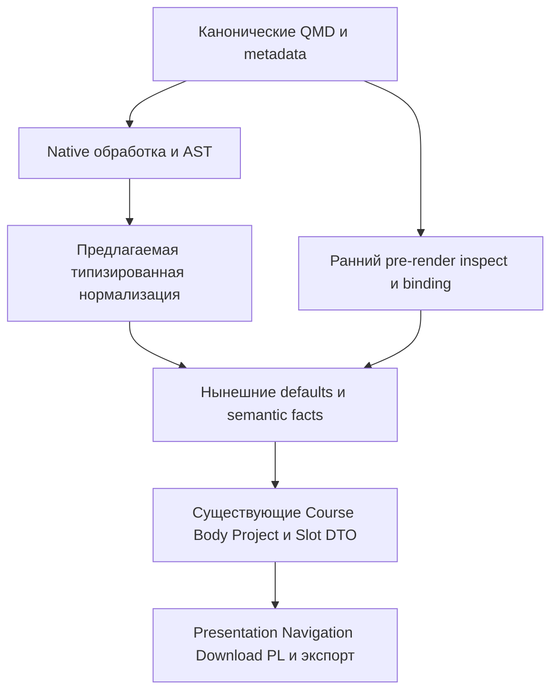

# Интеграция авторского YAML с моделью курса и расширениями

**Уточнение статуса на 29 октября:** это исследование авторской поверхности и прежних примеров. Цель проектируется заново по решениям 35/54 без обязательства старых API; нынешние модели — источники фактов и гарантий, не требуемая форма. Единственная [текущая повестка](../../refactoring-plan.md#current-agenda-20261029) и [целевой проект](../target-design-20261029/README.md) имеют приоритет. Полный новый пример reverse-array находится в целевом пакете; прежние A/B ниже — история, принципы 45–56 уже выбраны.

Исследование от 27 октября 2026 года для согласования авторского ввода Java, System Practice и общих расширений.
Cybersecurity служит проверкой конкретной разметки; Cloud, Print и Moodle рассматриваются отдельно как прежние потребители.
Это результат исследования и сравнение вариантов, а не утверждённый дизайн или план реализации.

По итогам исследования пользователь принял принцип: **один типизированный вход в существующие модели и проверки, совместимые короткие атрибуты и YAML для сложных деклараций**.
Простая роль или ссылка не требует отдельного блока; новая форма не создаёт вторую модель курса.
Универсальный перенос любых YAML-ключей в любые атрибуты узла не решает задачу типов и владения и здесь отклонён.

Пользователь одобрил общее разделение: учебный QMD, локальное описание проекта и общие правила с зависимостями.
Имена служебного блока и полей, схемы, парсер, правила смешения форм, приоритеты и конкретная реализация ещё не утверждены.
Код, установки, публикация и данные студентов этим исследованием не изменены.
Общую [сводку сессии 28 октября](../../refactoring-plan.md#сводка-обсуждения-на-28-октября) ведёт текущий план: пользовательское согласование, исследованность и открытые контракты различаются; реализация не разрешена.
[Рефакторинг расширений/репозиториев](../../refactoring-plan.md#рефакторинг-расширений-и-очистка-репозиториев) и новый формат курса входят в единую программу, связанную с [исходными исследованиями и измерениями course-performance](../../refactoring-plan.md#связь-исследования-изменений-и-приёмки). Реестр, эскиз, качество и обратная связь — тематические части общей повестки, не отдельные проекты; дальнейшие исследования и согласования структуры/архитектуры, готовых альтернатив и очистки ещё впереди.

## База и охват

Точные состав и происхождение Java задают [providers.json](../../../providers.json), [installed-packages.json](../../../installed-packages.json) и [toolchain](../../../CI/toolchain.json).
Исследовательский снимок — `273ce2d63cc245d8c70e00167acb15e4bc63ef64`, PR27.
Проверка установленного набора сопоставила 1180 файлов со свидетельством установки без расхождений и лишних файлов; это проверка байтов, не исполнения.

| Установленный пакет | Версия и исходный коммит | Авторская поверхность |
| --- | --- | --- |
| Core | 8.3.0, `3ccc9e81eb2fc297cd0f283a51e040f71572ce18` | Учебные роли, банк, работы, назначения, проекты, проверки, ответы и материализация |
| Presentation | 8.3.0, тот же коммит | Представление проверенных ролей, answers, native Reveal и оформление |
| Navigation | 8.3.0, тот же коммит | Навигационные metadata, индекс упражнений, ссылки и preview |
| Publisher | 5.1.5, `8a70de8bdbfdc34a520bdb7df353abd6e1697423` | `subprojects` и композиция native подпроектов |
| QRC | 3.1.0, `3df2110e9f525f03f3ecb4926b5d55718e955c4c` | Namespace/import/export metadata, `xref` и ссылки `@namespace:id` |
| PrairieLearn | 8.3.0, `11a4fd3d877c7c9c6124a2d05beb0a8c8c2833b5` | Четыре локальных override-атрибута, defaults и delivery metadata |
| Download | 3.2.1, `498b1d89c159548c0eb1d706438178be16ddb082` | Ресурсы, модельные комплекты и shortcode `project-download` |

Core и Presentation установлены в корне и пяти формах; Navigation — в lectures/practice/tasks; PL — в tasks; Publisher — в корне.
Performance bridge оборачивает операции и читает переменную окружения, но в изученных bridge нет собственного QMD AST API.
Поля инструментирования `kind/scope/id` не становятся атрибутами учебного документа.

Сравнительный локальный Cybersecurity — `054cfa39e1040799a00e5a2e4d55a7fe49850070`, Core7.3.0.
Четыре релевантных файла default `master` сверены с GitHub: [random.qmd][cyber-random], [control-demo.qmd][cyber-demo], [backup.qmd][cyber-backup] и manifest Core.
Это подтверждает эти файлы, а не весь удалённый HEAD. Основной снимок SP — PR8 `76a87d65bf73605b8d1e2bb0e81e8949e0defa08`; его актуальность в этой фазе заново не проверялась.
Старые локальные owner checkout5.0.2 не подменяют установленный Java8.3 или выбранный SP.

## Как читать реестр

[Таблица разметки](attributes.md) даёт обзор, [attributes.json](attributes.json) сохраняет три исходных раздела `core`, `ui`, `pl` без изменения их формата.
В них соответственно 202, 82 и 19 записей наблюдений; в PL также сохранены четыре metadata-семейства и пять исключений вне `entries`.
**Это не число уникальных авторских атрибутов:** записи включают metadata, классы, ID, native и служебные поля, повторные контексты и отдельный legacy-контроль.

Для сопоставления нужны ключ, тип узла, область действия, владелец и статус.
Например, `target` упражнения, HTML target ссылки и target файла материализации различаются; одинаковое имя не доказывает общий контракт.
Авторские поля отделены от native-consumed, derived/generated, совместимых и отвергаемых legacy-форм.
Динамические adapter prefixes и native families имеют отдельные границы; статический поиск не является доказательством полноты произвольного кода.

## Реальные конструкции

В прочитанных авторских QMD Java theory/lectures/handbook/practice/tasks bank/labs не найдены `course-role` или оболочка `course-model`.
Учебный текст опирается на Markdown, `sec-*`, ссылки, код и native формат; длинные атрибуты сосредоточены в банковских `exr-*`.
В Cybersecurity найдено 13 `course-role`: цели, предварительные знания, ограничения, вывод, демонстрации и самостоятельная деятельность с результатом и критериями.
Это разные потребности, которые нельзя свести только к настройкам Java-проверки.

| Реальный случай | Что сохраняется | Что можно сокращать |
| --- | --- | --- |
| Java [array-average](../../../tasks/bank/arrays.qmd#L37) | `#exr-*`, Header, полное условие, ссылка скачивания | difficulty/project/check/PL overrides в длинной строке |
| Cyber [демонстрация][cyber-demo] | Деятельность с `course-role=demonstration`, собственные условие и решение | Несколько настроек могут перейти в типизированное объявление без Java/PL |
| Cyber [цели и предварительные знания][cyber-random] | Отдельные смысловые Div с обычным текстом | Короткую роль разумно оставить атрибутом |
| Cyber [результат и критерии][cyber-backup] | Вложенные deliverables/criteria принадлежат задаче | Новый блок должен сохранить локального владельца |
| Java [состав работы](../../../tasks/labs/arrays.qmd#L38) | Список ссылок и позиционные назначения | Вычислимые повторы defaults; не вторая карта members |
| Java [front matter работы](../../../tasks/labs/arrays.qmd#L6) | Уже существующий вложенный `assessment` | Повтор баллов и overrides обсуждается отдельно |
| Native лекция и ресурсы | `format.revealjs`, `.notes`, `{mermaid}`, ссылки/include | Новый course YAML не заменяет native Quarto |

Сохраняется выбранная раскладка А: `bank/<theme>.qmd` отдельно от `projects/<theme>/<task>/` внутри tasks.
Полное условие находится на странице темы; inline и include равноправны.
Отдельные страницы каждой задачи не создаются; отдельный фрагмент необязателен.
Проектные проверки, библиотеки, тесты и авторские решения размещаются у проекта и общих владельцев; не нужно перечислять весь PL/runtime в QMD.
Общий Git не определяет состав `full`/`student` и архивов PL/Pages. Реальные студенческие ответы и учётные данные относятся к другому предмету.

## Семантика которую нельзя объединить по имени

| Понятие | Текущий смысл | Существенная граница |
| --- | --- | --- |
| `course-role` | Авторская роль педагогического Div | Не HTML `role`; Header этим collector не становится PedagogicalElement |
| `Exercise.purpose` | demonstration/discussion/independent-study/control | Только activity-роли; objectives/criteria/deliverables сюда не входят |
| Assignment stage | demonstration/classroom/homework в конкретной работе | requirement/work-mode тоже относятся к использованию задачи |
| `course.view` | full/student composition | Не учебная роль и не HTML/Reveal формат |
| Statement visibility | open/restricted условие | Отдельна от view, назначения и хранения исходников |
| `project-download.course-model` | Boolean подключения Download к Core artifacts | Не DTO Course и не общий маркер на каждом Div |
| Topic и Project | Документный TopicFact, sourceTopic задачи, ProjectFact и native owner различаются | Из наличия проекта не выводятся тема, работа и PL instance |

[Core vocabulary][vocabulary] задаёт общий источник enum; TS/CUE варианты производны.
На `exr/exm` допустимы только activity-роли; на другом Div — остальные известные педагогические роли; solution определяется отдельно.
`for` связывает вспомогательный Div с упражнением, но у банковского solution запрещён.
`stage` принадлежит task-items, у Span запрещён; requirement педагогического Div допустим только для reading, а у назначения — required/optional.
Span — inline-узел и не содержит CodeBlock: его короткую форму нельзя заменить YAML-блоком «внутри» тем же способом, что Div.
Структурированное описание slots — отдельное согласование состава работы без второго канона; inline shortcodes тоже остаются inline.

У demonstration уже есть техническое следствие: [open demonstration может получать full student artifact][projects].
Assignment stage=demonstration дополнительно требует open statement, purpose demonstration и фактическое public solution.
**Отметка демонстрационных тестов — другое правило:** роль задачи не должна автоматически включать все соседние тесты и решения в ZIP.

## Текущие значения по умолчанию и специальные значения

Ниже правила существующих читателей, а не уже выбранное наследование новой формы.
Native metadata разрешает Quarto; для локального CodeBlock такое наследование само собой не возникает.

| Слой | Отсутствие и default | `false` / `null` | Пустые структуры и unknown | Приоритет и область |
| --- | --- | --- | --- | --- |
| Native metadata | Project/directory/document/profiles разрешает Quarto | Не объявляем единый reset для любых ключей | Объединение объектов/списков — native, не Core merge | Проверить точный pinned1.11.5 путь |
| `default-exercise-*` | Только target/course-role/statement-visibility/difficulty/time/project-check | false отключает default; текст null запрещён, если дошёл до Lua | List/map не допускаются; другой суффикс — ошибка | Explicit обычно выше; конфликт explicit/default target — ошибка |
| Явные exercise attrs | Подставляется разрешённый default | Строковые attrs не имеют общего boolean/null reset | Вложенные maps/lists не поддержаны | project без default; project-check требует project |
| Pedagogy document defaults | Только при `document-defaults:true` | false выключает opt-in; значение должно быть boolean | Единственный config key; unknown отклонён | Core не подставляет в exr |
| Core check defaults/profile | Отсутствующий ключ наследуется | Значение определяется leaf schema, не общим reset | Maps рекурсивны, списки заменяются; unknown — ошибка | Этот merge выполняется после native metadata |
| Source profile | Выбранное имя должно существовать | Не выключается произвольным false/null | mode/root/include; include непуст | Имя профиля не выводится из ID/пути |
| Materialization | Recipe может отсутствовать | include-git — boolean; не reset всего recipe | common-files — список; target уникален | Owner/QMD одного ID не сливаются молча |
| Task-items/позиция | required/individual; stage отсутствует | Не общий reset | Один native список; allowlist атрибутов | Позиция выше defaults списка |
| PL question defaults | Grading без настройки начинает с external | single-variant отсутствие не равно false | Четыре локальных override-имени | Attr выше defaults; upload удаляет inherited ace-mode |
| PL assessment defaults | Defaults плюс конкретная work policy | По полю и схеме; не blanket reset | Maps merge, списки replace; assignment заменяется целиком | Отдельный owner merge PL |
| Presentation answers | auto; можно expanded | Только enum, не audience switch | Unknown presentation config отвергается | `course-presentation.mode` отвергается; course-mode — URL query |
| Answer-spec | Банк может отсутствовать | По выбранному answer type | parts/prompts/options имеют свои type/min/unique guards | Lua/CUE и TS fallback требуют проверки эквивалентности |

Опоры: [exercise defaults][defaults], [pedagogy defaults][pedagogy], [check merge][projects], [PL нормализатор][pl-native] и [PL assessment][pl-assessment].
`exercise-statement-visibility` — совместимое старое имя **метаданных документа** для `default-exercise-statement-visibility`, с проверкой согласованности при наличии обоих.
Атрибут узла называется `statement-visibility`; старое metadata-имя не является его alias. `course.schema` запрещён.
Core не применяет pedagogy document-defaults ко всем exr, а Presentation исключает из них именно банковский exr.
Различие для внебанковского exr может разделять модель и подпись; **без выбранного ожидаемого поведения это не доказанный дефект**.

## Два подхода и отвергнутая альтернатива

| Подход | Польза | Цена и предел |
| --- | --- | --- |
| Общий типизированный вход в существующий путь Core | Одна нормализация attrs/YAML, origin, types и namespace владельцев; вложенные поля имеют настоящие схемы | Согласовать ранние readers и старые scalar readers; не превращать вход в новую универсальную модель |
| Только сокращённая форма скаляров к существующим attrs | Малый путь для difficulty/project/course-role с сохранением нынешних guards | Вложенные maps/lists и локальные проектные договоры не решает; нельзя скрыть их сериализацией в строку |
| Произвольный setter любых attrs | Внешне мало правил | Смешивает native/Core/adapter поля и контексты; типов и происхождения не даёт — отклонён |

Принцип общего типизированного входа принят пользователем после исследования; таблица сохраняет сопоставление, на котором основан выбор. Ограниченный скалярный поднабор как мост остаётся возможным способом реализации.
Короткая форма остаётся допустимой там, где уже ясна; общее правило не обязывает objectives или одну ссылку получать YAML-блок.
Core владеет общим педагогическим смыслом, адаптер — своей секцией, Quarto — штатными форматами, ID, условиями и синтаксисом/выполнением shortcode.
Имена, аргументы и предметный смысл `xref`, `project-download` и навигационных shortcode принадлежат соответствующим расширениям.
Наличие установленного пакета не должно активировать его адаптер: выбор задаёт `course.adapters` и конфигурация владельца.

Актуальный [цельный пример reverse-array](reverse-array-example.md) связывает QMD, общие определения и единственный локальный YAML. Пользователь принял показанное [направление обычного Gradle-комплекта и одного канона по типам данных](reverse-array-example.md#предложение-обычного-gradle-комплекта-от-28-октября) (пункт 33 плана); точные поля/пути/модули и реализация не утверждены. Build/settings — настоящий Gradle-канон, прежние YAML-блоки остаются историческим эскизом, не новой схемой.
[Аудит условий задач](task-condition-audit-20261028.md) отделяет лексический подсчёт от независимой содержательной оценки и сохраняет три предложенные редакции; финальная проза ещё требует согласования, рабочий курс не переписан.
[Историческое материализованное сравнение A/B](_examples/reverse-array/README.md) показывает общий QMD-view, локальные наборы или именованные компоненты и реальные выходные каталоги student/авторского контекста; это исторические исследовательские предложения с пределами full/JUnit/Gradle. Локальная композиция, наследуемый выбор, конфликты, README и именование уточнены решениями 45–56; точная схема и producer всё ещё не утверждены.
[Исследование открытых тестов](public-tests.md) дополнено решением от 28 октября: выбраны обычный Java/JUnit, короткое пояснение и подключаемый исходник.
Последнее уточнение: demo — необязательные подсказки к самопроверке, когда решение складывается; основная доставка — файлами в starter/student ZIP сайта и отдельными файлами/архивом в PL по задаче. В условии достаточно краткого указателя, фрагмент со ссылкой допустим, целый inline JUnit-файл не является показом по умолчанию; обязательное описание каждого теста не вводится.
Общий принцип дальнейшей проработки — канонический студенческий стартер конкретной задачи для сайта/PL и независимо простой приём одного файла с кодом, где возможно; файлы/архив для сложных задач выбираются отдельно. Студент выбирает глубину работы с комплектом, большой ZIP не требует сдавать ZIP; преподавательский full не включается. Отображение путей комплекта во вход grader ещё требует проверки.
Fixtures и параметризованные тесты — по необходимости; новые карточки и сценарный DSL исключены, YAML-гибрид сохранён только как история. Точные составы/зависимости и реализация ещё обсуждаются; весь grader/авторский набор не включается автоматически.
[Аудит обратной связи от 28 октября](feedback-audit-20261028.md) различает охват metadata, потери сообщений в student-проекции и неподтверждённый живой UI; это основание узкой переработки диагностики обычного JUnit.
[Качество исходников](source-quality.md) фиксирует языки, владельцев, однострочные файлы и кандидатов форматирования/lint; инструменты и массовые правки пока не выбраны.
Приняты имя `_metadata.yml`, native наследование Quarto и разграничение баз путей; точные маркеры, поля, схемы, парсер и технический мост ещё не утверждены.
В текущем эскизе Header — первый блок упражнения, служебный YAML расположен после него.
Большие настройки проверок и PL, выбор наборов и зависимостей принадлежат локальному входу проекта и общим правилам; сами проверки — обычный Java/JUnit с необязательными fixtures, не обязательные YAML-сценарии.
Служебный CodeBlock — обычный отображаемый AST-контейнер до обработки, а не вычисляемая `{yaml}` ячейка.
Его нельзя распознавать по одному языку или по случайно встретившемуся ключу учебного примера.

## Привязка и происхождение

Кандидат для проверки — один явно отмеченный **непосредственный дочерний** CodeBlock владеющего Div.
Соседний блок возможен, но требует отдельной точной связи; правило «ближайший следующий Div» хрупко при include и перестановках.
Вложенный педагогический Div сохраняет своего владельца. Nested exr по нынешнему договору запрещён, обычные вложенные Div — другой случай.

[Native validator][native-document] требует Header первым блоком упражнения с target.
В прежнем исследованном варианте блок перед Header пришлось бы потреблять до guard; текущий эскиз располагает блок после Header.
Блок исключается из body после успешной проверки; ошибочный ввод не заменяется молча пустым местом.

Предлагаемый конфликтный договор — отклонять два служебных объявления одного владельца и двойное задание одного поля через attrs/YAML.
Допуск одинаковых значений возможен как отдельный компромисс миграции; скрытый приоритет не принят.
Duplicate keys, aliases/tags/merge keys и null требуют явного согласованного правила, а не доверия parser default.

[Include Quarto](https://quarto.org/docs/authoring/includes.html) сохраняет контекст включающего документа.
Локальный YAML не создаёт fragment-owner или независимый курс; project path остаётся относительно native owner.
Повторное включение одного exercise ID даёт конфликт, а повтор обычного текста без ID — иной случай.

Текущая [диагностика][diagnostics] даёт source/id/field/related/hint без универсального span.
Нужны owner, путь вложенного поля, место декларации и происхождение default; строка внутри YAML и строка физического include — разные координаты.
Публичный CodeBlock API сам по себе не обещает file/line/column: точную source map ещё нужно доказать.

## Фазы и существующие модели

Схема показывает два входных пути, а не утверждённый полный временной порядок native фильтров.

В Core локальная граница — до [filter.lua:37][core-filter], то есть до defaults, ProjectFact, domain validation, answer/adapter validation и raw/public clones.
Одного нового map недостаточно: native validator, Exercise collector и PL reader ещё читают attrs; их нужно согласовать с одним нормализованным входом.
Нормализация формы, проверка смысла и создание Course/Body/runtime DTO остаются разными шагами.

Metadata-список filters не является полным временным порядком: [Quarto фазирует фильтры](https://quarto.org/docs/advanced/quarto-ast.html#targeting-of-ast-processing-phases).
Статическое чтение pinned1.11.5 даёт pre-ast Core/Presentation/PL/QRC requests, post-ast QRC probes, pre-quarto Navigation без `at`, post-quarto Core deferred assignments и Download.
При этом проектные pre-render Core и Download уже читают inspect/config до AST.
Поэтому общий вход должен предшествовать **раннему reader каждого владельца**, а не только одной Lua-функции; это требует малой совместной проверки фаз.

Для `project-materialization` [authoritative binding][binding] берёт owner.config и QMD metadata.
Обычный CodeBlock этими raw metadata readers не считается origin декларации.
Просто скопировать его в doc.meta означает разорвать нынешнюю связь входов; перенос вложенного recipe требует согласованного source-origin договора.
Ограниченное сокращение difficulty/project этой отдельной миграции не решает и не обещает.

## Разбор схема семантика и редактор

| Уровень | Отдельная гарантия |
| --- | --- |
| Подсветка YAML | Читаемость; не валидность ключей |
| Parser | Синтаксис и выбранная модель scalar/list/map/null |
| Схема владельца | Required/unknown keys, типы, enum, диапазоны |
| Semantic validation | Ссылки, владелец, дубли ID, допустимые назначения и коллизии |
| Provenance | Связь значения и ошибки с физическим источником и наследованием |
| IDE completion | Ассоциация схемы и поведение конкретного редактора; не появляется от CodeBlock автоматически |

Уже есть специализированный `.answer-spec`: [Lua][answers] передаёт YAML в CUE по [answer.cue][answer-schema], затем получает JSON.
Контекст и число банков проверяет Core; схема ответа остаётся самостоятельным смысловым договором.
Обобщать можно decoder/provenance/validation infrastructure, сохраняя варианты ответа и public projection, а не превращая answer-spec в общий setter.
TS fallback использует YAML1.2 parser с uniqueKeys и отказом на aliases/tags; Lua/CUE и этот путь не объявлены эквивалентными без сравнения.

Практические parser-кандидаты — Pandoc Meta-мост, существующий CUE-путь и пакетный Deno/YAML-проход.
Meta-мост не является raw YAML tree: числа/строки/null могут потерять нужное различие. В публичном Quarto Lua API готовый YAML decoder не подтверждён.
Private CLI functions и скрытый `dev-call validate-yaml` не становятся поддерживаемым API расширения.
CUE-процесс для каждого Div заранее не оправдан; пакетирование сравнивается по стоимости и точности контекста.

[Quarto VS Code](https://quarto.org/docs/tools/vscode/index.html#yaml-intelligence) описывает completion для project/front matter/cell options, не произвольного fence.
`$schema` или `_schema.yml` сами по себе не подключают проверку локального блока и editor completion.
Редакторный маршрут требует отдельной проверки; runtime validation обязателен независимо от IDE.

## Различия версий и прежние адаптеры

В сравненном installed Core7.3 Cyber с Java8.3 побайтно совпали 11 из 14 выбранных файлов, включая vocabulary, exercise defaults, педагогические валидаторы и answer parser/schema.
Различаются реальные возможности: Cyber assessment допускает только random; Java добавляет choice с required guard.
Java projects добавляет feedback/public-cases/java-build/primary-required и materialization binding, которых нет в проверенном Cyber decoder.
Переносимость базовых ролей не доказывает переносимость этих вложенных полей; требуется явная версия возможности.
В проверенных читателях авторских полей пяти UI-владельцев расхождений не найдено; разные manifests и отдельные runtime/compose-файлы не объявлены одинаковыми выпусками.

| Legacy-контроль вне установленного набора | Что действительно прочитано | Граница |
| --- | --- | --- |
| Cloud `4b1ac644017f72575210e6b2ff2aa10be83e3aa8` | Header `.cloud-step key`, CodeBlock `.cloud-action phase/vm/file`, VM metadata | Собственная структурная грамматика; pointer-v1, не PL Workspace и не обещание VM execution |
| Print `25b8c6950c7d23e43e8240bfceb88c6ddfe6a34d` | Экспорт Body v1; внешние header/API parameters | Собственного QMD AST parser нет |
| Moodle `03abf4a78649ec95726260a02473d4c0bc6fff3d` | Экспорт Body v1 в XML; внешний binding | Это не custom QMD grammar новой Java |

Cloud резервирует `cloud-*`, отвергает старые `.step/.action`; язык первого класса, порядок шагов и тело скрипта должны сохраняться.
Нельзя «обобщить» Cloud, превратив весь код и Header в произвольные свойства exr.
Print/Moodle DTO, `date/group/defaultGrade/shuffle` внешних файлов не добавляются к author attrs QMD.
Их полная миграция не включается автоматически из-за исследования общей разметки.

Старые attrs и ID сохраняют смысл до выбранного перехода. Новая форма требует проверки эквивалентности и карты потребителей, а не механического удаления короткой формы.
Согласованная совместимость `exr/sec` и перенос старого зачёта остаются отдельными принятыми требованиями [текущего плана](../../refactoring-plan.md).

## Что различить перед выбором реализации

1. Один Java exr, один педагогический Div Cyber и manual/data-only случай SP: общий вход без навязывания Java/PL.
2. На Quarto1.11.5 отдельно проверить маркер/AST, фазы/ранних читателей и затем совместный путь потребителей; обычный учебный YAML не активируется.
3. Ошибки синтаксиса/типа, неизвестный ключ, повтор, отсутствующая ссылка, многострочная строка, отсутствие/false/null/[]/{}, aliases/tags; одинаковая политика обоих входов.
4. Header, непосредственный дочерний блок, вложенный Div, повтор объявления, конфликт attrs/YAML и inline/include с точным происхождением ошибки.
5. Действующие defaults, отличие Core/Presentation и PL override: эквивалентность фактов и отображения без скрытой смены merge.
6. ID/QRC/shortcodes/body/download/PL: служебный блок не попадает в условие, состав выдачи и прежние входы сохраняются.
7. Вложенный recipe: отдельная проверка привязки происхождения; общий Git не меняет выбранный student/full состав.
8. Два реальных режима редактора: подсветка, completion, диагностические ошибки и сохранность блока при переключении source/visual.

Эти проверки относятся к следующему согласуемому этапу, не к выполненной реализации.
Текущий результат — карта интерфейса, владельцев и различающих случаев; дорогой общий рендер, новый педагогический пилот и новый универсальный YAML resolver для этого не нужны.

## Источники

Точные пути/строки и исходные форматы записей сохранены в [реестре](attributes.json); читаемый перечень — [attributes.md](attributes.md).
Основной договор работы — [план согласования](../../refactoring-plan.md), методические формы и приёмка лекций им не переоткрываются.
Официальные руководства [Pandoc AST](https://pandoc.org/lua-filters.html#type-codeblock), [metadata merging Quarto](https://quarto.org/docs/projects/quarto-projects.html#metadata-merging) и [metadata extensions](https://quarto.org/docs/extensions/metadata.html) прочитаны 27 октября; они не заменяют проверки закреплённой1.11.5.

[cyber-random]: https://github.com/BSU-RFCT-Afonenko-Courses/Cybersecurity/blob/master/theory/crypto/random.qmd
[cyber-demo]: https://github.com/BSU-RFCT-Afonenko-Courses/Cybersecurity/blob/master/seminars/control-demo.qmd
[cyber-backup]: https://github.com/BSU-RFCT-Afonenko-Courses/Cybersecurity/blob/master/task/data-integrity/backup.qmd
[vocabulary]: ../../../tasks/_extensions/Afonenko-Course-Tools/course-core/contract-vocabulary.json
[defaults]: ../../../tasks/_extensions/Afonenko-Course-Tools/course-core/exercise-defaults.lua#L10
[pedagogy]: ../../../tasks/_extensions/Afonenko-Course-Tools/course-core/pedagogy/contract.lua#L40
[projects]: ../../../tasks/_extensions/Afonenko-Course-Tools/course-core/projects.lua#L71
[native-document]: ../../../tasks/_extensions/Afonenko-Course-Tools/course-core/native-document.lua#L114
[diagnostics]: ../../../tasks/_extensions/Afonenko-Course-Tools/course-core/diagnostics.lua#L3
[core-filter]: ../../../tasks/_extensions/Afonenko-Course-Tools/course-core/filter.lua#L37
[binding]: ../../../tasks/_extensions/Afonenko-Course-Tools/course-core/infrastructure/common-path-binding.ts#L172
[answers]: ../../../tasks/_extensions/Afonenko-Course-Tools/course-core/native-answers.lua#L16
[answer-schema]: ../../../tasks/_extensions/Afonenko-Course-Tools/course-core/body-export/answer.cue
[pl-native]: ../../../tasks/_extensions/Afonenko-Course-Tools/course-prairielearn/native.lua#L35
[pl-assessment]: ../../../tasks/_extensions/Afonenko-Course-Tools/course-prairielearn/assessment.lua#L9
