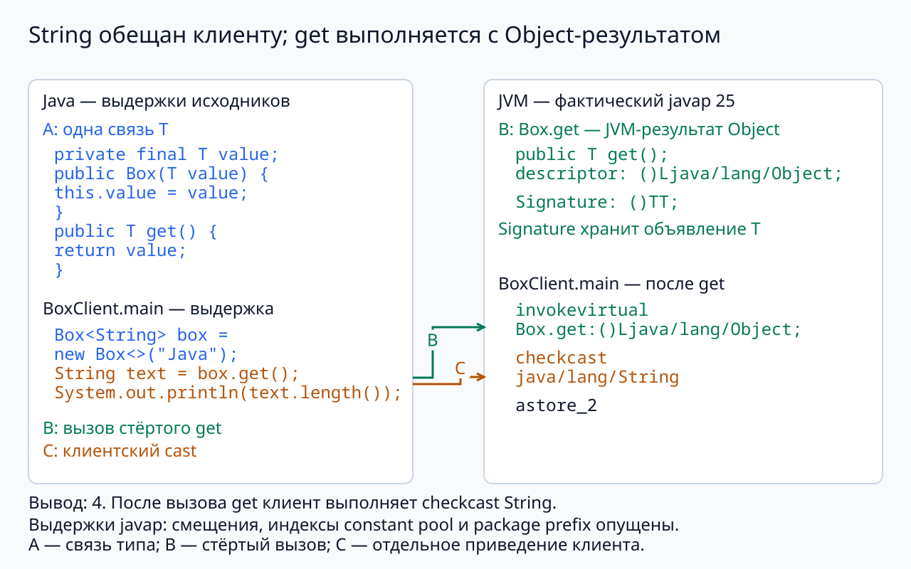
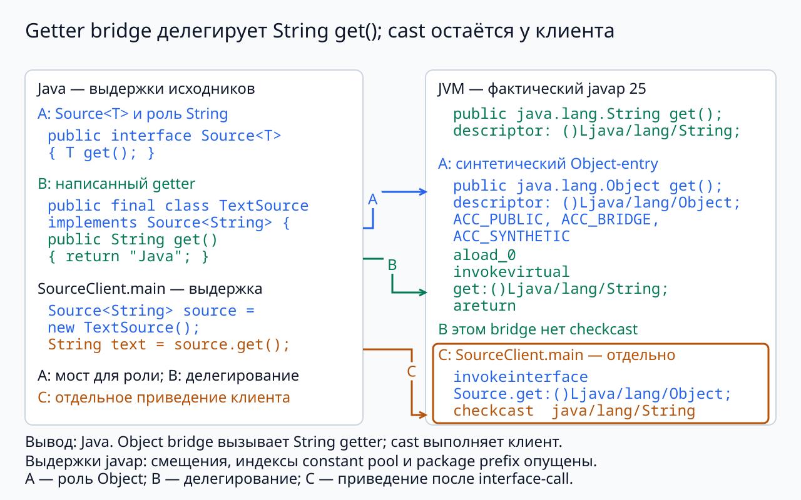

## Стирание и общие алгоритмы {#sec-j25-lecture-erasure-algorithms}

`Box<T>` связывает вход и результат; extends читает, super принимает. List.size/get и строгая граница сравнения уже известны.

**Ведущий вопрос:** Что остаётся от проверенных связей типов при выполнении и откуда алгоритм получает операции?

### Какие файлы сравниваем {#sec-j25-lecture-erasure-algorithms-context}

В пакете course.examples.generics остаётся полный `Box<T>` прошлого занятия. Для измерения JVM используются Box.java, BoxClient.java, Source.java, TextSource.java и SourceClient.java. Для dot — отдельные Arithmetic.java, DotDemo.java и реализации ниже.

Короткие вызовы dot — тела DotDemo.main с import java.util.List. Код отделён от реального вывода javap. Предсказываем перевод, затем читаем descriptor и инструкцию.

## Обобщения и миграция библиотек {#sec-j25-lecture-erasure-algorithms-java-one}

В первой редакции Java библиотечный `Vector` хранил элементы через
`Object`. Метод `addElement(Object)` принимал общий объект,
а `elementAt(int)` возвращал `Object`. Тип элементов отдельного
контейнера в его объявлении не выражался.

Это реальный исторический вариант уже разобранного `ObjectBox`:
общая реализация существовала, а согласование содержимого и
приведений лежало на клиентском коде.

Связь типа элемента и сигнатуры коллекции предстояло выразить
в языке. Тогда компилятор мог бы проверять её сразу при использовании
контейнера, сохраняя общую реализацию для разных типов.

### GJ: обобщения и существующее представление {#sec-j25-lecture-erasure-algorithms-gj}

В работе о GJ, опубликованной в 1998 году, рассматривалось добавление
параметрического полиморфизма к Java с переводом в существующее
представление программы.

Замысел связывал две задачи. Исходный язык должен был выражать
отношения типов и проверять их до запуска. Полученная программа
при этом могла сохранять общий исполняемый код и взаимодействовать
со сложившимися библиотеками.

Поэтому вопрос «как записать `Box<T>`» не исчерпывал проектирование.
Нужно было решить, как новые проверяемые объявления соотносятся
с уже существующими классами, методами и клиентами.

### JSR 14 и постепенная миграция {#sec-j25-lecture-erasure-algorithms-jsr-fourteen}

Стандартизация JSR 14 началась в 1999 году. К этому моменту Java
уже имела библиотеки, class-файлы и множество зависимых приложений.
Автор библиотеки и все её пользователи не могли всегда обновляться
одновременно.

Требования JSR 14 включали совместимость существующих программ
и возможность постепенно обобщать API. Новые объявления должны были
давать более сильную проверку новым клиентам, сохраняя путь
взаимодействия с прежним кодом.

Миграция экосистемы стала частью задачи языка. Решение оценивалось
не только по выразительности отдельной программы, но и по тому,
как независимо развиваются её зависимости.

### Java 5 и цена совместимости {#sec-j25-lecture-erasure-algorithms-java-five}

Обобщения вошли в Java 5 в 2004 году. Историческая последовательность
связывает Java 1 с `Object`-контейнерами, GJ 1998 года, JSR 14
с 1999 года и стандартизованный механизм Java 5.

В новой модели компилятор проверяет параметры типов, а обычный
обобщённый класс сохраняет единое представление при выполнении.
Для прежнего кода остаётся возможность использовать класс без
аргументов типа — raw type.

Эти решения объясняют одновременно удобство постепенного перехода
и будущие ограничения. Далее проследим отдельно перевод корректного
кода и место, где raw-ссылка ослабляет проверку.

## Стирание типов {#sec-j25-lecture-erasure-algorithms-erasure}

```java
final class Box<T> {
    private final T value;
    Box(T value) { this.value = value; }
    T get() { return value; }
}
```

| В исходном объявлении | После стирания |
|---|---|
| `T value` | `Object value` |
| `Box(T value)` | `Box(Object value)` |
| `T get()` | `Object get()` |

Неограниченный `T` стирается до `Object`. У ограниченного параметра
используется стирание первой границы: для `T extends Number` это
`Number`. Проверка исходных типов предшествует такому переводу.

### Полный клиент перед байткодом {#sec-j25-lecture-erasure-algorithms-cast-client}

```java
package course.examples.generics;
public class BoxClient {
    public static void main(String[] args) {
        Box<String> box = new Box<>("Java");
        String text = box.get();
        System.out.println(text.length());
    }
}
```

BoxClient.java вместе с прежним Box.java: вывод 4. Прогноз: для поля final T и get без bound descriptor содержит Object, но клиенту нужна String.

### A → B → C: приведение у клиента {#sec-j25-lecture-erasure-algorithms-erased-read}

{fig-alt="A → B → C: приведение у клиента; буквенные метки связывают исходник, descriptor и инструкции" .nostretch width=1152}

### Читаем схему по шагам {#sec-j25-lecture-erasure-algorithms-erased-read-explanation}

**A** `Box<T>` связывает тип поля и get(); клиент создаёт `Box<String>`, поэтому результат в исходнике имеет тип String. **B** descriptor get: `()Ljava/lang/Object;`, Signature сохраняет `()TT;`. **C** после вызова в клиенте стоит `checkcast java/lang/String`. Проверка типов источника предшествует этому переводу.

Точный javap: @handbook:sec-j25-api-erasure-javap.

### Класс объекта и метаданные {#sec-j25-lecture-erasure-algorithms-signature .continuation}

```java
Box<String> text = new Box<>("Java");
Box<Integer> number = new Box<>(25);
System.out.println(text.getClass() == number.getClass()); // true
```

Обе коробки имеют один выполняемый класс `Box`. Вызов `getClass()`
у их содержимого наблюдал бы `String` и `Integer`, но это сведения
о значениях, а не восстановленный аргумент типа коробки.

При этом class-файл может содержать атрибут `Signature`, описывающий
обобщённые объявления. Его используют компиляторы, инструменты
и отражение. Метаданные объявления не превращают каждую коробку
в объект с отдельным доступным при выполнении параметром `T`.

### Контракт до синтетического метода {#sec-j25-lecture-erasure-algorithms-bridge-source}

```java
package course.examples.generics;
public interface Source<T> { T get(); }
```

Source.java. Роль обещает результат типа T.

```java
package course.examples.generics;
public final class TextSource implements Source<String> {
    public String get() { return "Java"; }
}
```

TextSource.java. Собственное тело возвращает String; descriptor стёртой роли возвращает Object.


### Полный клиент роли {#sec-j25-lecture-erasure-algorithms-source-client}

```java
package course.examples.generics;
public class SourceClient {
    public static void main(String[] args) {
        Source<String> source = new TextSource();
        String text = source.get();
        System.out.println(text); // Java
    }
}
```

SourceClient.java вместе с двумя предыдущими файлами. Это точный клиент реального javap на следующей схеме. Предскажите, где нужен checkcast String и где нужен bridge Object get.

### A → B → C: мост делегирует {#sec-j25-lecture-erasure-algorithms-bridge}

{fig-alt="A → B → C: мост делегирует; буквенные метки связывают исходник, descriptor и инструкции" .nostretch width=1152}

### Читаем схему по шагам {#sec-j25-lecture-erasure-algorithms-bridge-explanation}

**A** Роль `Source<T>` требует стёртый Object get; синтетический вход TextSource имеет ACC_BRIDGE и ACC_SYNTHETIC. **B** Написанный String get вызывается из bridge: aload_0 → invokevirtual get:String → areturn. **C** Отдельный SourceClient после invokeinterface Source.get:Object выполняет checkcast String. Внутри этого getter bridge приведения нет.

Результат видно целиком в обеих версиях; порядок чтения отмечен буквами. @theory:sec-j25-theory-type-relations-bridge

### Операции, требующие аргумента типа {#sec-j25-lecture-erasure-algorithms-runtime-limits}

В общем классе нельзя непосредственно написать `new T()` или
`new T[n]`: выбранный аргумент типа не предоставлен выполняемому
коду как готовое описание создаваемого класса или массива.
Проверка `instanceof Box<String>` тоже не может установить
параметризацию конкретной коробки.

Та же граница проявляется в перегрузке: методы с параметрами
`List<String>` и `List<Integer>` получают одинаковую форму после
стирания. Одного различия аргументов типа недостаточно, чтобы
объявить такие две перегрузки.

Это связанные последствия выбранного представления. При проектировании
API недостающие сведения или способ создания приходится задавать явно.

### Raw types {#sec-j25-lecture-erasure-algorithms-raw-types}

Отдельный RawDemo.java без package: `import java.util.List;` и
`import java.util.ArrayList;`. Следующий блок — тело
`public static void main(String[] args)` класса RawDemo.

```java
List<String> words = new ArrayList<>();
List raw = words;
raw.add(25);                // unchecked-предупреждение
String word = words.get(0); // ClassCastException
```

Raw type использует обобщённый класс без аргумента типа.
Обе переменные ссылаются на один список, но `raw` не сохраняет
контракт «элементы имеют тип `String`».

Вызов `raw.add(25)` обходит обычную проверку этой связи и получает
предупреждение. При чтении через `words` компилятор рассчитывает
на `String`; вставленное приведение встречает `Integer` и завершается
исключением.

### Загрязнение кучи {#sec-j25-lecture-erasure-algorithms-heap-pollution .continuation}

После записи через raw-ссылку список содержит значение, которое
не соответствует обещанию `List<String>`. Такую ситуацию называют
**загрязнением кучи**: типизированная ссылка больше не даёт
ожидаемой гарантии о доступном через неё содержимом.

Предупреждение `unchecked` указывает на участок, где компилятор
не может выполнить обычное доказательство согласованности.
Подавление предупреждения меняет диагностику, но не содержимое списка
и не основание безопасности последующего чтения.

При взаимодействии со старым API такую операцию локализуют и
обосновывают проверкой или контрактом. В новом API связь типов
следует сохранять параметризованными объявлениями.

### Совместимость как свойство модели {#sec-j25-lecture-erasure-algorithms-migration-consequences}

Стирание позволило совместить более точную проверку исходного кода
с общим представлением выполняемых классов. Raw types сохранили
переход между прежними и обобщёнными объявлениями, но создали места,
где гарантия типов ослабляется.

Одна историческая задача поэтому видна в нескольких современных
особенностях: автоматических приведениях, `Signature`, ограничениях
создания `T` и предупреждениях `unchecked`.

Чтобы оценить другую модель обобщений, полезно задать конкретную
задачу: какие отношения и операции должен выразить API, когда они
проверяются и какие сведения требуются при выполнении.

## Сумма попарных произведений {#sec-j25-lecture-erasure-algorithms-arithmetic-problem}

Для двух векторов одинаковой длины требуется вычислить

$$
\operatorname{dot}(a,b)=\sum_{i=0}^{n-1} a_i b_i.
$$

Для действительных значений $[1,2]$ и $[3,4]$ получаем
$1\cdot3+2\cdot4=11$. Алгоритму нужны сложение, умножение
и начальный ноль; устройство цикла от вида чисел не зависит.

Для комплексных чисел здесь задана **билинейная сумма без сопряжения**.
Эрмитово скалярное произведение потребовало бы ещё операции сопряжения.
Сначала фиксируется смысл вычисления, затем его обобщённый интерфейс.

### Контракт арифметики {#sec-j25-lecture-erasure-algorithms-arithmetic-interface}

```java
interface Arithmetic<T> {
    T zero();
    T add(T left, T right);
    T multiply(T left, T right);
}
```

`T extends Number` не предоставляет этих трёх операций с результатом
типа `T`. Преобразование всего в `double` поменяло бы задачу,
в частности потеряло бы комплексную часть.

Интерфейс `Arithmetic<T>` выражает нужные операции непосредственно.
Один `T` связывает аргументы и результаты сложения и умножения,
а `zero()` создаёт подходящее начальное значение. Конкретную
арифметику алгоритм получает отдельным объектом.

### Алгоритм с переданными операциями {#sec-j25-lecture-erasure-algorithms-java-dot}

```java
static <T> T dot(List<T> left, List<T> right, Arithmetic<T> arithmetic) {
    if (left.size() != right.size()) {
        throw new IllegalArgumentException("Different vector lengths");
    }
    T result = arithmetic.zero();
    for (int i = 0; i < left.size(); i++) {
        T term = arithmetic.multiply(left.get(i), right.get(i));
        result = arithmetic.add(result, term);
    }
    return result;
}
```

Параметр `T` связывает элементы обоих векторов, арифметику,
промежуточный результат и ответ. Равенство длин проверяется
при выполнении: данная сигнатура не кодирует длину в типе.

### Действительные значения {#sec-j25-lecture-erasure-algorithms-double-arithmetic .continuation}

```java
final class DoubleArithmetic implements Arithmetic<Double> {
    public Double zero() { return 0.0; }
    public Double add(Double a, Double b) { return a + b; }
    public Double multiply(Double a, Double b) { return a * b; }
}
```

```java
double value = dot(List.of(1.0, 2.0), List.of(3.0, 4.0),
                   new DoubleArithmetic());
System.out.println(value); // 11.0
```

В реализации известен конкретный `Double`, поэтому доступны
распаковка и обычные числовые операции. Общий метод `dot`
при этом не знает ни о `Double`, ни об операторах примитивного типа.

### Сумма произведений комплексных значений {#sec-j25-lecture-erasure-algorithms-complex-addition}

```java
record Complex(double re, double im) {}
final class ComplexArithmetic implements Arithmetic<Complex> {
    public Complex zero() { return new Complex(0, 0); }
    public Complex add(Complex a, Complex b) {
        return new Complex(a.re()+b.re(), a.im()+b.im());
    }
    public Complex multiply(Complex a, Complex b) {
        return new Complex(a.re()*b.re()-a.im()*b.im(),
                           a.re()*b.im()+a.im()*b.re());
    }
}
```

Два соседних класса в ComplexArithmetic.java того же пакета. Каждый результат — новое значение, аргументы не меняются. Вызов и разбор следуют дальше.


### Тот же цикл над комплексными числами {#sec-j25-lecture-erasure-algorithms-complex-client}

```java
Complex value = dot(
    List.of(new Complex(1,1), new Complex(2,0)),
    List.of(new Complex(3,0), new Complex(4,-1)),
    new ComplexArithmetic());
System.out.println(value); // Complex[re=11.0, im=1.0]
```

main DotDemo с прежним dot и import java.util.List. Первый член 3+3i, второй 8−2i, сумма 11+i. Сопряжение не выполняется: это выбранная билинейная сумма, не эрмитово произведение.

### Правильная сигнатура не доказывает правильный ноль {#sec-j25-lecture-erasure-algorithms-arithmetic-laws}

```java
final class WrongZeroArithmetic implements Arithmetic<Double> {
    public Double zero() { return 1.0; }
    public Double add(Double a, Double b) { return a + b; }
    public Double multiply(Double a, Double b) { return a * b; }
}
```

Отдельный WrongZeroArithmetic.java того же пакета. В DotDemo прежние [1,2]/[3,4] дают 12.0 вместо 11.0. Два пустых списка дают 1.0 вместо 0.0. Типы согласованы; нарушен закон нейтрального элемента.

Длины проверяются до вызова zero. Списки, элементы, arithmetic и результаты операций ненулевые; add/multiply не меняют аргументы. Complex-опыт даёт 11+i без сопряжения.

## Шаблоны C++ {#sec-j25-lecture-erasure-algorithms-cpp-templates}

В C++ зависимые операции шаблона проверяются с учётом выбранного
аргумента. Поэтому общий алгоритм может использовать выражения
`a + b` и `a * b`, если они допустимы для подставляемого типа.

В Java тело метода опиралось на объявленный `Arithmetic<T>`.
Для C++-версии того же `dot` нужно описать, какие выражения
и действия над значениями требуются от самого `T`.

Concepts в C++20 позволяют записать эти требования рядом
с объявлением шаблона. Это делает условия применения частью
его интерфейса и позволяет проверить подстановку по ним.

### Concept DotElement {#sec-j25-lecture-erasure-algorithms-cpp-concept}

```cpp
template<class T>
concept DotElement = std::semiregular<T> && requires(const T a, const T b) {
    T{};
    { a + b } -> std::same_as<T>;
    { a * b } -> std::same_as<T>;
};
```

`std::semiregular<T>` требует возможности создания, копирования
и присваивания значений. `requires` дополнительно проверяет
допустимость арифметических выражений и совпадение типа результата с `T`.

Для алгоритма нужно ещё, чтобы `T{}` означало нейтральный элемент
сложения. Проверка допустимости выражения не доказывает это
математическое свойство; оно остаётся смысловым условием.

### Сумма произведений в C++ {#sec-j25-lecture-erasure-algorithms-cpp-dot}

```cpp
template<DotElement T>
T dot(const std::vector<T>& left, const std::vector<T>& right) {
    if (left.size() != right.size()) {
        throw std::invalid_argument("Different vector lengths");
    }
    T result{};
    for (std::size_t i = 0; i < left.size(); ++i) {
        result = result + left[i] * right[i];
    }
    return result;
}
```

Форма цикла совпадает с Java-алгоритмом. Вместо вызовов переданного
объекта используются операторы выбранного типа. Проверка длины
остаётся условием выполнения, а соответствие `DotElement` —
условием применения шаблона.

### Подстановка числовых типов {#sec-j25-lecture-erasure-algorithms-cpp-calls .continuation}

```cpp
auto real = dot(std::vector<double>{1.0, 2.0},
                std::vector<double>{3.0, 4.0});

using C = std::complex<double>;
auto complex = dot(std::vector<C>{{1.0, 1.0}, {2.0, 0.0}},
                   std::vector<C>{{3.0, 0.0}, {4.0, -1.0}});
```

Для `double` начальное `T{}` даёт ноль, а операции вычисляют `11`.
Для `std::complex<double>` та же схема даёт $11+i$.
Обе подстановки удовлетворяют требованиям нашего алгоритма.

Объект с арифметикой передавать не требуется: подходящие операции
уже доступны для выбранных типов. Отсутствие сопряжения сохраняет
тот же контракт суммы произведений, что и в Java.

### Размер как аргумент шаблона {#sec-j25-lecture-erasure-algorithms-cpp-specialization}

```cpp
template<DotElement T, std::size_t N>
T dot(const std::array<T, N>& a, const std::array<T, N>& b) {
    T result{};
    for (std::size_t i = 0; i < N; ++i)
        result = result + a[i] * b[i];
    return result;
}
```

C++20, то же объявление DotElement; это перегрузка по std::array в том же опыте. Два std::`array<double,2>` с 1/2 и 3/4 дают 11. Длины 2 и 3 не согласуют один N и отвергаются при подстановке. У vector длина проверяется при runtime. Причина — выбранные сигнатуры размера, не стирание T. @theory:sec-j25-theory-type-parameters-model-comparison

### Python: явно объявленный структурный договор {#sec-j25-lecture-erasure-algorithms-python-protocol}

Файл продолжается на следующих экранах; части соединяются по порядку.

```python
from dataclasses import dataclass
from typing import Protocol

class HasScore(Protocol):
    @property
    def score(self) -> int: ...

@dataclass(frozen=True)
class Candidate:
    score: int

def passed(value: HasScore) -> bool:
    return value.score >= 80

```

### Продолжение того же файла {#sec-j25-lecture-erasure-algorithms-python-protocol-part-1}

```python
print(passed(Candidate(80)))  # True
```

Полный score_protocol.py; Python3.14 и strict Pyright проверяются отдельно. Candidate не наследует HasScore: достаточно читаемого свойства score типа int. Вывод True. Protocol — класс из typing, его объявление не выполняет проверку аргумента при runtime.

### Отдельно статическая ошибка и выполненный путь {#sec-j25-lecture-erasure-algorithms-python-rejection}

```python
@dataclass(frozen=True)
class BadCandidate:
    score: str

print(passed(BadCandidate("80")))
```

Добавление к полному score_protocol.py вместо положительного print. Strict checker отвергает score:str. Обычный Python доходит до сравнения строки с 80 и даёт TypeError. Совпадение названия поля без подходящего типа не удовлетворяет протоколу. @theory:sec-j25-theory-type-parameters-model-comparison

## Контракт общего алгоритма {#sec-j25-lecture-erasure-algorithms-language-comparison}

| Вопрос | Java | C++20 | Python typing |
|---|---|---|---|
| Доступные операции | Объявленный интерфейс | Проверяемые выражения concept | Структура Protocol |
| Проверка клиента | javac | Подстановка шаблона | Отдельный checker |
| Runtime | Выполняет проверенный перевод | Выполняет выбранную специализацию | Выполняет реальную операцию объекта |

Для dot неверный ноль 1 даёт 12 вместо 11; допустимая сигнатура не устанавливает этот закон. У HasScore поле str отвергнуто checker, а выполненное сравнение даёт TypeError. Дополнительное сравнение C# находится после ядра.

### Представление и проверка {#sec-j25-lecture-erasure-algorithms-model-comparison}

Java `Box<String>` и `Box<Integer>` имеют один runtime-класс; сведения Signature относятся к объявлению. C++ проверяет зависимые выражения для выбранного T, а N может сделать размер частью типа. Python Protocol помогает checker проверить структуру до запуска, но не вставляет runtime-проверку.

Ни одно из этих наблюдений само по себе не задаёт рейтинг производительности. Оно отвечает на конкретный вопрос: где данная связь выражена и кем проверяется?

### Проектирование обобщённого API {#sec-j25-lecture-erasure-algorithms-api-design}

Для переноса значений связываем source и target через T. Для dot связываем элементы и результаты через `Arithmetic<T>`. Дополнительно называем длины, ненулевые значения и запрет мутации.

На прежнем входе неверный zero меняет 11 на 12; на `Box<String>` raw-запись может разрушить проверенную связь. Эти опыты объясняют, почему типовая форма и условия значения нужны вместе. Точные продолжения: @theory:sec-j25-theory-type-relations-copy, @theory:sec-j25-theory-type-parameters-operations, @theory:sec-j25-theory-type-relations-erasure.

### Проверка переноса {#sec-j25-lecture-erasure-algorithms-exit}

**Прогноз:** Где checkcast getter-примера и почему неправильный zero проходит типы?

**Разбор:** Checkcast находится у клиента; getter bridge делегирует String get и возвращает Object. zero1 даёт 12 и 1 наempty: типы не доказывают закон. C++N выражает длину в типе; Pythonchecker отделён отruntime.

Точное объяснение: @theory:sec-j25-theory-type-parameters, @theory:sec-j25-theory-type-relations.

## Дополнительно — за пределами 80 минут {#sec-j25-lecture-erasure-algorithms-additional}

Эти продолжения не требуются для основного маршрута.

## Обобщения C# и CLR {#sec-j25-lecture-erasure-algorithms-csharp-runtime}

CLR сохраняет сведения об аргументах построенных обобщённых типов.
`List<int>` и `List<string>` — различные типы времени выполнения.
Аргументами могут служить и ссылочные типы, и типы значений.

Это отличается от рассмотренного Java `Box`, чьи параметризации
имеют общий выполняемый класс. Здесь сведения об аргументе типа
являются частью модели времени выполнения.

Однако сохранение аргументов не требует отдельной машинной копии
кода для каждой подстановки: среда может разделять код там,
где это допускает представление. Само наличие runtime-типов
также ещё не задаёт арифметические операции над `T`.

### Контракты generic math {#sec-j25-lecture-erasure-algorithms-csharp-operations}

```csharp
where T : IAdditionOperators<T, T, T>,
          IMultiplyOperators<T, T, T>,
          IAdditiveIdentity<T, T>
```

C# 11 и.NET 7+ позволяют требовать статические операции через
интерфейсные контракты. Три ограничения из `System.Numerics`
сообщают, что для `T` доступны сложение, умножение и нейтральный
элемент сложения.

Алгоритму не требуется отношение «больше». Поэтому здесь выбран
узкий набор операций, пригодный и для комплексных чисел,
без навязывания им полного числового порядка.

### Сумма произведений в C\# {#sec-j25-lecture-erasure-algorithms-csharp-dot}

```csharp
static T Dot<T>(IReadOnlyList<T> left, IReadOnlyList<T> right)
    where T : IAdditionOperators<T, T, T>,
              IMultiplyOperators<T, T, T>,
              IAdditiveIdentity<T, T>
{
    if (left.Count != right.Count)
        throw new ArgumentException("Different vector lengths");
    T result = T.AdditiveIdentity;
    for (int i = 0; i < left.Count; i++)
        result += left[i] * right[i];
    return result;
}
```

Ограничения разрешают `+`, `*` и `T.AdditiveIdentity` в теле метода.
Операции предоставляет контракт типа; отдельный объект арифметики,
как в Java-примере, не передаётся.

### Арифметика и сохранение типов {#sec-j25-lecture-erasure-algorithms-csharp-contract .continuation}

C# объединяет две отдельные возможности: сведения об аргументах
сохраняются в CLR, а нужные операции выражаются интерфейсами
со статическими абстрактными членами.

В нашем `Dot` тип `T` связывает элементы и результат; три интерфейса
разрешают арифметику. Ни сохранение типа, ни наличие этих интерфейсов
не доказывают законы сложения или равенство длин векторов.

Для действительных и комплексных значений смысл остаётся прежним:
суммируются попарные произведения. Переход к эрмитову произведению
потребовал бы явно добавить сопряжение во всех трёх языках.

## Источники {.unnumbered.scrollable}

[@bib-cpp-template-constraints; @bib-csharp-generics-runtime; @bib-ctx-objects-gj-migration; @bib-dotnet-generic-math; @bib-goetz-erasure-2020; @bib-jls-heap-pollution; @bib-jls-raw-types; @bib-jls-type-erasure; @bib-jls1-vector; @bib-jsr14; @bib-jvms-generic-signatures]
